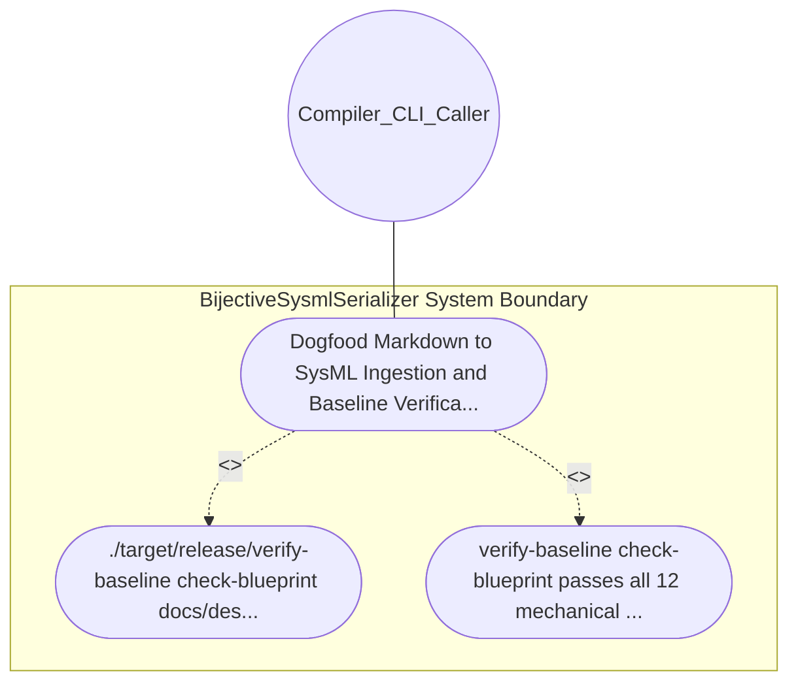

| Attribute | Specification Detail |
| :--- | :--- |
| **Issue ID** | #638 |
| **Title** | Use Case 15: Dogfood Markdown to SysML Ingestion and Baseline Verification |
| **Type** | use-case |
| **Primary Actor** | Compiler_CLI_Caller |
| **Scope** | BijectiveSysmlSerializer |
| **Level** | User Goal |
| **Generation Mode** | subagent |
| **Specification Source** | [schema/model.sysml](../../schema/model.sysml) |

# Use Case 15: Dogfood Markdown to SysML Ingestion and Baseline Verification

## UML Diagrams

## 1. Actors
- `Compiler_CLI_Caller`

## 2. Preconditions
- This blueprint document `docs/designs/blueprint-03-sysml-ast-bijective-roundtrip-compiler-gate.md` (**REQ-0603**) modeling 100% normative OMG SysML v2.0 + KerML 1.0 BNF grammar coverage across all 6 clauses (zero 16-construct artificial caps, `#hazard`/`#risk`/`#capability`/`#rt_loop`/`#dal`/`#fls` `metadata def` + backward-compatible `hazard def`/`risk def`/`capability def`).

## 3. Trigger
- ./target/release/verify-baseline check-blueprint docs/designs/blueprint-03-sysml-ast-bijective-roundtrip-compiler-gate.md --dry-run is executed.

## 4. Main Success Scenario
1. `Compiler_CLI_Caller` executes `./target/release/verify-baseline check-blueprint docs/designs/blueprint-03-sysml-ast-bijective-roundtrip-compiler-gate.md --dry-run` using `pulldown-cmark` Markdown AST inspection with zero hand-rolled scanners.
2. `SysmlBijectiveRoundtripCompilerGate` validates all 12 mechanical blueprint verification gates for `REQ-0603`, including KaTeX complexity/bijectivity invariants (`Invariant_REQ_0603_Formal_Bijectivity_Complexity_Invariants`, `Invariant_REQ_0603_SC_04`), Mermaid state/sequence diagrams, and 5-column STPA/FMECA tables.
3. `Compiler_CLI_Caller` invokes `ingest-sysml` on `docs/designs/blueprint-03-sysml-ast-bijective-roundtrip-compiler-gate.md`, which tokenizes and parses the extracted SysML v2 blocks across all 6 normative OMG SysML v2.0 + KerML 1.0 BNF clauses via `NativeSigilAndLifetimeLexer` (`scan_all`) and `FailClosedRecursiveDescentParser` (`parse_package_or_file`) using `logos` + `rowan` lossless Red/Green CSTs (`deap_core::sysml_cst`) and `salsa` incremental queries (`salsa::input`, `salsa::tracked`), bounded inside `< 380` exec SLOC submodules (`./crates/deap-core/src/sysml_cst/` and `./crates/compile-sysml/src/roundtrip/`) with explicit deletion of legacy hand-rolled scanner/parser monoliths (`-2,400+` SLOC retired).
4. `BijectiveSysmlSerializer` and `CompilerRoundtripVerificationGate` execute `ast_orig_to_sysml` and `verify_bijective_ast_roundtrip` to verify that `SysmlBijectiveRoundtripCompilerGate`, all 4 BOM subcomponents, 4 interface ports, 4 attributes, and `REQ_0603` roundtrip with Stage-1 == Stage-2 bijective parity (`roundtrip_ast_mismatch_count == 0`).
5. `SysmlBijectiveRoundtripCompilerGate` persists the verified SysML v2 package via `SerializedSysmlOutputPort` and exits with code 0.

## 5. Alternate and Exception Flows
- 3a. Blueprint Markdown fails any of the 12 mechanical verification gates in `check-blueprint`:
  - `verify-baseline` returns `Result::Err`, emits an `ariadne` / `miette` structural diagnostic on `BijectiveDiffDiagnosticPort`, and exits fail-closed with code 1.
- 4a. Bijective roundtrip mismatch (`roundtrip_ast_mismatch_count > 0`) during blueprint SysML v2 ingestion:
  - `CompilerRoundtripVerificationGate` transitions to `RejectedE0400`, emits diagnostic code `E0400` on `BijectiveDiffDiagnosticPort`, and aborts persistence with exit code 1.
- 5a. Invariant violation while enforcing `Invariant_REQ_0603_SC_04`:
  - `BijectiveSysmlSerializer` aborts execution without partial state mutation, preserves prior verified state, and notifies `Compiler_CLI_Caller` with fail-closed exit code 1.

## 6. Postconditions
- `verify-baseline check-blueprint` passes all 12 mechanical gates, extracts `SysmlBijectiveRoundtripCompilerGate` with all 4 BOM parts, 4 interface ports, 4 attributes, 4 parametric constraints (`C-RT-01..C-RT-04`), and `REQ_0603` requirement definitions across the 6 OMG SysML v2.0 + KerML 1.0 BNF clauses, and persists the Stage-1 == Stage-2 bijectively verified SysML v2 model (`roundtrip_ast_mismatch_count == 0`).

## 8. Realization Matrix
| Specification Item | Type | Link / Reference |
| :--- | :--- | :--- |
| **#583** | User Story | [User Story 16: ast orig to sysml](../user-stories/US-16-ast_orig_to_sysml.md) |
| **#667** | Feature | [Feature 11: [BP 03 SysML v2 AST Bijective Roundtrip and Token Stream Parser Gate Blueprint] BijectiveSysmlSerializer](../features/FEAT-11-BijectiveSysmlSerializer.md) |

## Source References
Use case operational flows and lifecycle activity references:
- System Architecture Model: `schema/model.sysml`
- Normative Systems Engineering Standard: ISO/IEC/IEEE 29148:2018 §6.4.2 Concept of Operations

Operational use case realization and traceability links derive from `schema/model.sysml` pursuant to ISO/IEC/IEEE 29148.
