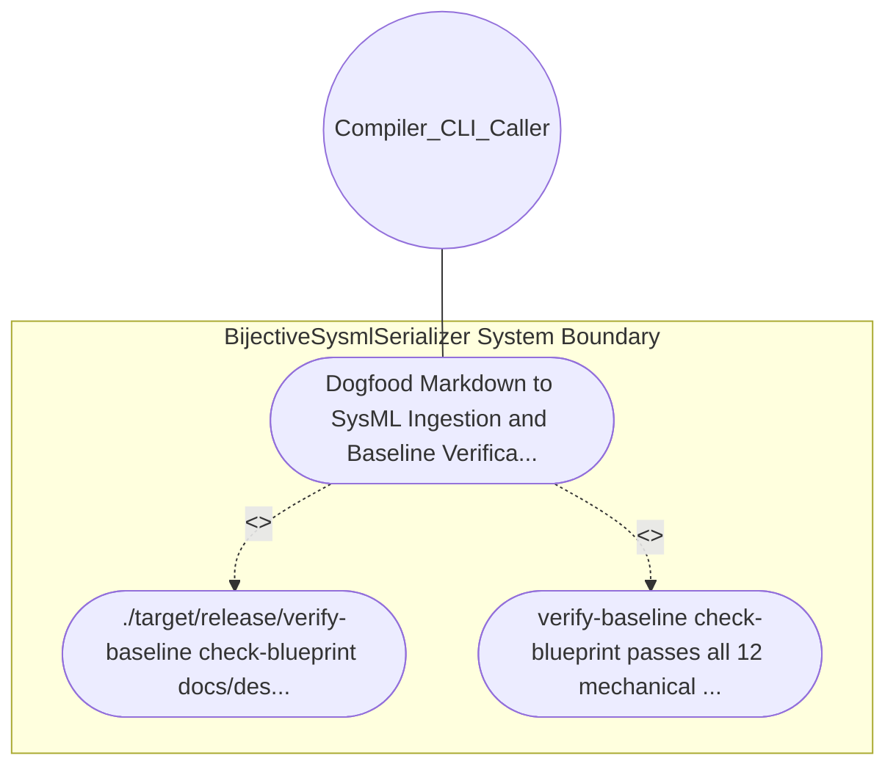

| Attribute | Specification Detail |
| :--- | :--- |
| **Issue ID** | #638 |
| **Title** | Use Case 15: Dogfood Markdown to SysML Ingestion and Baseline Verification |
| **Type** | use-case |
| **Primary Actor** | Compiler_CLI_Caller |
| **Scope** | BijectiveSysmlSerializer |
| **Level** | User Goal |
| **Generation Mode** | subagent |
| **Specification Source** | [schema/model.sysml](../../schema/model.sysml) |

# Use Case 15: Dogfood Markdown to SysML Ingestion and Baseline Verification

## UML Diagrams

## 1. Actors
- `Compiler_CLI_Caller`

## 2. Preconditions
- This blueprint document docs/designs/blueprint-03-sysml-ast-bijective-roundtrip-compiler-gate.md (**REQ-0603**).

## 3. Trigger
- ./target/release/verify-baseline check-blueprint docs/designs/blueprint-03-sysml-ast-bijective-roundtrip-compiler-gate.md --dry-run is executed.

## 4. Main Success Scenario
1. ./target/release/verify-baseline check-blueprint docs/designs/blueprint-03-sysml-ast-bijective-roundtrip-compiler-gate.md --dry-run is executed.
2. verify-baseline check-blueprint passes all 12 mechanical gates, extracts SysmlBijectiveRoundtripCompilerGate with all 4 BOM parts, 4 interface ports, 4 attributes, 4 parametric constraints (C-RT-01..C-RT-04), and REQ_0603 requirement definitions, persists.

## 5. Alternate and Exception Flows
- Precondition guard failure in `BijectiveSysmlSerializer`:
  - `BijectiveSysmlSerializer` rejects the `Dogfood Markdown to SysML Ingestion and Baseline Verification` request without partial state mutation and reports diagnostic status to `Compiler_CLI_Caller`.
- Invariant violation while enforcing `Dogfood Markdown to SysML Ingestion and Baseline Verification`:
  - `BijectiveSysmlSerializer` aborts `Dogfood Markdown to SysML Ingestion and Baseline Verification` execution, preserves prior verified state, and notifies `Compiler_CLI_Caller`.

## 6. Postconditions
- verify-baseline check-blueprint passes all 12 mechanical gates, extracts SysmlBijectiveRoundtripCompilerGate with all 4 BOM parts, 4 interface ports, 4 attributes, 4 parametric constraints (C-RT-01..C-RT-04), and REQ_0603 requirement definitions, persists.

## 8. Realization Matrix
| Specification Item | Type | Link / Reference |
| :--- | :--- | :--- |
| **#583** | User Story | [User Story 16: ast orig to sysml](../user-stories/US-16-ast_orig_to_sysml.md) |
| **#667** | Feature | [Feature 11: [BP 03 SysML v2 AST Bijective Roundtrip and Token Stream Parser Gate Blueprint] BijectiveSysmlSerializer](../features/FEAT-11-BijectiveSysmlSerializer.md) |

## Source References
Use case operational flows and lifecycle activity references:
- System Architecture Model: `schema/model.sysml`
- Normative Systems Engineering Standard: ISO/IEC/IEEE 29148:2018 §6.4.2 Concept of Operations

Operational use case realization and traceability links derive from `schema/model.sysml` pursuant to ISO/IEC/IEEE 29148.
