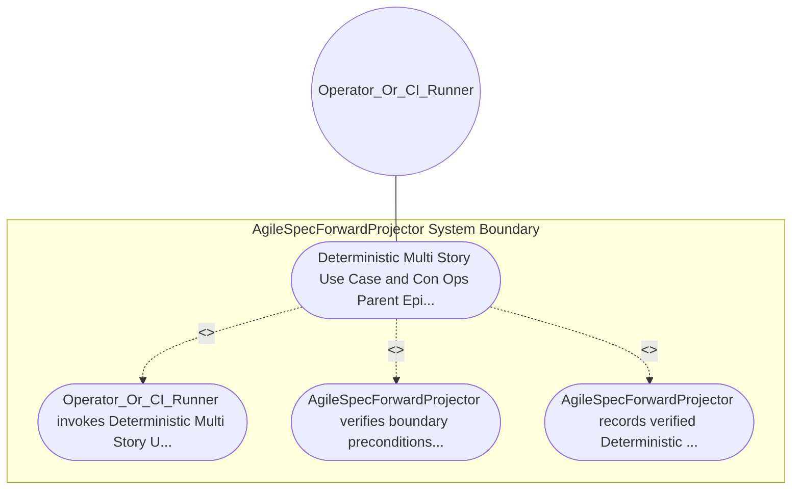

| Attribute | Specification Detail |
| :--- | :--- |
| **Issue ID** | #639 |
| **Title** | Use Case 16: Deterministic Multi Story Use Case and Con Ops Parent Epic Projection |
| **Type** | use-case |
| **Primary Actor** | Operator_Or_CI_Runner |
| **Scope** | AgileSpecForwardProjector |
| **Level** | User Goal |
| **Generation Mode** | subagent |
| **Specification Source** | [schema/model.sysml](../../schema/model.sysml) |

# Use Case 16: Deterministic Multi Story Use Case and Con Ops Parent Epic Projection

## UML Diagrams

## 1. Actors
- `Operator_Or_CI_Runner`

## 2. Preconditions
- `AgileSpecForwardProjector` is initialized and ready to enforce `Deterministic Multi Story Use Case and ConOps Parent Epic Projection`.
- `Operator_Or_CI_Runner` holds authorized operational access to `AgileSpecForwardProjector`.

## 3. Trigger
- Deterministic Multi Story Use Case and ConOps Parent Epic Projection

## 4. Main Success Scenario
1. `Operator_Or_CI_Runner` invokes `CompileSysmlForwardSyncDocs` (`compile-sysml --forward-sync docs`) on `DeterministicSpecIcdWbsForwardCompiler`, loading the parsed `PackageDef` AST through `SysmlPackageAstInputPort` via `logos` and `rowan` with `llm_subagent_invocation_count == 0`.
2. `AgileSpecForwardProjector` receives ordered `PackageDef`, `PartDef`, `InteractionDef`, and `UseCaseDef` slices on `packageAstInPort` and transitions `BP_04_Deterministic_Specification_ICD_and_WBS_Forward_Compiler_Blueprint_LifecycleState` from `AstLoaded` to `ForwardProjected`.
3. `AgileSpecForwardProjector` executes `ResolveParentEpicByPkgName` to bind `ConOps` and subsystem packages deterministically to their owning Parent Epic without fallback ambiguity.
4. `AgileSpecForwardProjector` executes `BindAllPackageStoriesToUse` and `EmitSymmetricActionDefSignaturesAndE1` (`preserveTypedActionParams = true`), projecting all package User Stories into Use Case Realization Matrices and synthesizing Check 13B E1-E5 compliant Mermaid diagrams (`mermaid_e1_e5_violation_count == 0`).
5. `AgileSpecForwardProjector` writes the generated Epics, Features, User Stories, and Use Cases atomically via `specMarkdownOutPort` and `MarkdownSpecSuiteOutputPort` within `maxForwardLatencyMs` using `pulldown-cmark` validation and returns `Result::Ok` to `Operator_Or_CI_Runner`.

## 5. Alternate and Exception Flows
- 3a. Unresolved `PackageDef` parent epic binding or missing `InteractionDef` / `UseCaseDef` AST node (`Diagnostic: E0100`):
  - `AgileSpecForwardProjector` transitions to `Rejected`, emits diagnostic `E0100` via `ariadne` / `miette`, and terminates fail-closed with exit code 1 without partial writes to `specMarkdownOutPort`.
- 4a. Synthesized Mermaid diagram violates Check 13B E1-E5 syntax rules (`mermaid_e1_e5_violation_count > 0`):
  - `DeterministicSpecIcdWbsForwardCompiler` aborts forward projection via `Result<T, E>`, preserves prior verified `docs/` artifacts, and exits fail-closed with code 1.
- 5a. Invariant violation under `Invariant_REQ_0604_SC_01` (`ast_node_coverage_percent < 100`):
  - `AgileSpecForwardProjector` aborts execution, preserves prior verified state, emits a deterministic `miette` coverage diagnostic to `Operator_Or_CI_Runner`, and exits with code 1.

## 6. Postconditions
- `AgileSpecForwardProjector` satisfies declared objective `Deterministic Multi Story Use Case and ConOps Parent Epic Projection` with all subsystem invariants intact.
- Verified `Deterministic Multi Story Use Case and Con Ops Parent Epic Projection` completion status is recorded for `Operator_Or_CI_Runner`.

## 8. Realization Matrix
| Specification Item | Type | Link / Reference |
| :--- | :--- | :--- |
| **#707** | User Story | [User Story 18: Compile Sysml Forward Sync Docs](../user-stories/US-18-CompileSysmlForwardSyncDocs.md) |
| **#670** | Feature | [Feature 16: [BP 04 Deterministic Specification ICD and WBS Forward Compiler Blueprint] AgileSpecForwardProjector](../features/FEAT-16-AgileSpecForwardProjector.md) |

## Source References
Use case operational flows and lifecycle activity references:
- System Architecture Model: `schema/model.sysml`
- Normative Systems Engineering Standard: ISO/IEC/IEEE 29148:2018 §6.4.2 Concept of Operations

Operational use case realization and traceability links derive from `schema/model.sysml` pursuant to ISO/IEC/IEEE 29148.
