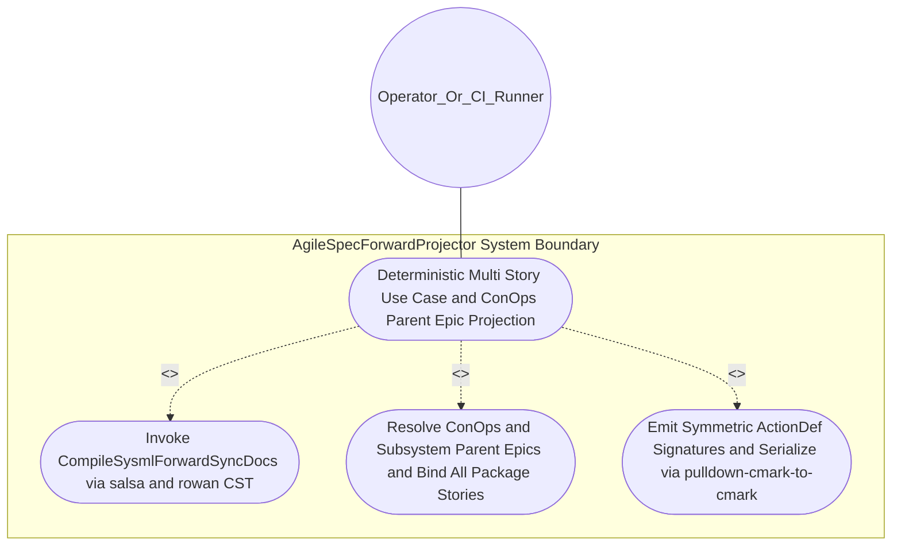
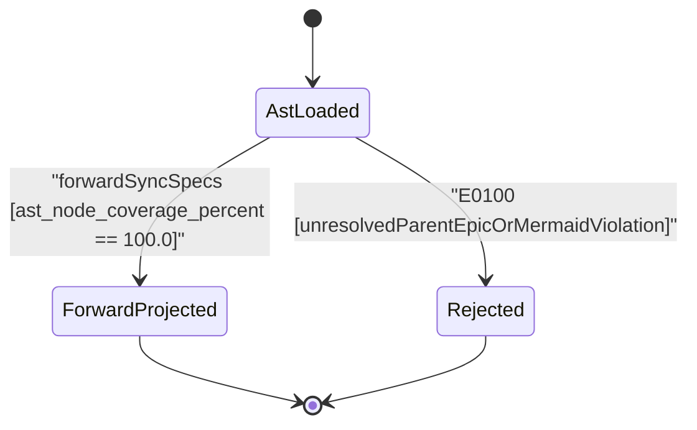

| Attribute | Specification Detail |
| :--- | :--- |
| **Issue ID** | #639 |
| **Title** | Use Case 16: Deterministic Multi Story Use Case and Con Ops Parent Epic Projection |
| **Type** | use-case |
| **Parent Epic** | [EPIC-04-BP_04_Deterministic_Specification_ICD_and_WBS_Forward_Compiler_Blueprint](../epics/EPIC-04-BP_04_Deterministic_Specification_ICD_and_WBS_Forward_Compiler_Blueprint.md) |
| **Schema Containers** | `BP_04_Deterministic_Specification_ICD_and_WBS_Forward_Compiler_Blueprint::AgileSpecForwardProjector` |
| **Primary Actor** | Operator_Or_CI_Runner |
| **Scope** | AgileSpecForwardProjector |
| **Level** | User Goal |
| **Generation Mode** | subagent |
| **Specification Source** | [schema/model.sysml](../../schema/model.sysml) |

# Use Case 16: Deterministic Multi Story Use Case and Con Ops Parent Epic Projection

## UML Diagrams

## 1. Actors
- **Primary Actor:** `Operator_Or_CI_Runner`
- **Secondary Actors:** `AgileSpecForwardProjector`, `DeterministicSpecIcdWbsForwardCompiler`, `BidirectionalBacklogReconciler`

## 2. Preconditions
- `AgileSpecForwardProjector` and `DeterministicSpecIcdWbsForwardCompiler` are initialized with a lossless `logos` + `rowan` + `salsa` SysML v2 CST/AST (`deap_core::sysml_cst`) covering 100% of the OMG SysML v2.0 and KerML 1.0 textual grammar with zero 16-construct caps (Contract A).
- `Operator_Or_CI_Runner` holds authorized operational access to `AgileSpecForwardProjector` and `./schema/model.sysml`.

## 3. Trigger
- `Operator_Or_CI_Runner` invokes `CompileSysmlForwardSyncDocs` (`compile-sysml --forward-sync docs`) to deterministically project Agile Epics, Features, User Stories, Use Cases, and ConOps units (`assemble-conops`).

## 4. Main Success Scenario
1. `Operator_Or_CI_Runner` invokes `CompileSysmlForwardSyncDocs` (`compile-sysml --forward-sync docs`) on `DeterministicSpecIcdWbsForwardCompiler`, loading the full OMG SysML v2.0 + KerML 1.0 `PackageDef` CST/AST (Contract A, zero 16-construct caps) through `SysmlPackageAstInputPort` via `logos`, `rowan`, and `salsa` with `llm_subagent_invocation_count == 0`.
2. `AgileSpecForwardProjector` receives ordered `PackageDef`, `PartDef`, `ItemDef`, `ActionDef`, `CalcDef`, `StateDef`, `InteractionDef`, `UseCaseDef`, `VerificationDef`, `TestCaseDef`, and `#capability`/`#hazard`/`#risk`/`#dal`/`#fls` slices on `packageAstInPort` and transitions `BP_04_Deterministic_Specification_ICD_and_WBS_Forward_Compiler_Blueprint_LifecycleState` from `AstLoaded` to `ForwardProjected`.
3. `AgileSpecForwardProjector` executes `ResolveParentEpicByPkgName` via memoized `salsa` derived queries across `compile-sysml` and `assemble-conops` to bind ConOps (`pkg_name == "ConOps"`) and subsystem packages deterministically to their owning Parent Epic without fallback ambiguity.
4. `AgileSpecForwardProjector` executes `BindAllPackageStoriesToUse` and `EmitSymmetricActionDefSignaturesAndE1` (`preserveTypedActionParams = true`), projecting all package User Stories (`#707`..`#719`) into Use Case Realization Matrices and synthesizing Check 13B E1-E5 compliant Mermaid diagrams (`mermaid_e1_e5_violation_count == 0`) with symmetric `in`, `out`, `inout`, and `return` parameter signatures.
5. `AgileSpecForwardProjector` serializes the generated Epics, Features, User Stories, Use Cases, and ConOps Markdown ASTs losslessly via `pulldown-cmark` + `pulldown-cmark-to-cmark` and `toml_edit` (Contract B, zero hand-rolled scanners) across `specMarkdownOutPort` and `MarkdownSpecSuiteOutputPort` within `maxForwardLatencyMs` (`<= 25` ms) and returns `Result::Ok` to `Operator_Or_CI_Runner`.

## 5. Alternate and Exception Flows
- 3a. Unresolved `PackageDef` parent epic binding or missing `InteractionDef` / `UseCaseDef` AST node (`Diagnostic: E0100`, branches from step 3):
  1. `AgileSpecForwardProjector` transitions to `Rejected` and constructs a span-accurate diagnostic `E0100` via `ariadne` / `miette`.
  2. `AgileSpecForwardProjector` terminates fail-closed with exit code 1 without partial writes to `specMarkdownOutPort`.
- 4a. Synthesized Mermaid diagram violates Check 13B E1-E5 syntax rules (`mermaid_e1_e5_violation_count > 0`, branches from step 4):
  1. `DeterministicSpecIcdWbsForwardCompiler` detects the Mermaid AST violation during pre-emission validation.
  2. `DeterministicSpecIcdWbsForwardCompiler` aborts forward projection via `Result<T, E>`, preserves prior verified `./docs/` artifacts, and exits fail-closed with code 1.
- 5a. Invariant violation under `Invariant_REQ_0604_SC_01` (`ast_node_coverage_percent < 100.0`, branches from step 5):
  1. `AgileSpecForwardProjector` detects unprojected OMG SysML v2.0 or KerML 1.0 AST definitions or usages.
  2. `AgileSpecForwardProjector` aborts execution, preserves prior verified state, emits a deterministic `ariadne` / `miette` coverage diagnostic to `Operator_Or_CI_Runner`, and exits with code 1.

## 6. Postconditions
- **Success Guarantee:** `AgileSpecForwardProjector` satisfies `Deterministic Multi Story Use Case and ConOps Parent Epic Projection` with `llm_subagent_invocation_count == 0`, `ast_node_coverage_percent == 100.0`, `mermaid_e1_e5_violation_count == 0`, and lossless `pulldown-cmark-to-cmark` output committed.
- **Failure Guarantee:** On any `E0100` or invariant violation, `AgileSpecForwardProjector` transitions to `Rejected`, performs zero partial filesystem writes, and preserves prior verified `./docs/` artifacts.

## 7. Architectural Realization (3-Layer Definition of Done)
- **Layer 1 (Domain State & Data Model):** Full OMG SysML v2.0 + KerML 1.0 `logos` + `rowan` + `salsa` HIR models (`deap_core::sysml_cst`, zero 16-construct caps) and `pulldown-cmark::Event` Markdown AST streams across all 6 workspace crates (`deap-core`, `compile-sysml`, `ingest-sysml`, `reconcile-backlog`, `verify-baseline`, `assemble-conops`).
- **Layer 2 (Logic & State Management):** Memoized `salsa` derived Spec and ConOps projection queries enforcing `Invariant_REQ_0604_SC_01` and `Invariant_REQ_0604_SC_02` within `< 380` executable SLOC submodules (`./crates/compile-sysml/src/forward_sync/`, `./crates/assemble-conops/src/`) and explicit deletion of legacy hand-rolled Markdown/SysML string scanners (`-1,100+` SLOC net-negative ratchet).
- **Layer 3 (Presentation & Actuator Interface Binding):** Lossless CommonMark emission via `pulldown-cmark-to-cmark` across `specMarkdownOutPort` and `MarkdownSpecSuiteOutputPort` with `ariadne` / `miette` diagnostics (`E0100`).

## 8. Realization Matrix
| Specification Item | Type | Link / Reference |
| :--- | :--- | :--- |
| **#707** | User Story | [User Story 18: Compile Sysml Forward Sync Docs](../user-stories/US-18-CompileSysmlForwardSyncDocs.md) |
| **#708** | User Story | [User Story 19: Resolve Parent Epic By Pkg Name](../user-stories/US-19-ResolveParentEpicByPkgName.md) |
| **#709** | User Story | [User Story 20: Bind All Package Stories To Use](../user-stories/US-20-BindAllPackageStoriesToUse.md) |
| **#710** | User Story | [User Story 21: Emit Symmetric Action Def Signatures And E1](../user-stories/US-21-EmitSymmetricActionDefSignaturesAndE1.md) |
| **#670** | Feature | [Feature 16: [BP 04 Deterministic Specification ICD and WBS Forward Compiler Blueprint] AgileSpecForwardProjector](../features/FEAT-16-AgileSpecForwardProjector.md) |
| **#672** | Feature | [Feature 18: [BP 04 Deterministic Specification ICD and WBS Forward Compiler Blueprint] DeterministicSpecIcdWbsForwardCompiler](../features/FEAT-18-DeterministicSpecIcdWbsForwardCompiler.md) |

### Required User Stories
- [ ] #707 - [User Story 18: Compile Sysml Forward Sync Docs](../user-stories/US-18-CompileSysmlForwardSyncDocs.md) (executes deterministic salsa forward projection of Agile specifications)
- [ ] #708 - [User Story 19: Resolve Parent Epic By Pkg Name](../user-stories/US-19-ResolveParentEpicByPkgName.md) (resolves ConOps and subsystem Parent Epic bindings by package AST name)
- [ ] #709 - [User Story 20: Bind All Package Stories To Use](../user-stories/US-20-BindAllPackageStoriesToUse.md) (binds all package User Stories to owning Use Case Realization Matrices)
- [ ] #710 - [User Story 21: Emit Symmetric Action Def Signatures And E1](../user-stories/US-21-EmitSymmetricActionDefSignaturesAndE1.md) (emits symmetric ActionDef signatures and Check 13B E1-E5 Mermaid diagrams)

### Required Features
- [ ] #670 - [Feature 16: [BP 04 Deterministic Specification ICD and WBS Forward Compiler Blueprint] AgileSpecForwardProjector](../features/FEAT-16-AgileSpecForwardProjector.md) (provides AgileSpecForwardProjector salsa queries and pulldown-cmark-to-cmark emitter)
- [ ] #672 - [Feature 18: [BP 04 Deterministic Specification ICD and WBS Forward Compiler Blueprint] DeterministicSpecIcdWbsForwardCompiler](../features/FEAT-18-DeterministicSpecIcdWbsForwardCompiler.md) (enforces Invariant_REQ_0604_SC_01 and Invariant_REQ_0604_SC_02 across forward compilation)

## Source References
Use case operational flows and lifecycle activity references:
- System Architecture Model: `schema/model.sysml`
- Normative Systems Engineering Standard: ISO/IEC/IEEE 29148:2018 §6.4.2 Concept of Operations

Operational use case realization and traceability links derive from `schema/model.sysml` pursuant to ISO/IEC/IEEE 29148.
