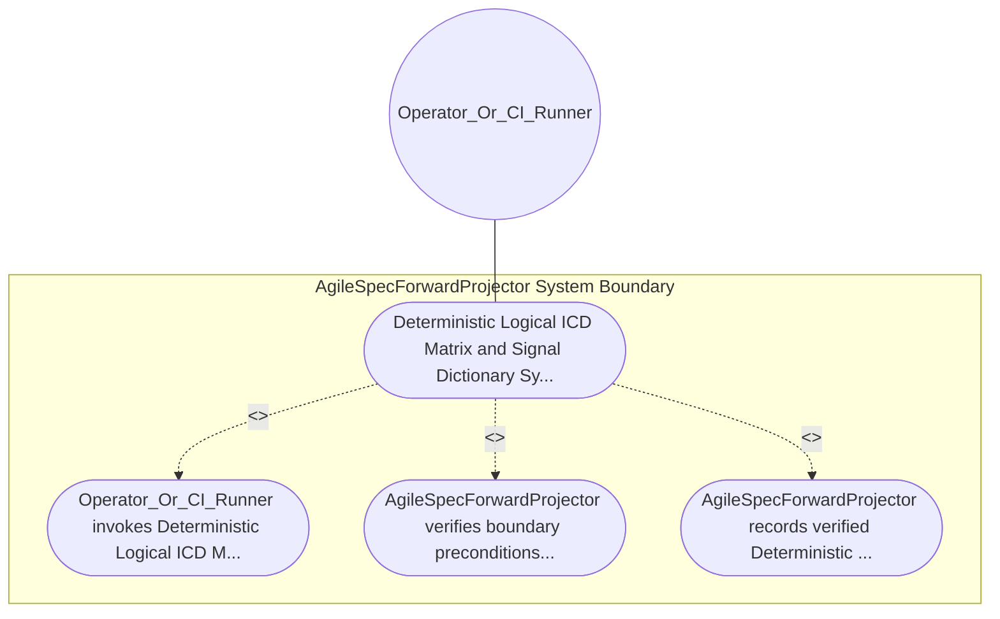

| Attribute | Specification Detail |
| :--- | :--- |
| **Issue ID** | #640 |
| **Title** | Use Case 17: Deterministic Logical ICD Matrix and Signal Dictionary Synthesis |
| **Type** | use-case |
| **Primary Actor** | Operator_Or_CI_Runner |
| **Scope** | AgileSpecForwardProjector |
| **Level** | User Goal |
| **Generation Mode** | subagent |
| **Specification Source** | [schema/model.sysml](../../schema/model.sysml) |

# Use Case 17: Deterministic Logical ICD Matrix and Signal Dictionary Synthesis

## UML Diagrams

## 1. Actors
- `Operator_Or_CI_Runner`

## 2. Preconditions
- `AgileSpecForwardProjector` is initialized and ready to enforce `Deterministic Logical ICD Matrix and Signal Dictionary Synthesis`.
- `Operator_Or_CI_Runner` holds authorized operational access to `AgileSpecForwardProjector`.

## 3. Trigger
- Deterministic Logical ICD Matrix and Signal Dictionary Synthesis

## 4. Main Success Scenario
1. `Operator_Or_CI_Runner` invokes `Deterministic Logical ICD Matrix and Signal Dictionary Synthesis` on `AgileSpecForwardProjector` targeting objective `Deterministic Logical ICD Matrix and Signal Dictionary Synthesis`.
2. `AgileSpecForwardProjector` verifies boundary preconditions and evaluates `Deterministic Logical ICD Matrix and Signal Dictionary Synthesis` invariants (guarding `Diagnostic: E0200`).
3. `AgileSpecForwardProjector` records verified `Deterministic Logical ICD Matrix and Signal Dictionary Synthesis` outcome and returns status to `Operator_Or_CI_Runner`.

## 5. Alternate and Exception Flows
- Diagnostic: E0200

## 6. Postconditions
- `AgileSpecForwardProjector` satisfies declared objective `Deterministic Logical ICD Matrix and Signal Dictionary Synthesis` with all subsystem invariants intact.
- Verified `Deterministic Logical ICD Matrix and Signal Dictionary Synthesis` completion status is recorded for `Operator_Or_CI_Runner`.

## 8. Realization Matrix
| Specification Item | Type | Link / Reference |
| :--- | :--- | :--- |
| **#708** | User Story | [User Story 19: Resolve Parent Epic By Pkg Name](../user-stories/US-19-ResolveParentEpicByPkgName.md) |
| **#670** | Feature | [Feature 16: [BP 04 Deterministic Specification ICD and WBS Forward Compiler Blueprint] AgileSpecForwardProjector](../features/FEAT-16-AgileSpecForwardProjector.md) |

## Source References
Use case operational flows and lifecycle activity references:
- System Architecture Model: `schema/model.sysml`
- Normative Systems Engineering Standard: ISO/IEC/IEEE 29148:2018 §6.4.2 Concept of Operations

Operational use case realization and traceability links derive from `schema/model.sysml` pursuant to ISO/IEC/IEEE 29148.
