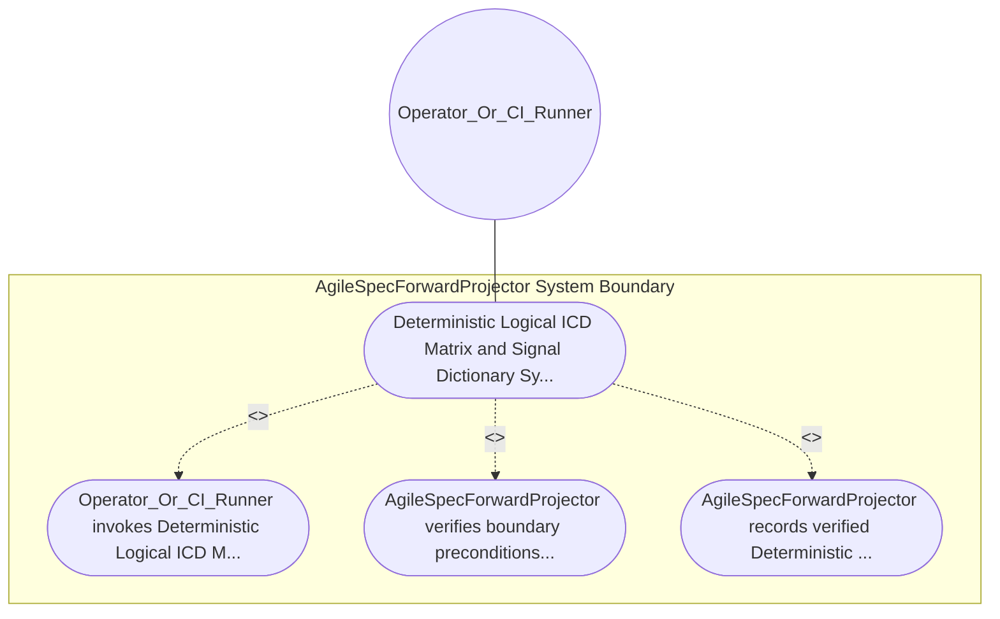

| Attribute | Specification Detail |
| :--- | :--- |
| **Issue ID** | #640 |
| **Title** | Use Case 17: Deterministic Logical ICD Matrix and Signal Dictionary Synthesis |
| **Type** | use-case |
| **Primary Actor** | Operator_Or_CI_Runner |
| **Scope** | AgileSpecForwardProjector |
| **Level** | User Goal |
| **Generation Mode** | subagent |
| **Specification Source** | [schema/model.sysml](../../schema/model.sysml) |

# Use Case 17: Deterministic Logical ICD Matrix and Signal Dictionary Synthesis

## UML Diagrams

## 1. Actors
- `Operator_Or_CI_Runner`

## 2. Preconditions
- `AgileSpecForwardProjector` is initialized and ready to enforce `Deterministic Logical ICD Matrix and Signal Dictionary Synthesis`.
- `Operator_Or_CI_Runner` holds authorized operational access to `AgileSpecForwardProjector`.

## 3. Trigger
- Deterministic Logical ICD Matrix and Signal Dictionary Synthesis

## 4. Main Success Scenario
1. `Operator_Or_CI_Runner` invokes `CompileSysmlEmitIcdDocsInterfaces` (`compile-sysml --emit-icd docs/interfaces`) on `DeterministicSpecIcdWbsForwardCompiler`, routing `PartDef`, `PortDef`, `ConnectionDef`, `FlowDef`, and `ItemDef` AST nodes to `LogicalIcdMatrixCompiler` via `interconnectAstInPort`.
2. `LogicalIcdMatrixCompiler` orders all component axes and connection channels deterministically using `BTreeMap` traversal (`lexicographicalSort = true`) within `maxIcdLatencyMs`.
3. `LogicalIcdMatrixCompiler` executes `ProjectNxNConnectionDefMatrixAndFlowDef` to construct the N-by-N system interconnect matrix in `ICD_01_SYSTEM_INTERFACE_MATRIX.md` and the typed signal dictionary in `ICD_02_MASTER_SIGNAL_DICTIONARY.md`.
4. `LogicalIcdMatrixCompiler` validates the generated CommonMark tables and Mermaid topology diagrams via `pulldown-cmark` to ensure `mermaid_e1_e5_violation_count == 0` and 100% port/flow coverage (`ast_node_coverage_percent == 100`).
5. `LogicalIcdMatrixCompiler` transitions `BP_04_Deterministic_Specification_ICD_and_WBS_Forward_Compiler_Blueprint_LifecycleState` to `IcdSynthesized`, writes `ICD_01_SYSTEM_INTERFACE_MATRIX.md` and `ICD_02_MASTER_SIGNAL_DICTIONARY.md` atomically via `icdMarkdownOutPort` and `IcdMatrixArtifactPort`, and returns `Result::Ok` to `Operator_Or_CI_Runner`.

## 5. Alternate and Exception Flows
- 3a. Dangling `ConnectionDef` endpoint or undeclared `PortDef` / `FlowDef` reference in `schema/model.sysml` (`Diagnostic: E0200`):
  - `LogicalIcdMatrixCompiler` transitions to `Rejected`, emits diagnostic `E0200` via `ariadne` / `miette`, and terminates fail-closed with exit code 1 without modifying `docs/interfaces/`.
- 4a. Atomic filesystem write failure on `icdMarkdownOutPort` or `IcdMatrixArtifactPort`:
  - `LogicalIcdMatrixCompiler` propagates `Result::Err`, preserves prior verified ICD artifacts, and exits fail-closed with code 1.
- 5a. Invariant violation under `Invariant_REQ_0604_SC_01` or `Invariant_REQ_0604_SC_02`:
  - `AgileSpecForwardProjector` and `LogicalIcdMatrixCompiler` abort synthesis, preserve prior verified state, and notify `Operator_Or_CI_Runner` with fail-closed exit status 1.

## 6. Postconditions
- `AgileSpecForwardProjector` satisfies declared objective `Deterministic Logical ICD Matrix and Signal Dictionary Synthesis` with all subsystem invariants intact.
- Verified `Deterministic Logical ICD Matrix and Signal Dictionary Synthesis` completion status is recorded for `Operator_Or_CI_Runner`.

## 8. Realization Matrix
| Specification Item | Type | Link / Reference |
| :--- | :--- | :--- |
| **#708** | User Story | [User Story 19: Resolve Parent Epic By Pkg Name](../user-stories/US-19-ResolveParentEpicByPkgName.md) |
| **#670** | Feature | [Feature 16: [BP 04 Deterministic Specification ICD and WBS Forward Compiler Blueprint] AgileSpecForwardProjector](../features/FEAT-16-AgileSpecForwardProjector.md) |

## Source References
Use case operational flows and lifecycle activity references:
- System Architecture Model: `schema/model.sysml`
- Normative Systems Engineering Standard: ISO/IEC/IEEE 29148:2018 §6.4.2 Concept of Operations

Operational use case realization and traceability links derive from `schema/model.sysml` pursuant to ISO/IEC/IEEE 29148.
