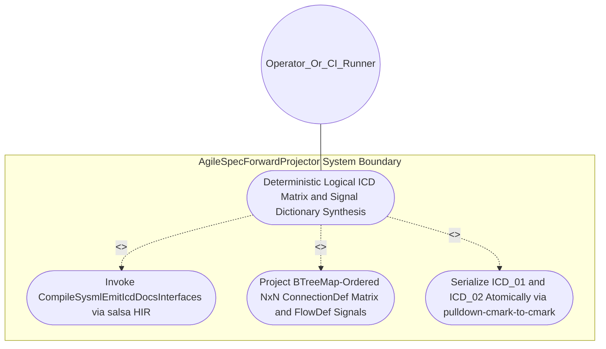
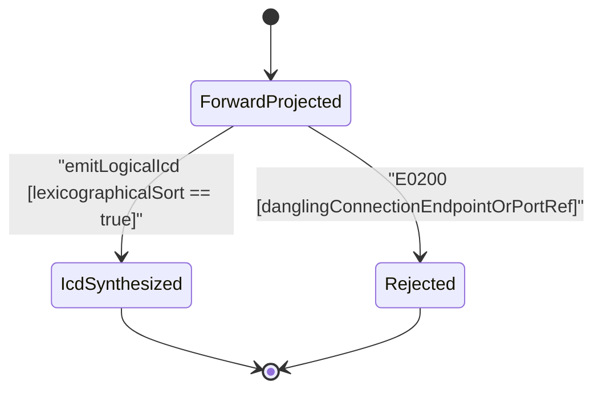

| Attribute | Specification Detail |
| :--- | :--- |
| **Issue ID** | #640 |
| **Title** | Use Case 17: Deterministic Logical ICD Matrix and Signal Dictionary Synthesis |
| **Type** | use-case |
| **Parent Epic** | [EPIC-04-BP_04_Deterministic_Specification_ICD_and_WBS_Forward_Compiler_Blueprint](../epics/EPIC-04-BP_04_Deterministic_Specification_ICD_and_WBS_Forward_Compiler_Blueprint.md) |
| **Schema Containers** | `BP_04_Deterministic_Specification_ICD_and_WBS_Forward_Compiler_Blueprint::LogicalIcdMatrixCompiler` |
| **Primary Actor** | Operator_Or_CI_Runner |
| **Scope** | AgileSpecForwardProjector |
| **Level** | User Goal |
| **Generation Mode** | subagent |
| **Specification Source** | [schema/model.sysml](../../schema/model.sysml) |

# Use Case 17: Deterministic Logical ICD Matrix and Signal Dictionary Synthesis

## UML Diagrams

## 1. Actors
- **Primary Actor:** `Operator_Or_CI_Runner`
- **Secondary Actors:** `LogicalIcdMatrixCompiler`, `DeterministicSpecIcdWbsForwardCompiler`, `AgileSpecForwardProjector`

## 2. Preconditions
- `LogicalIcdMatrixCompiler` and `AgileSpecForwardProjector` are initialized in state `ForwardProjected` with full OMG SysML v2.0 + KerML 1.0 `logos` + `rowan` + `salsa` interconnect AST structures (`deap_core::sysml_cst`, zero 16-construct caps, Contract A).
- `Operator_Or_CI_Runner` holds authorized operational access to `LogicalIcdMatrixCompiler`.

## 3. Trigger
- `Operator_Or_CI_Runner` invokes `CompileSysmlEmitIcdDocsInterfaces` (`compile-sysml --emit-icd docs/interfaces`).

## 4. Main Success Scenario
1. `Operator_Or_CI_Runner` invokes `CompileSysmlEmitIcdDocsInterfaces` (`compile-sysml --emit-icd docs/interfaces`) on `DeterministicSpecIcdWbsForwardCompiler`, routing full OMG SysML v2.0 + KerML 1.0 `PartDef`/`Part`, `PortDef`/`Port` (`in`, `out`, `inout`, `~` conjugation), `InterfaceDef`/`Interface`, `ConnectionDef`/`Connection`, `FlowDef`/`Flow`, `ItemDef`/`Item`, and `ISQ`/`SI`/`ScalarValues` AST nodes (Contract A, zero 16-construct caps) to `LogicalIcdMatrixCompiler` via `interconnectAstInPort`.
2. `LogicalIcdMatrixCompiler` orders all component axes, port endpoints, and connection channels deterministically using `BTreeMap` lexicographical traversal (`lexicographicalSort = true`) via memoized `salsa` queries within `maxIcdLatencyMs` (`<= 10` ms).
3. `LogicalIcdMatrixCompiler` executes `ProjectNxNConnectionDefMatrixAndFlowDef` to construct the N-by-N system interconnect matrix in `./docs/interfaces/ICD_01_SYSTEM_INTERFACE_MATRIX.md` and the typed signal dictionary in `./docs/interfaces/ICD_02_MASTER_SIGNAL_DICTIONARY.md`.
4. `LogicalIcdMatrixCompiler` builds and validates the CommonMark tables and Mermaid topology diagrams via `pulldown-cmark` + `pulldown-cmark-to-cmark` (Contract B, zero hand-rolled scanners) to ensure `mermaid_e1_e5_violation_count == 0` and 100% port/flow coverage (`ast_node_coverage_percent == 100.0`).
5. `LogicalIcdMatrixCompiler` transitions `BP_04_Deterministic_Specification_ICD_and_WBS_Forward_Compiler_Blueprint_LifecycleState` to `IcdSynthesized`, writes `ICD_01_SYSTEM_INTERFACE_MATRIX.md` and `ICD_02_MASTER_SIGNAL_DICTIONARY.md` atomically via `icdMarkdownOutPort` and `IcdMatrixArtifactPort`, and returns `Result::Ok` to `Operator_Or_CI_Runner`.

## 5. Alternate and Exception Flows
- 3a. Dangling `ConnectionDef` endpoint or undeclared `PortDef` / `FlowDef` reference in `./schema/model.sysml` (`Diagnostic: E0200`, branches from step 3):
  1. `LogicalIcdMatrixCompiler` transitions to `Rejected` and emits span-accurate diagnostic `E0200` via `ariadne` / `miette`.
  2. `LogicalIcdMatrixCompiler` terminates fail-closed with exit code 1 without modifying `./docs/interfaces/`.
- 4a. Atomic filesystem write failure on `icdMarkdownOutPort` or `IcdMatrixArtifactPort` (branches from step 4):
  1. `LogicalIcdMatrixCompiler` captures the I/O fault and aborts tempfile promotion.
  2. `LogicalIcdMatrixCompiler` propagates `Result::Err`, preserves prior verified ICD artifacts, and exits fail-closed with code 1.
- 5a. Invariant violation under `Invariant_REQ_0604_SC_01` or `Invariant_REQ_0604_SC_02` (branches from step 5):
  1. `AgileSpecForwardProjector` and `LogicalIcdMatrixCompiler` detect an interconnect coverage or Mermaid E1-E5 violation.
  2. Both components abort synthesis, preserve prior verified state, and notify `Operator_Or_CI_Runner` with fail-closed exit status 1.

## 6. Postconditions
- **Success Guarantee:** `LogicalIcdMatrixCompiler` satisfies `Deterministic Logical ICD Matrix and Signal Dictionary Synthesis` with `BTreeMap`-ordered `ICD_01` and `ICD_02` persisted via `pulldown-cmark-to-cmark` and all subsystem invariants intact.
- **Failure Guarantee:** On any `E0200` or I/O fault, `LogicalIcdMatrixCompiler` transitions to `Rejected` and preserves prior verified `./docs/interfaces/` files without partial writes.

## 7. Architectural Realization (3-Layer Definition of Done)
- **Layer 1 (Domain State & Data Model):** `BTreeMap`-indexed `PartDef`, `PortDef` (`in`, `out`, `inout`, `~`), `InterfaceDef`, `ConnectionDef`, `FlowDef`, and `ItemDef` `salsa` HIR records (`deap_core::sysml_cst`, zero 16-construct caps) and `pulldown-cmark::Event` table AST models.
- **Layer 2 (Logic & State Management):** Deterministic NxN matrix and signal dictionary `salsa` queries enforcing `Invariant_REQ_0604_SC_01` and `Invariant_REQ_0604_SC_02` inside `< 380` executable SLOC submodules (`./crates/compile-sysml/src/icd_wbs/`) with explicit deletion of legacy hand-rolled ICD string emitters and line-by-line scanners (`-1,100+` SLOC net-negative ratchet).
- **Layer 3 (Presentation & Actuator Interface Binding):** Lossless `pulldown-cmark-to-cmark` emission across `icdMarkdownOutPort` and `IcdMatrixArtifactPort` with `ariadne` / `miette` diagnostics (`E0200`).

## 8. Realization Matrix
| Specification Item | Type | Link / Reference |
| :--- | :--- | :--- |
| **#708** | User Story | [User Story 19: Resolve Parent Epic By Pkg Name](../user-stories/US-19-ResolveParentEpicByPkgName.md) |
| **#711** | User Story | [User Story 22: Compile Sysml Emit Icd Docs Interfaces](../user-stories/US-22-CompileSysmlEmitIcdDocsInterfaces.md) |
| **#712** | User Story | [User Story 23: Project Nx N Connection Def Matrix And Flow Def](../user-stories/US-23-ProjectNxNConnectionDefMatrixAndFlowDef.md) |
| **#670** | Feature | [Feature 16: [BP 04 Deterministic Specification ICD and WBS Forward Compiler Blueprint] AgileSpecForwardProjector](../features/FEAT-16-AgileSpecForwardProjector.md) |
| **#673** | Feature | [Feature 19: [BP 04 Deterministic Specification ICD and WBS Forward Compiler Blueprint] LogicalIcdMatrixCompiler](../features/FEAT-19-LogicalIcdMatrixCompiler.md) |

### Required User Stories
- [ ] #708 - [User Story 19: Resolve Parent Epic By Pkg Name](../user-stories/US-19-ResolveParentEpicByPkgName.md) (resolves owning subsystem package context for interconnect endpoints)
- [ ] #711 - [User Story 22: Compile Sysml Emit Icd Docs Interfaces](../user-stories/US-22-CompileSysmlEmitIcdDocsInterfaces.md) (executes compile-sysml --emit-icd docs/interfaces)
- [ ] #712 - [User Story 23: Project Nx N Connection Def Matrix And Flow Def](../user-stories/US-23-ProjectNxNConnectionDefMatrixAndFlowDef.md) (projects BTreeMap-sorted NxN ConnectionDef matrices and FlowDef signal dictionaries)

### Required Features
- [ ] #670 - [Feature 16: [BP 04 Deterministic Specification ICD and WBS Forward Compiler Blueprint] AgileSpecForwardProjector](../features/FEAT-16-AgileSpecForwardProjector.md) (coordinates forward specification and interconnect projection)
- [ ] #673 - [Feature 19: [BP 04 Deterministic Specification ICD and WBS Forward Compiler Blueprint] LogicalIcdMatrixCompiler](../features/FEAT-19-LogicalIcdMatrixCompiler.md) (compiles ICD_01 and ICD_02 via salsa and pulldown-cmark-to-cmark)

## Source References
Use case operational flows and lifecycle activity references:
- System Architecture Model: `schema/model.sysml`
- Normative Systems Engineering Standard: ISO/IEC/IEEE 29148:2018 §6.4.2 Concept of Operations

Operational use case realization and traceability links derive from `schema/model.sysml` pursuant to ISO/IEC/IEEE 29148.
