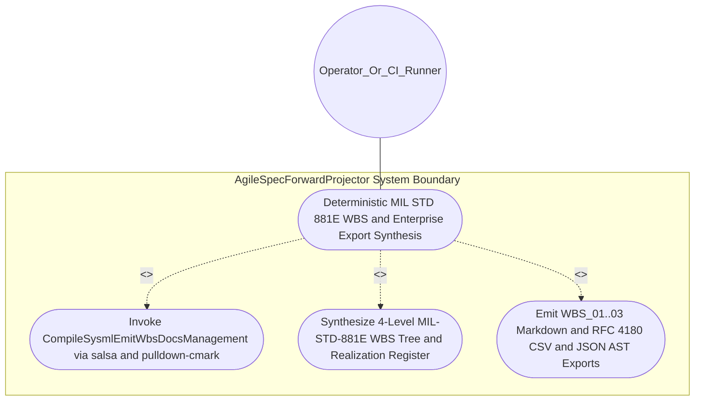
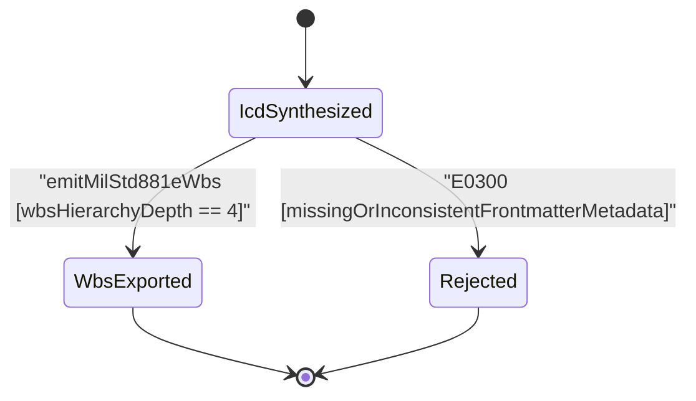

| Attribute | Specification Detail |
| :--- | :--- |
| **Issue ID** | #641 |
| **Title** | Use Case 18: Deterministic MIL STD 881 E WBS and Enterprise Export Synthesis |
| **Type** | use-case |
| **Parent Epic** | [EPIC-04-BP_04_Deterministic_Specification_ICD_and_WBS_Forward_Compiler_Blueprint](../epics/EPIC-04-BP_04_Deterministic_Specification_ICD_and_WBS_Forward_Compiler_Blueprint.md) |
| **Schema Containers** | `BP_04_Deterministic_Specification_ICD_and_WBS_Forward_Compiler_Blueprint::MilStd881eWbsExporter` |
| **Primary Actor** | Operator_Or_CI_Runner |
| **Scope** | AgileSpecForwardProjector |
| **Level** | User Goal |
| **Generation Mode** | subagent |
| **Specification Source** | [schema/model.sysml](../../schema/model.sysml) |

# Use Case 18: Deterministic MIL STD 881 E WBS and Enterprise Export Synthesis

## UML Diagrams

## 1. Actors
- **Primary Actor:** `Operator_Or_CI_Runner`
- **Secondary Actors:** `MilStd881eWbsExporter`, `DeterministicSpecIcdWbsForwardCompiler`, `AgileSpecForwardProjector`

## 2. Preconditions
- `MilStd881eWbsExporter` and `AgileSpecForwardProjector` are initialized in state `IcdSynthesized` with full OMG SysML v2.0 + KerML 1.0 `logos` + `rowan` + `salsa` `PackageDef` AST hierarchies (`deap_core::sysml_cst`, zero 16-construct caps, Contract A) and synchronized `./docs/` CommonMark specification tables.
- `Operator_Or_CI_Runner` holds authorized operational access to `MilStd881eWbsExporter`.

## 3. Trigger
- `Operator_Or_CI_Runner` invokes `CompileSysmlEmitWbsDocsManagement` (`compile-sysml --emit-wbs docs/management`).

## 4. Main Success Scenario
1. `Operator_Or_CI_Runner` invokes `CompileSysmlEmitWbsDocsManagement` (`compile-sysml --emit-wbs docs/management`) on `DeterministicSpecIcdWbsForwardCompiler`, feeding the full OMG SysML v2.0 + KerML 1.0 `PackageDef`, `PartDef`, `AllocationDef`, `RequirementDef`, `VerificationDef`, `TestCaseDef`, and `#capability`/`#dal`/`#fls` AST hierarchy (Contract A, zero 16-construct caps) and synchronized `./docs/` frontmatter metadata into `MilStd881eWbsExporter` via `wbsAstMetadataInPort`.
2. `MilStd881eWbsExporter` parses synchronized specification metadata tables using `pulldown-cmark` (`in_html_comment` state-guarded) and `toml_edit` and decomposes the system via `salsa` derived queries into `wbsHierarchyDepth = 4` canonical MIL-STD-881E levels (Level 1 System, Level 2 Subsystem, Level 3 Work Package, Level 4 Deliverable Task) within `maxWbsLatencyMs` (`<= 15` ms).
3. `MilStd881eWbsExporter` executes `SynthesizeMilStd881eTreeAnd` to generate `WBS_01` through `WBS_03` Markdown registers via `pulldown-cmark-to-cmark` alongside RFC 4180 CSV and typed `serde_json` JSON AST enterprise exports (Contract B, zero hand-rolled scanners).
4. `DeterministicSpecIcdWbsForwardCompiler` verifies that `llm_subagent_invocation_count == 0`, `ast_node_coverage_percent == 100.0`, and `mermaid_e1_e5_violation_count == 0` under `Invariant_REQ_0604_SC_01`.
5. `MilStd881eWbsExporter` transitions `BP_04_Deterministic_Specification_ICD_and_WBS_Forward_Compiler_Blueprint_LifecycleState` to `WbsExported`, writes all WBS Markdown and CSV/JSON artifacts atomically via `wbsArtifactsOutPort` and `WbsEnterpriseExportPort`, and returns `Result::Ok` to `Operator_Or_CI_Runner`.

## 5. Alternate and Exception Flows
- 3a. Missing or inconsistent specification frontmatter metadata across `./docs/` during WBS tree construction (`Diagnostic: E0300`, branches from step 2):
  1. `MilStd881eWbsExporter` transitions to `Rejected` and emits span-accurate diagnostic `E0300` via `ariadne` / `miette`.
  2. `MilStd881eWbsExporter` terminates fail-closed with exit code 1 without modifying `./docs/management/`.
- 4a. Serialization or I/O failure while emitting RFC 4180 CSV or JSON AST exports on `wbsArtifactsOutPort` (branches from step 3):
  1. `MilStd881eWbsExporter` aborts atomic tempfile promotion.
  2. `MilStd881eWbsExporter` returns `Result::Err` without partial file writes, preserves prior verified `./docs/management/` artifacts, and exits fail-closed with code 1.
- 5a. Invariant violation under `Invariant_REQ_0604_SC_01` or `Invariant_REQ_0604_SC_02` (branches from step 4):
  1. `AgileSpecForwardProjector` and `MilStd881eWbsExporter` detect incomplete work package coverage or Mermaid E1-E5 violations.
  2. Both components abort execution, preserve prior verified state, and notify `Operator_Or_CI_Runner` with fail-closed exit code 1.

## 6. Postconditions
- **Success Guarantee:** `MilStd881eWbsExporter` satisfies `Deterministic MIL STD 881E WBS and Enterprise Export Synthesis` with 4-level MIL-STD-881E `WBS_01..03` Markdown and RFC 4180 CSV / JSON AST exports persisted and all subsystem invariants intact.
- **Failure Guarantee:** On any `E0300` or serialization failure, `MilStd881eWbsExporter` transitions to `Rejected` and preserves prior verified `./docs/management/` artifacts.

## 7. Architectural Realization (3-Layer Definition of Done)
- **Layer 1 (Domain State & Data Model):** 4-level MIL-STD-881E `salsa` WBS hierarchy structures (`deap_core::sysml_cst`, zero 16-construct caps), `pulldown-cmark::Event` metadata table records, and typed `serde_json` / RFC 4180 CSV schemas.
- **Layer 2 (Logic & State Management):** Deterministic `salsa` WBS tree synthesis queries enforcing `Invariant_REQ_0604_SC_01` and `Invariant_REQ_0604_SC_02` inside `< 380` executable SLOC submodules (`./crates/compile-sysml/src/icd_wbs/`) with explicit deletion of legacy hand-rolled WBS/Markdown string emitters and line-by-line table scanners (`-1,100+` SLOC net-negative ratchet).
- **Layer 3 (Presentation & Actuator Interface Binding):** Lossless `pulldown-cmark-to-cmark` Markdown serialization and atomic CSV/JSON export across `wbsArtifactsOutPort` and `WbsEnterpriseExportPort` with `ariadne` / `miette` diagnostics (`E0300`).

## 8. Realization Matrix
| Specification Item | Type | Link / Reference |
| :--- | :--- | :--- |
| **#709** | User Story | [User Story 20: Bind All Package Stories To Use](../user-stories/US-20-BindAllPackageStoriesToUse.md) |
| **#713** | User Story | [User Story 24: Compile Sysml Emit Wbs Docs Management](../user-stories/US-24-CompileSysmlEmitWbsDocsManagement.md) |
| **#714** | User Story | [User Story 25: Synthesize Mil Std881 e Tree And](../user-stories/US-25-SynthesizeMilStd881eTreeAnd.md) |
| **#670** | Feature | [Feature 16: [BP 04 Deterministic Specification ICD and WBS Forward Compiler Blueprint] AgileSpecForwardProjector](../features/FEAT-16-AgileSpecForwardProjector.md) |
| **#674** | Feature | [Feature 20: [BP 04 Deterministic Specification ICD and WBS Forward Compiler Blueprint] MilStd881eWbsExporter](../features/FEAT-20-MilStd881eWbsExporter.md) |

### Required User Stories
- [ ] #709 - [User Story 20: Bind All Package Stories To Use](../user-stories/US-20-BindAllPackageStoriesToUse.md) (binds package User Stories and Use Cases into WBS work package traceability)
- [ ] #713 - [User Story 24: Compile Sysml Emit Wbs Docs Management](../user-stories/US-24-CompileSysmlEmitWbsDocsManagement.md) (executes compile-sysml --emit-wbs docs/management)
- [ ] #714 - [User Story 25: Synthesize Mil Std881 e Tree And](../user-stories/US-25-SynthesizeMilStd881eTreeAnd.md) (synthesizes 4-level MIL-STD-881E WBS trees and CSV/JSON exports)

### Required Features
- [ ] #670 - [Feature 16: [BP 04 Deterministic Specification ICD and WBS Forward Compiler Blueprint] AgileSpecForwardProjector](../features/FEAT-16-AgileSpecForwardProjector.md) (provides synchronized specification frontmatter for WBS decomposition)
- [ ] #674 - [Feature 20: [BP 04 Deterministic Specification ICD and WBS Forward Compiler Blueprint] MilStd881eWbsExporter](../features/FEAT-20-MilStd881eWbsExporter.md) (synthesizes WBS_01..03 and enterprise CSV/JSON AST exports)

## Source References
Use case operational flows and lifecycle activity references:
- System Architecture Model: `schema/model.sysml`
- Normative Systems Engineering Standard: ISO/IEC/IEEE 29148:2018 §6.4.2 Concept of Operations

Operational use case realization and traceability links derive from `schema/model.sysml` pursuant to ISO/IEC/IEEE 29148.
