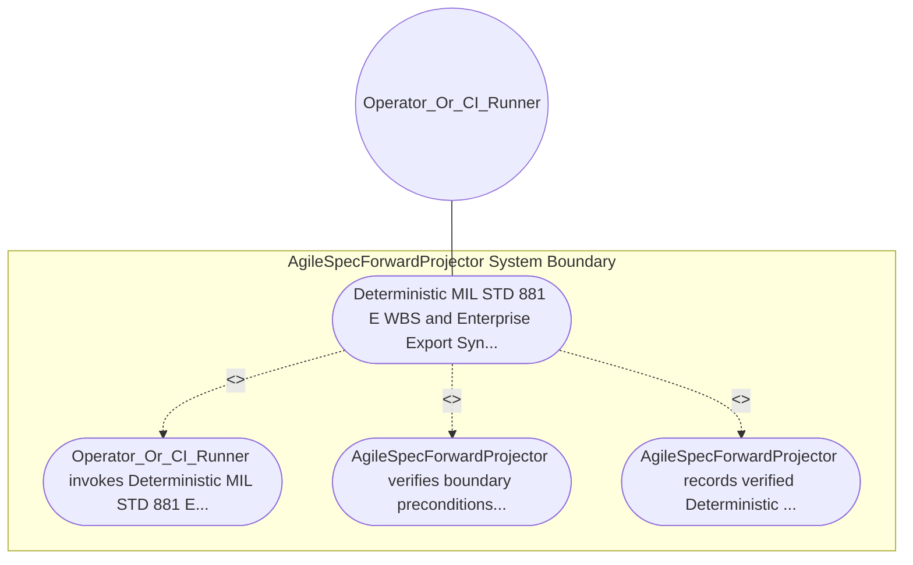

| Attribute | Specification Detail |
| :--- | :--- |
| **Issue ID** | #641 |
| **Title** | Use Case 18: Deterministic MIL STD 881 E WBS and Enterprise Export Synthesis |
| **Type** | use-case |
| **Primary Actor** | Operator_Or_CI_Runner |
| **Scope** | AgileSpecForwardProjector |
| **Level** | User Goal |
| **Generation Mode** | subagent |
| **Specification Source** | [schema/model.sysml](../../schema/model.sysml) |

# Use Case 18: Deterministic MIL STD 881 E WBS and Enterprise Export Synthesis

## UML Diagrams

## 1. Actors
- `Operator_Or_CI_Runner`

## 2. Preconditions
- `AgileSpecForwardProjector` is initialized and ready to enforce `Deterministic MIL STD 881E WBS and Enterprise Export Synthesis`.
- `Operator_Or_CI_Runner` holds authorized operational access to `AgileSpecForwardProjector`.

## 3. Trigger
- Deterministic MIL STD 881E WBS and Enterprise Export Synthesis

## 4. Main Success Scenario
1. `Operator_Or_CI_Runner` invokes `CompileSysmlEmitWbsDocsManagement` (`compile-sysml --emit-wbs docs/management`) on `DeterministicSpecIcdWbsForwardCompiler`, feeding the `PackageDef` AST hierarchy and synchronized `docs/` frontmatter metadata into `MilStd881eWbsExporter` via `wbsAstMetadataInPort`.
2. `MilStd881eWbsExporter` parses synchronized specification metadata tables using `pulldown-cmark` and decomposes the system into `wbsHierarchyDepth = 4` canonical MIL-STD-881E levels (System, Subsystem, Work Package, Deliverable Task) within `maxWbsLatencyMs`.
3. `MilStd881eWbsExporter` executes `SynthesizeMilStd881eTreeAnd` to generate `WBS_01` through `WBS_03` Markdown registers alongside RFC 4180 CSV and JSON AST enterprise exports.
4. `DeterministicSpecIcdWbsForwardCompiler` verifies that `llm_subagent_invocation_count == 0`, `ast_node_coverage_percent == 100`, and `mermaid_e1_e5_violation_count == 0` under `Invariant_REQ_0604_SC_01`.
5. `MilStd881eWbsExporter` transitions `BP_04_Deterministic_Specification_ICD_and_WBS_Forward_Compiler_Blueprint_LifecycleState` to `WbsExported`, writes all WBS Markdown and CSV/JSON artifacts atomically via `wbsArtifactsOutPort` and `WbsEnterpriseExportPort`, and returns `Result::Ok` to `Operator_Or_CI_Runner`.

## 5. Alternate and Exception Flows
- 3a. Missing or inconsistent specification frontmatter metadata across `docs/` during WBS tree construction (`Diagnostic: E0300`):
  - `MilStd881eWbsExporter` transitions to `Rejected`, emits diagnostic `E0300` via `ariadne` / `miette`, and terminates fail-closed with exit code 1.
- 4a. Serialization or I/O failure while emitting RFC 4180 CSV or JSON AST exports on `wbsArtifactsOutPort`:
  - `MilStd881eWbsExporter` returns `Result::Err` without partial file writes, preserves prior verified `docs/management/` artifacts, and exits fail-closed with code 1.
- 5a. Invariant violation under `Invariant_REQ_0604_SC_01` or `Invariant_REQ_0604_SC_02`:
  - `AgileSpecForwardProjector` and `MilStd881eWbsExporter` abort execution, preserve prior verified state, and notify `Operator_Or_CI_Runner` with fail-closed exit code 1.

## 6. Postconditions
- `AgileSpecForwardProjector` satisfies declared objective `Deterministic MIL STD 881E WBS and Enterprise Export Synthesis` with all subsystem invariants intact.
- Verified `Deterministic MIL STD 881 E WBS and Enterprise Export Synthesis` completion status is recorded for `Operator_Or_CI_Runner`.

## 8. Realization Matrix
| Specification Item | Type | Link / Reference |
| :--- | :--- | :--- |
| **#709** | User Story | [User Story 20: Bind All Package Stories To Use](../user-stories/US-20-BindAllPackageStoriesToUse.md) |
| **#670** | Feature | [Feature 16: [BP 04 Deterministic Specification ICD and WBS Forward Compiler Blueprint] AgileSpecForwardProjector](../features/FEAT-16-AgileSpecForwardProjector.md) |

## Source References
Use case operational flows and lifecycle activity references:
- System Architecture Model: `schema/model.sysml`
- Normative Systems Engineering Standard: ISO/IEC/IEEE 29148:2018 §6.4.2 Concept of Operations

Operational use case realization and traceability links derive from `schema/model.sysml` pursuant to ISO/IEC/IEEE 29148.
