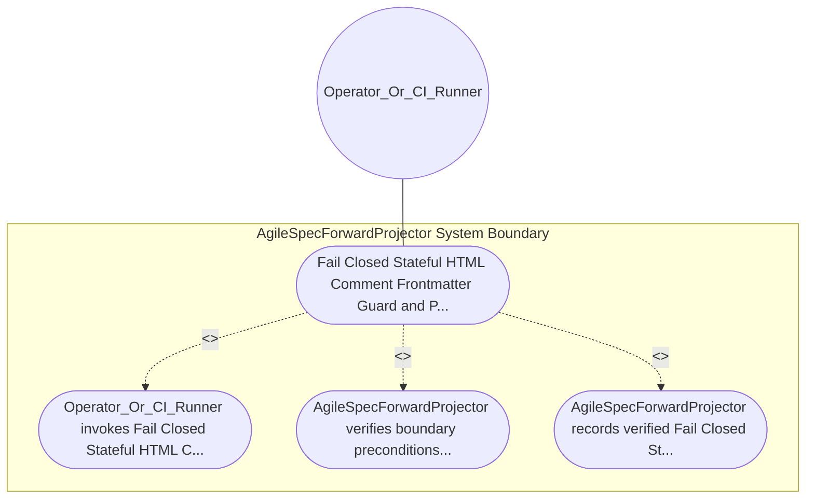

| Attribute | Specification Detail |
| :--- | :--- |
| **Issue ID** | #642 |
| **Title** | Use Case 19: Fail Closed Stateful HTML Comment Frontmatter Guard and Parent Inclusive Checklist Reconciliation |
| **Type** | use-case |
| **Primary Actor** | Operator_Or_CI_Runner |
| **Scope** | AgileSpecForwardProjector |
| **Level** | User Goal |
| **Generation Mode** | subagent |
| **Specification Source** | [schema/model.sysml](../../schema/model.sysml) |

# Use Case 19: Fail Closed Stateful HTML Comment Frontmatter Guard and Parent Inclusive Checklist Reconciliation

## UML Diagrams

## 1. Actors
- `Operator_Or_CI_Runner`

## 2. Preconditions
- `AgileSpecForwardProjector` is initialized and ready to enforce `Fail Closed Stateful HTML Comment Frontmatter Guard and Parent Inclusive Checklist Reconciliation`.
- `Operator_Or_CI_Runner` holds authorized operational access to `AgileSpecForwardProjector`.

## 3. Trigger
- Fail Closed Stateful HTML Comment Frontmatter Guard and Parent Inclusive Checklist Reconciliation

## 4. Main Success Scenario
1. `Operator_Or_CI_Runner` invokes `ReconcileBacklogReconcileDocsDirDocs` (`reconcile-backlog reconcile --docs-dir docs`) on `BidirectionalBacklogReconciler` via `specDocsInOutPort`.
2. `BidirectionalBacklogReconciler` executes `ParseCommonMarkTablesWithInHtml` using `pulldown-cmark` with `trackHtmlCommentState = true` (`in_html_comment` state tracking) so commented-out example tables never spoof frontmatter `Issue ID` attributes.
3. `BidirectionalBacklogReconciler` executes `ReconcileChecklistsWithParentInclusiveEpic` (`parentInclusiveEpics = true`) to compute the parent-inclusive Epic count and reconcile bidirectional Epic, Feature, User Story, and Use Case checklists without wildcard misbinding.
4. `BidirectionalBacklogReconciler` verifies that zero unpopulated placeholders or spoofed issue IDs exist across `docs/epics/`, `docs/features/`, `docs/user-stories/`, and `docs/use-cases/`.
5. `BidirectionalBacklogReconciler` transitions `BP_04_Deterministic_Specification_ICD_and_WBS_Forward_Compiler_Blueprint_LifecycleState` to `BacklogReconciled`, commits updated checklists atomically via `specDocsInOutPort`, and returns `Result::Ok` to `Operator_Or_CI_Runner`.

## 5. Alternate and Exception Flows
- 3a. Spoofed frontmatter table inside an unclosed HTML comment or malformed CommonMark table (`Diagnostic: E0300`):
  - `BidirectionalBacklogReconciler` transitions to `Rejected` on `htmlCommentSpoofOrCardinalityError`, emits diagnostic `E0300` via `ariadne` / `miette`, and terminates fail-closed with exit code 1.
- 4a. Parent-child Epic/Feature/Story/Use-Case checklist cardinality mismatch detected:
  - `BidirectionalBacklogReconciler` returns `Result::Err`, aborts reconciliation without partial state mutation on `specDocsInOutPort`, and exits fail-closed with code 1.
- 5a. Invariant violation under `Invariant_REQ_0604_SC_01` or `Invariant_REQ_0604_SC_02`:
  - `AgileSpecForwardProjector` and `BidirectionalBacklogReconciler` abort execution, preserve prior verified state, and notify `Operator_Or_CI_Runner` with fail-closed exit code 1.

## 6. Postconditions
- `AgileSpecForwardProjector` satisfies declared objective `Fail Closed Stateful HTML Comment Frontmatter Guard and Parent Inclusive Checklist Reconciliation` with all subsystem invariants intact.
- Verified `Fail Closed Stateful HTML Comment Frontmatter Guard and Parent Inclusive Checklist Reconciliation` completion status is recorded for `Operator_Or_CI_Runner`.

## 8. Realization Matrix
| Specification Item | Type | Link / Reference |
| :--- | :--- | :--- |
| **#710** | User Story | [User Story 21: Emit Symmetric Action Def Signatures And E1](../user-stories/US-21-EmitSymmetricActionDefSignaturesAndE1.md) |
| **#670** | Feature | [Feature 16: [BP 04 Deterministic Specification ICD and WBS Forward Compiler Blueprint] AgileSpecForwardProjector](../features/FEAT-16-AgileSpecForwardProjector.md) |

## Source References
Use case operational flows and lifecycle activity references:
- System Architecture Model: `schema/model.sysml`
- Normative Systems Engineering Standard: ISO/IEC/IEEE 29148:2018 §6.4.2 Concept of Operations

Operational use case realization and traceability links derive from `schema/model.sysml` pursuant to ISO/IEC/IEEE 29148.
