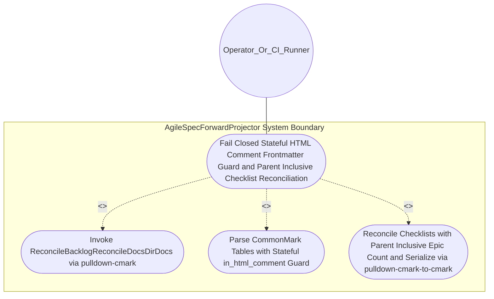

| Attribute | Specification Detail |
| :--- | :--- |
| **Issue ID** | #642 |
| **Title** | Use Case 19: Fail Closed Stateful HTML Comment Frontmatter Guard and Parent Inclusive Checklist Reconciliation |
| **Type** | use-case |
| **Parent Epic** | [EPIC-04-BP_04_Deterministic_Specification_ICD_and_WBS_Forward_Compiler_Blueprint](../epics/EPIC-04-BP_04_Deterministic_Specification_ICD_and_WBS_Forward_Compiler_Blueprint.md) (#688) |
| **Schema Containers** | `BP_04_Deterministic_Specification_ICD_and_WBS_Forward_Compiler_Blueprint::BidirectionalBacklogReconciler` |
| **Primary Actor** | Operator_Or_CI_Runner |
| **Scope** | AgileSpecForwardProjector |
| **Level** | User Goal |
| **Generation Mode** | subagent |
| **Specification Source** | [schema/model.sysml](../../schema/model.sysml) |

# Use Case 19: Fail Closed Stateful HTML Comment Frontmatter Guard and Parent Inclusive Checklist Reconciliation

## UML Diagrams



```sysml
stateDiagram-v2
    [*] --> WbsExported
    WbsExported --> BacklogReconciled : "reconcileBacklog [trackHtmlCommentState == true && parentInclusiveEpics == true]"
    WbsExported --> Rejected : "htmlCommentSpoofOrCardinalityError [E0300]"
    BacklogReconciled --> [*]
    Rejected --> [*]
```

## 1. Actors
- **Primary Actor:** `Operator_Or_CI_Runner`
- **Secondary Actors:** `BidirectionalBacklogReconciler`, `AgileSpecForwardProjector`, `DeterministicSpecIcdWbsForwardCompiler`

## 2. Preconditions
- `BidirectionalBacklogReconciler` and `AgileSpecForwardProjector` are initialized in state `WbsExported` with full OMG SysML v2.0 + KerML 1.0 `salsa` HIR tables (Contract A, zero 16-construct caps) and `pulldown-cmark` CommonMark AST parsers (Contract B, zero hand-rolled scanners).
- `Operator_Or_CI_Runner` holds authorized operational access to `BidirectionalBacklogReconciler`.

## 3. Trigger
- `Operator_Or_CI_Runner` invokes `ReconcileBacklogReconcileDocsDirDocs` (`reconcile-backlog reconcile --docs-dir docs`).

## 4. Main Success Scenario
1. `Operator_Or_CI_Runner` invokes `ReconcileBacklogReconcileDocsDirDocs` (`reconcile-backlog reconcile --docs-dir docs`) on `BidirectionalBacklogReconciler` via `specDocsInOutPort`.
2. `BidirectionalBacklogReconciler` executes `ParseCommonMarkTablesWithInHtml` using `pulldown-cmark` (`Options::ENABLE_TABLES | Options::ENABLE_TASKLISTS`) with `trackHtmlCommentState = true` (`in_html_comment` state tracking over `pulldown-cmark::Event::Html`) so commented-out example tables never spoof frontmatter `Issue ID` attributes (Contract B, zero hand-rolled line scanners).
3. `BidirectionalBacklogReconciler` executes `ReconcileChecklistsWithParentInclusiveEpic` (`parentInclusiveEpics = true`) via `salsa` derived queries across the full OMG SysML v2.0 + KerML 1.0 package/part/interaction/use-case hierarchy (Contract A, zero 16-construct caps) to compute the parent-inclusive Epic count and reconcile bidirectional Epic, Feature, User Story, and Use Case checklists without wildcard misbinding.
4. `BidirectionalBacklogReconciler` verifies that zero unpopulated placeholders (`#IssueID`) or spoofed issue IDs exist across `./docs/epics/`, `./docs/features/`, `./docs/user-stories/`, and `./docs/use-cases/`.
5. `BidirectionalBacklogReconciler` transitions `BP_04_Deterministic_Specification_ICD_and_WBS_Forward_Compiler_Blueprint_LifecycleState` to `BacklogReconciled`, serializes updated checklists losslessly via `pulldown-cmark-to-cmark` across `specDocsInOutPort`, and returns `Result::Ok` to `Operator_Or_CI_Runner`.

## 5. Alternate and Exception Flows
- 3a. Spoofed frontmatter table inside an unclosed HTML comment or malformed CommonMark table (`Diagnostic: E0300`, branches from step 2):
  1. `BidirectionalBacklogReconciler` transitions to `Rejected` on `htmlCommentSpoofOrCardinalityError` and emits diagnostic `E0300` via `ariadne` / `miette`.
  2. `BidirectionalBacklogReconciler` terminates fail-closed with exit code 1 without modifying `./docs/`.
- 4a. Parent-child Epic/Feature/Story/Use-Case checklist cardinality mismatch detected (branches from step 3):
  1. `BidirectionalBacklogReconciler` identifies the unlinked or orphaned specification item via `salsa` cross-reference queries.
  2. `BidirectionalBacklogReconciler` returns `Result::Err`, aborts reconciliation without partial state mutation on `specDocsInOutPort`, and exits fail-closed with code 1.
- 5a. Invariant violation under `Invariant_REQ_0604_SC_01` or `Invariant_REQ_0604_SC_02` (branches from step 4):
  1. `AgileSpecForwardProjector` and `BidirectionalBacklogReconciler` detect an unresolved placeholder or AST drift condition.
  2. Both components abort execution, preserve prior verified state, and notify `Operator_Or_CI_Runner` with fail-closed exit code 1.

## 6. Postconditions
- **Success Guarantee:** `BidirectionalBacklogReconciler` satisfies `Fail Closed Stateful HTML Comment Frontmatter Guard and Parent Inclusive Checklist Reconciliation` with all CommonMark tables and checklists losslessly reconciled via `pulldown-cmark-to-cmark`.
- **Failure Guarantee:** On any `E0300` HTML-comment spoof or cardinality error, `BidirectionalBacklogReconciler` transitions to `Rejected` and preserves prior verified `./docs/` files.

## 7. Architectural Realization (3-Layer Definition of Done)
- **Layer 1 (Domain State & Data Model):** Stateful `pulldown-cmark::Event` table and tasklist AST models (`in_html_comment` guard state), `toml_edit::DocumentMut` manifests, and parent-inclusive `salsa` Epic/Feature/Story/Use-Case linkage maps (`deap_core::sysml_cst`, zero 16-construct caps).
- **Layer 2 (Logic & State Management):** `ParseCommonMarkTablesWithInHtml` and `ReconcileChecklistsWithParentInclusiveEpic` query logic enforcing `Invariant_REQ_0604_SC_01` and `Invariant_REQ_0604_SC_02` inside `< 380` executable SLOC submodules (`./crates/reconcile-backlog/src/table_cst/`) with explicit deletion of legacy hand-rolled pipe-splitting (`line.split('|')`) and regex HTML comment scanners (`-1,100+` SLOC net-negative ratchet).
- **Layer 3 (Presentation & Actuator Interface Binding):** Lossless `pulldown-cmark-to-cmark` AST splicing across `specDocsInOutPort` with `ariadne` / `miette` diagnostics (`E0300`).

## 8. Realization Matrix
| Specification Item | Type | Link / Reference |
| :--- | :--- | :--- |
| **#710** | User Story | [User Story 21: Emit Symmetric Action Def Signatures And E1](../user-stories/US-21-EmitSymmetricActionDefSignaturesAndE1.md) |
| **#715** | User Story | [User Story 26: Reconcile Backlog Reconcile Docs Dir Docs](../user-stories/US-26-ReconcileBacklogReconcileDocsDirDocs.md) |
| **#716** | User Story | [User Story 27: Parse CommonMark Tables With In Html](../user-stories/US-27-ParseCommonMarkTablesWithInHtml.md) |
| **#717** | User Story | [User Story 28: Reconcile Checklists With Parent Inclusive Epic](../user-stories/US-28-ReconcileChecklistsWithParentInclusiveEpic.md) |
| **#670** | Feature | [Feature 16: [BP 04 Deterministic Specification ICD and WBS Forward Compiler Blueprint] AgileSpecForwardProjector](../features/FEAT-16-AgileSpecForwardProjector.md) |
| **#671** | Feature | [Feature 17: [BP 04 Deterministic Specification ICD and WBS Forward Compiler Blueprint] BidirectionalBacklogReconciler](../features/FEAT-17-BidirectionalBacklogReconciler.md) |

### Required User Stories
- [ ] #710 - [User Story 21: Emit Symmetric Action Def Signatures And E1](../user-stories/US-21-EmitSymmetricActionDefSignaturesAndE1.md) (maintains symmetric ActionDef signatures across reconciled specs)
- [ ] #715 - [User Story 26: Reconcile Backlog Reconcile Docs Dir Docs](../user-stories/US-26-ReconcileBacklogReconcileDocsDirDocs.md) (executes reconcile-backlog reconcile --docs-dir docs)
- [ ] #716 - [User Story 27: Parse CommonMark Tables With In Html](../user-stories/US-27-ParseCommonMarkTablesWithInHtml.md) (enforces stateful pulldown-cmark in_html_comment table guard)
- [ ] #717 - [User Story 28: Reconcile Checklists With Parent Inclusive Epic](../user-stories/US-28-ReconcileChecklistsWithParentInclusiveEpic.md) (enforces parent-inclusive Epic count during checklist reconciliation)

### Required Features
- [ ] #670 - [Feature 16: [BP 04 Deterministic Specification ICD and WBS Forward Compiler Blueprint] AgileSpecForwardProjector](../features/FEAT-16-AgileSpecForwardProjector.md) (projects canonical CommonMark specification tables and checklists)
- [ ] #671 - [Feature 17: [BP 04 Deterministic Specification ICD and WBS Forward Compiler Blueprint] BidirectionalBacklogReconciler](../features/FEAT-17-BidirectionalBacklogReconciler.md) (reconciles frontmatter tables and checklists via pulldown-cmark and pulldown-cmark-to-cmark)

## Source References
Use case operational flows and lifecycle activity references:
- System Architecture Model: `schema/model.sysml`
- Normative Systems Engineering Standard: ISO/IEC/IEEE 29148:2018 §6.4.2 Concept of Operations

Operational use case realization and traceability links derive from `schema/model.sysml` pursuant to ISO/IEC/IEEE 29148.
