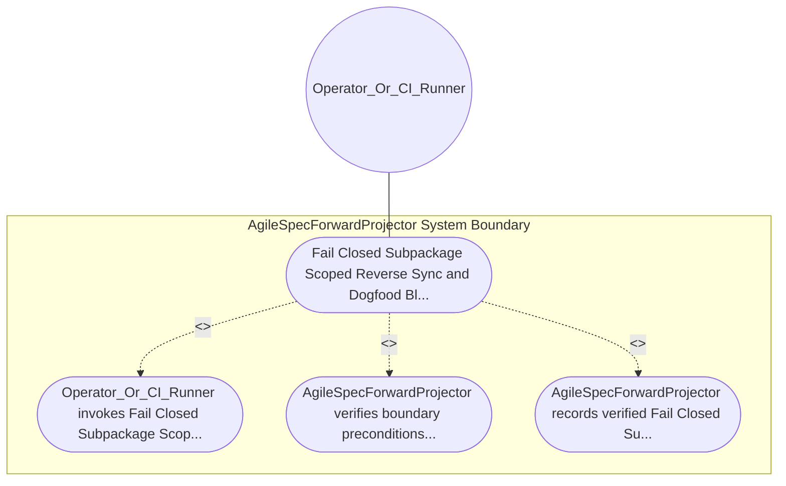

| Attribute | Specification Detail |
| :--- | :--- |
| **Issue ID** | #643 |
| **Title** | Use Case 20: Fail Closed Subpackage Scoped Reverse Sync and Dogfood Blueprint Ingestion Parity |
| **Type** | use-case |
| **Primary Actor** | Operator_Or_CI_Runner |
| **Scope** | AgileSpecForwardProjector |
| **Level** | User Goal |
| **Generation Mode** | subagent |
| **Specification Source** | [schema/model.sysml](../../schema/model.sysml) |

# Use Case 20: Fail Closed Subpackage Scoped Reverse Sync and Dogfood Blueprint Ingestion Parity

## UML Diagrams

## 1. Actors
- `Operator_Or_CI_Runner`

## 2. Preconditions
- `AgileSpecForwardProjector` is initialized and ready to enforce `Fail Closed Subpackage Scoped Reverse Sync and Dogfood Blueprint Ingestion Parity`.
- `Operator_Or_CI_Runner` holds authorized operational access to `AgileSpecForwardProjector`.

## 3. Trigger
- Fail Closed Subpackage Scoped Reverse Sync and Dogfood Blueprint Ingestion Parity

## 4. Main Success Scenario
1. `Operator_Or_CI_Runner` invokes `CompileSysmlReverseSyncDocs` (`compile-sysml --reverse-sync docs`) on `BidirectionalBacklogReconciler` and `DeterministicSpecIcdWbsForwardCompiler` via `specDocsInOutPort` and `BP_04_ReconcilerToForwardCompilerConnection`.
2. `BidirectionalBacklogReconciler` parses `docs/` specification Markdown ASTs via `pulldown-cmark` and `logos` / `rowan` and executes `MergeExtractedEntitiesIntoOwningSubpackages` to route each extracted entity into its owning `PackageDef` subpackage via `subpackageSyncOutPort`.
3. `DeterministicSpecIcdWbsForwardCompiler` transitions `BP_04_Deterministic_Specification_ICD_and_WBS_Forward_Compiler_Blueprint_LifecycleState` from `BacklogReconciled` to `ReverseSynced` while verifying zero root AST namespace pollution (`forward_reverse_drift_count == 0`).
4. `DeterministicSpecIcdWbsForwardCompiler` computes SHA-256 `SchemaDigest` parity between the forward-projected and reverse-synchronized `PackageDef` ASTs under `Invariant_REQ_0604_SC_02`.
5. Upon confirming `sha256DigestParityZero`, `DeterministicSpecIcdWbsForwardCompiler` transitions to `VerifiedRoundtrip`, persists the canonical SysML v2 model, and returns `Result::Ok` to `Operator_Or_CI_Runner`.

## 5. Alternate and Exception Flows
- 3a. Orphaned specification entity or root AST namespace pollution detected during `MergeExtractedEntitiesIntoOwningSubpackages` (`Diagnostic: E0400`):
  - `DeterministicSpecIcdWbsForwardCompiler` transitions to `Rejected` on `rootAstPollutionOrDriftDetected`, emits diagnostic `E0400` via `ariadne` / `miette`, and exits fail-closed with code 1.
- 4a. Non-zero SHA-256 digest drift (`forward_reverse_drift_count > 0`) after forward-then-reverse synchronization:
  - `DeterministicSpecIcdWbsForwardCompiler` returns `Result::Err`, preserves prior verified `schema/model.sysml` state without partial writes, and terminates fail-closed with exit code 1.
- 5a. Blueprint dogfood ingestion gate failure under `check-blueprint` or `ingest-sysml`:
  - `AgileSpecForwardProjector` aborts execution, emits a structured `miette` diagnostic to `Operator_Or_CI_Runner`, and exits fail-closed with code 1.

## 6. Postconditions
- `AgileSpecForwardProjector` satisfies declared objective `Fail Closed Subpackage Scoped Reverse Sync and Dogfood Blueprint Ingestion Parity` with all subsystem invariants intact.
- Verified `Fail Closed Subpackage Scoped Reverse Sync and Dogfood Blueprint Ingestion Parity` completion status is recorded for `Operator_Or_CI_Runner`.

## 8. Realization Matrix
| Specification Item | Type | Link / Reference |
| :--- | :--- | :--- |
| **#711** | User Story | [User Story 22: Compile Sysml Emit Icd Docs Interfaces](../user-stories/US-22-CompileSysmlEmitIcdDocsInterfaces.md) |
| **#670** | Feature | [Feature 16: [BP 04 Deterministic Specification ICD and WBS Forward Compiler Blueprint] AgileSpecForwardProjector](../features/FEAT-16-AgileSpecForwardProjector.md) |

## Source References
Use case operational flows and lifecycle activity references:
- System Architecture Model: `schema/model.sysml`
- Normative Systems Engineering Standard: ISO/IEC/IEEE 29148:2018 §6.4.2 Concept of Operations

Operational use case realization and traceability links derive from `schema/model.sysml` pursuant to ISO/IEC/IEEE 29148.
