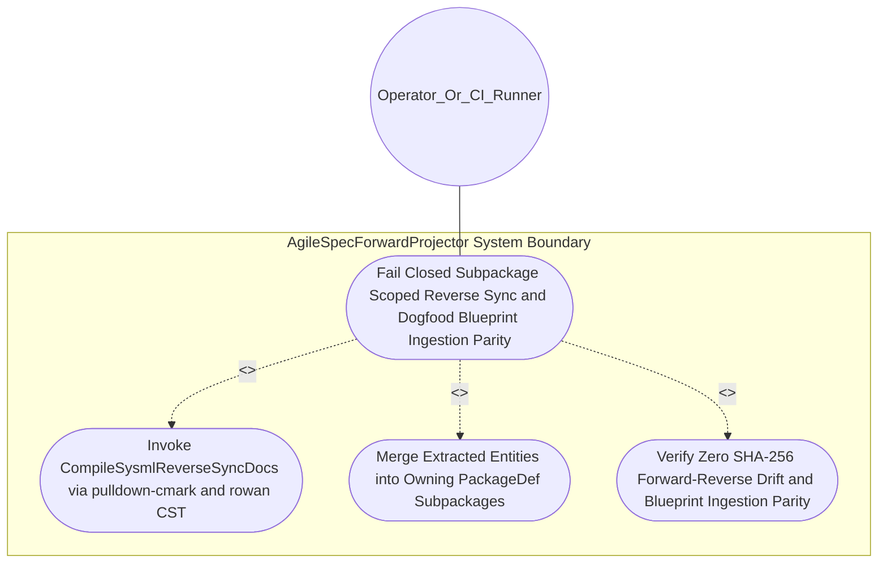
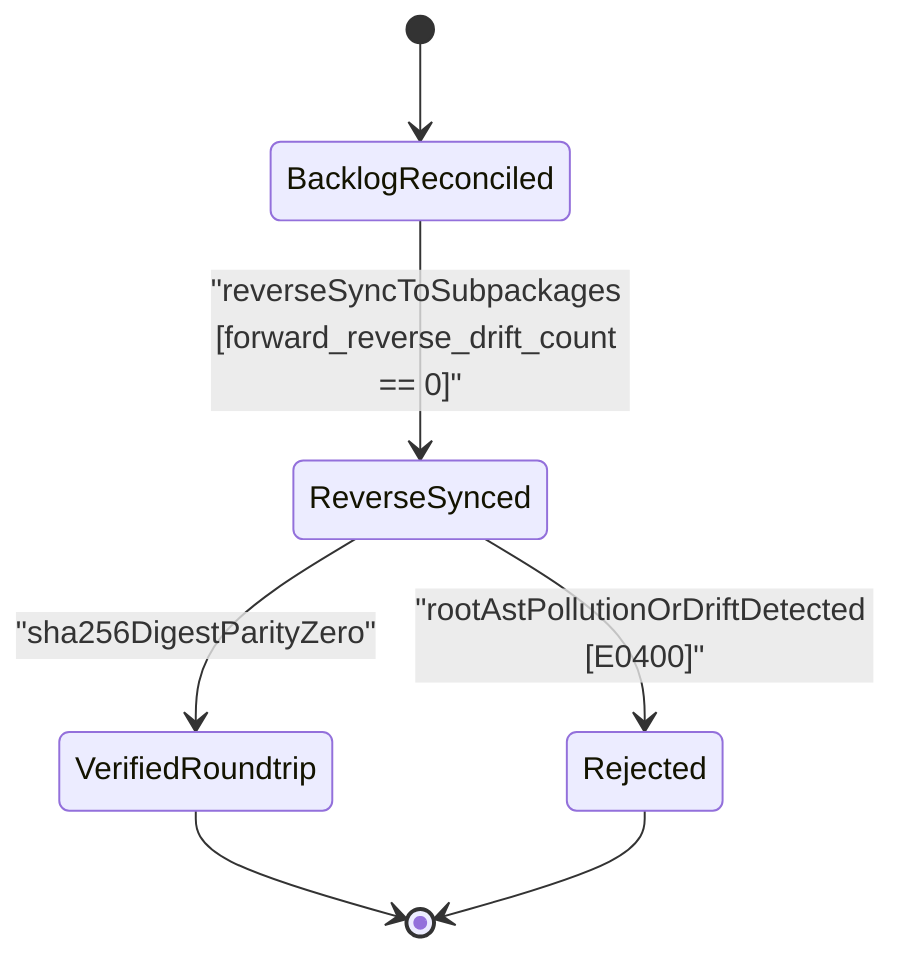

| Attribute | Specification Detail |
| :--- | :--- |
| **Issue ID** | #643 |
| **Title** | Use Case 20: Fail Closed Subpackage Scoped Reverse Sync and Dogfood Blueprint Ingestion Parity |
| **Type** | use-case |
| **Parent Epic** | [EPIC-04-BP_04_Deterministic_Specification_ICD_and_WBS_Forward_Compiler_Blueprint](../epics/EPIC-04-BP_04_Deterministic_Specification_ICD_and_WBS_Forward_Compiler_Blueprint.md) |
| **Schema Containers** | `BP_04_Deterministic_Specification_ICD_and_WBS_Forward_Compiler_Blueprint::BidirectionalBacklogReconciler` |
| **Primary Actor** | Operator_Or_CI_Runner |
| **Scope** | AgileSpecForwardProjector |
| **Level** | User Goal |
| **Generation Mode** | subagent |
| **Specification Source** | [schema/model.sysml](../../schema/model.sysml) |

# Use Case 20: Fail Closed Subpackage Scoped Reverse Sync and Dogfood Blueprint Ingestion Parity

## UML Diagrams

## 1. Actors
- **Primary Actor:** `Operator_Or_CI_Runner`
- **Secondary Actors:** `BidirectionalBacklogReconciler`, `DeterministicSpecIcdWbsForwardCompiler`, `AgileSpecForwardProjector`

## 2. Preconditions
- `BidirectionalBacklogReconciler` and `DeterministicSpecIcdWbsForwardCompiler` are initialized in state `BacklogReconciled` with lossless `pulldown-cmark` Markdown ASTs and `logos` + `rowan` + `salsa` SysML v2 CST/AST subpackages covering the full OMG SysML v2.0 + KerML 1.0 grammar (Contract A, zero 16-construct caps).
- `Operator_Or_CI_Runner` holds authorized operational access to `BidirectionalBacklogReconciler` and `DeterministicSpecIcdWbsForwardCompiler`.

## 3. Trigger
- `Operator_Or_CI_Runner` invokes `CompileSysmlReverseSyncDocs` (`compile-sysml --reverse-sync docs`).

## 4. Main Success Scenario
1. `Operator_Or_CI_Runner` invokes `CompileSysmlReverseSyncDocs` (`compile-sysml --reverse-sync docs`) on `BidirectionalBacklogReconciler` and `DeterministicSpecIcdWbsForwardCompiler` via `specDocsInOutPort` and `BP_04_ReconcilerToForwardCompilerConnection`.
2. `BidirectionalBacklogReconciler` parses `./docs/` specification Markdown ASTs via `pulldown-cmark` and `logos` + `rowan` + `salsa` (Contract B, zero hand-rolled scanners) across all OMG SysML v2.0 and KerML 1.0 Definition and Usage constructs (Contract A, zero 16-construct caps) and executes `MergeExtractedEntitiesIntoOwningSubpackages` to route each extracted entity into its owning `PackageDef` subpackage via `subpackageSyncOutPort`.
3. `DeterministicSpecIcdWbsForwardCompiler` transitions `BP_04_Deterministic_Specification_ICD_and_WBS_Forward_Compiler_Blueprint_LifecycleState` from `BacklogReconciled` to `ReverseSynced` while verifying zero root AST namespace pollution (`forward_reverse_drift_count == 0`).
4. `DeterministicSpecIcdWbsForwardCompiler` computes SHA-256 `SchemaDigest` parity between the forward-projected and reverse-synchronized `PackageDef` ASTs across all 6 workspace crates (`deap-core`, `compile-sysml`, `ingest-sysml`, `reconcile-backlog`, `verify-baseline`, `assemble-conops`) under `Invariant_REQ_0604_SC_02`.
5. Upon confirming `sha256DigestParityZero`, `DeterministicSpecIcdWbsForwardCompiler` transitions to `VerifiedRoundtrip`, persists the canonical SysML v2 model (`./schema/model.sysml`), and returns `Result::Ok` to `Operator_Or_CI_Runner`.

## 5. Alternate and Exception Flows
- 3a. Orphaned specification entity or root AST namespace pollution detected during `MergeExtractedEntitiesIntoOwningSubpackages` (`Diagnostic: E0400`, branches from step 2):
  1. `DeterministicSpecIcdWbsForwardCompiler` transitions to `Rejected` on `rootAstPollutionOrDriftDetected` and emits diagnostic `E0400` via `ariadne` / `miette`.
  2. `DeterministicSpecIcdWbsForwardCompiler` exits fail-closed with code 1 without modifying `./schema/model.sysml`.
- 4a. Non-zero SHA-256 digest drift (`forward_reverse_drift_count > 0`) after forward-then-reverse synchronization (branches from step 4):
  1. `DeterministicSpecIcdWbsForwardCompiler` identifies the divergent `PackageDef` or CST token span via `rowan` and `salsa`.
  2. `DeterministicSpecIcdWbsForwardCompiler` returns `Result::Err`, preserves prior verified `./schema/model.sysml` state without partial writes, and terminates fail-closed with exit code 1.
- 5a. Blueprint dogfood ingestion gate failure under `check-blueprint` or `ingest-sysml` (branches from step 5):
  1. `AgileSpecForwardProjector` detects a mismatch between blueprint 5-column derivation tables and the reverse-synced `PackageDef` subpackage.
  2. `AgileSpecForwardProjector` aborts execution, emits a structured `ariadne` / `miette` diagnostic to `Operator_Or_CI_Runner`, and exits fail-closed with code 1.

## 6. Postconditions
- **Success Guarantee:** `DeterministicSpecIcdWbsForwardCompiler` and `BidirectionalBacklogReconciler` reach `VerifiedRoundtrip` with `forward_reverse_drift_count == 0`, zero root AST namespace pollution, and bit-identical SHA-256 `SchemaDigest` parity.
- **Failure Guarantee:** On any `E0400` root AST pollution or SHA-256 parity mismatch, the compiler transitions to `Rejected` and preserves prior verified `./schema/model.sysml` and `./docs/` artifacts.

## 7. Architectural Realization (3-Layer Definition of Done)
- **Layer 1 (Domain State & Data Model):** Full OMG SysML v2.0 + KerML 1.0 `logos` + `rowan` + `salsa` `PackageDef` subpackage CST/AST trees (`deap_core::sysml_cst`, zero 16-construct caps), `pulldown-cmark::Event` Markdown AST streams, and SHA-256 `SchemaDigest` records across all 6 crates.
- **Layer 2 (Logic & State Management):** `CompileSysmlReverseSyncDocs` and `MergeExtractedEntitiesIntoOwningSubpackages` `salsa` queries enforcing `Invariant_REQ_0604_SC_01` and `Invariant_REQ_0604_SC_02` inside `< 380` executable SLOC submodules (`./crates/compile-sysml/src/forward_sync/`, `./crates/reconcile-backlog/src/table_cst/`) with explicit deletion of legacy hand-rolled reverse-sync string scanners (`-1,100+` SLOC net-negative ratchet).
- **Layer 3 (Presentation & Actuator Interface Binding):** Format-preserving `rowan` CST subpackage splicing across `subpackageSyncOutPort` and `pulldown-cmark-to-cmark` Markdown emission with `ariadne` / `miette` diagnostics (`E0400`).

## 8. Realization Matrix
| Specification Item | Type | Link / Reference |
| :--- | :--- | :--- |
| **#711** | User Story | [User Story 22: Compile Sysml Emit Icd Docs Interfaces](../user-stories/US-22-CompileSysmlEmitIcdDocsInterfaces.md) |
| **#718** | User Story | [User Story 29: Compile Sysml Reverse Sync Docs](../user-stories/US-29-CompileSysmlReverseSyncDocs.md) |
| **#719** | User Story | [User Story 30: Merge Extracted Entities Into Owning Subpackages](../user-stories/US-30-MergeExtractedEntitiesIntoOwningSubpackages.md) |
| **#670** | Feature | [Feature 16: [BP 04 Deterministic Specification ICD and WBS Forward Compiler Blueprint] AgileSpecForwardProjector](../features/FEAT-16-AgileSpecForwardProjector.md) |
| **#671** | Feature | [Feature 17: [BP 04 Deterministic Specification ICD and WBS Forward Compiler Blueprint] BidirectionalBacklogReconciler](../features/FEAT-17-BidirectionalBacklogReconciler.md) |
| **#672** | Feature | [Feature 18: [BP 04 Deterministic Specification ICD and WBS Forward Compiler Blueprint] DeterministicSpecIcdWbsForwardCompiler](../features/FEAT-18-DeterministicSpecIcdWbsForwardCompiler.md) |

### Required User Stories
- [ ] #711 - [User Story 22: Compile Sysml Emit Icd Docs Interfaces](../user-stories/US-22-CompileSysmlEmitIcdDocsInterfaces.md) (verifies interconnect parity across forward and reverse compilation)
- [ ] #718 - [User Story 29: Compile Sysml Reverse Sync Docs](../user-stories/US-29-CompileSysmlReverseSyncDocs.md) (executes compile-sysml --reverse-sync docs via pulldown-cmark and rowan)
- [ ] #719 - [User Story 30: Merge Extracted Entities Into Owning Subpackages](../user-stories/US-30-MergeExtractedEntitiesIntoOwningSubpackages.md) (merges extracted entities into owning PackageDef subpackages without root pollution)

### Required Features
- [ ] #670 - [Feature 16: [BP 04 Deterministic Specification ICD and WBS Forward Compiler Blueprint] AgileSpecForwardProjector](../features/FEAT-16-AgileSpecForwardProjector.md) (maintains forward/reverse AST projection symmetry)
- [ ] #671 - [Feature 17: [BP 04 Deterministic Specification ICD and WBS Forward Compiler Blueprint] BidirectionalBacklogReconciler](../features/FEAT-17-BidirectionalBacklogReconciler.md) (extracts specification entities and merges them into owning subpackages)
- [ ] #672 - [Feature 18: [BP 04 Deterministic Specification ICD and WBS Forward Compiler Blueprint] DeterministicSpecIcdWbsForwardCompiler](../features/FEAT-18-DeterministicSpecIcdWbsForwardCompiler.md) (verifies forward_reverse_drift_count == 0 and SHA-256 SchemaDigest parity)

## Source References
Use case operational flows and lifecycle activity references:
- System Architecture Model: `schema/model.sysml`
- Normative Systems Engineering Standard: ISO/IEC/IEEE 29148:2018 §6.4.2 Concept of Operations

Operational use case realization and traceability links derive from `schema/model.sysml` pursuant to ISO/IEC/IEEE 29148.
