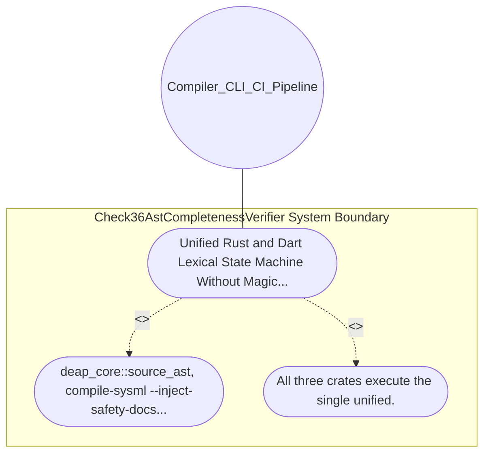

| Attribute | Specification Detail |
| :--- | :--- |
| **Issue ID** | #644 |
| **Title** | Use Case 21: Unified Rust and Dart Lexical State Machine Without Magic Offsets |
| **Type** | use-case |
| **Primary Actor** | Compiler_CLI_CI_Pipeline |
| **Scope** | Check36AstCompletenessVerifier |
| **Level** | User Goal |
| **Generation Mode** | subagent |
| **Specification Source** | [schema/model.sysml](../../schema/model.sysml) |

# Use Case 21: Unified Rust and Dart Lexical State Machine Without Magic Offsets

## UML Diagrams

## 1. Actors
- `Compiler_CLI_CI_Pipeline`

## 2. Preconditions
- .rs and .dart source files containing nested / * outer / * inner * / * / block comments, hashed raw strings r#\"...\"# and r##\"...\"##, Rust string literals containing \"{\", Dart interpolated strings \"value: {map['key']}\" containing nested quotes and comments, multi-byte UTF-8 character literals '↑', and multiple short lifetimes fn foo<'a, 'b>(x: &'a str, y: &'b str) within 10 bytes.

## 3. Trigger
- deap_core::source_ast, compile-sysml --inject-safety-docstrings, and verify-baseline Check 36 scan the files.

## 4. Main Success Scenario
1. deap_core::source_ast, compile-sysml --inject-safety-docstrings, and verify-baseline Check 36 scan the files.
2. All three crates execute the single unified.

## 5. Alternate and Exception Flows
- Precondition guard failure in `Check36AstCompletenessVerifier`:
  - `Check36AstCompletenessVerifier` rejects the `Unified Rust and Dart Lexical State Machine Without Magic Offsets` request without partial state mutation and reports diagnostic status to `Compiler_CLI_CI_Pipeline`.
- Invariant violation while enforcing `Unified Rust and Dart Lexical State Machine Without Magic Offsets`:
  - `Check36AstCompletenessVerifier` aborts `Unified Rust and Dart Lexical State Machine Without Magic Offsets` execution, preserves prior verified state, and notifies `Compiler_CLI_CI_Pipeline`.

## 6. Postconditions
- All three crates execute the single unified.

## 8. Realization Matrix
| Specification Item | Type | Link / Reference |
| :--- | :--- | :--- |
| **#720** | User Story | [User Story 31: Run Compile Sysml Inject Safety Docstrings](../user-stories/US-31-RunCompileSysmlInjectSafetyDocstrings.md) |
| **#678** | Feature | [Feature 21: [BP 05 Unified AST Safety Docstring Synthesizer and Check 36 Verification Blueprint] Check36AstCompletenessVerifier](../features/FEAT-21-Check36AstCompletenessVerifier.md) |

## Source References
Use case operational flows and lifecycle activity references:
- System Architecture Model: `schema/model.sysml`
- Normative Systems Engineering Standard: ISO/IEC/IEEE 29148:2018 §6.4.2 Concept of Operations

Operational use case realization and traceability links derive from `schema/model.sysml` pursuant to ISO/IEC/IEEE 29148.
