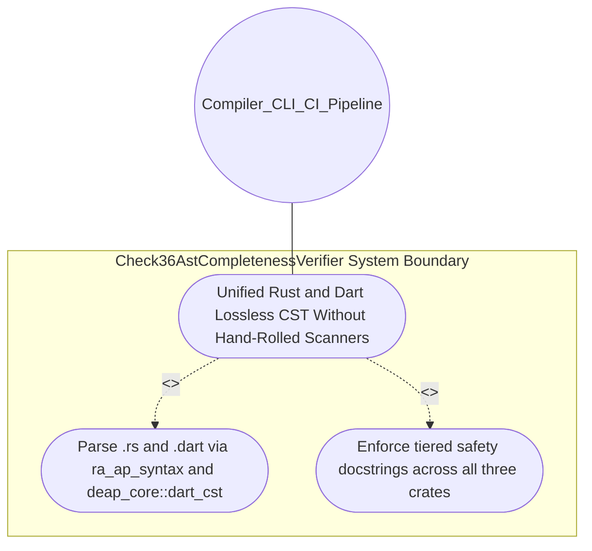

| Attribute | Specification Detail |
| :--- | :--- |
| **Issue ID** | #644 |
| **Title** | Use Case 21: Unified Rust and Dart Lexical State Machine Without Magic Offsets |
| **Type** | use-case |
| **Primary Actor** | Compiler_CLI_CI_Pipeline |
| **Scope** | Check36AstCompletenessVerifier |
| **Level** | User Goal |
| **Generation Mode** | subagent |
| **Specification Source** | [schema/model.sysml](../../schema/model.sysml) |

# Use Case 21: Unified Rust and Dart Lexical State Machine Without Magic Offsets

## UML Diagrams

## 1. Actors
- `Compiler_CLI_CI_Pipeline`

## 2. Preconditions
- `.rs` and `.dart` source files containing nested block comments, hashed raw strings `r#"..."#` and `r##"..."##`, Rust string literals containing `"{"`, Dart interpolated strings `"value: ${map['key']}"` containing nested quotes and comments, multi-byte UTF-8 character literals `'↑'`, and multiple short lifetimes `fn foo<'a, 'b>(x: &'a str, y: &'b str)` bound under **Contract A (100% Normative OMG SysML v2.0 + KerML 1.0 Grammar Coverage -- Zero 16-Construct Caps)** to a full OMG SysML v2.0 + KerML 1.0 model.

## 3. Trigger
- Under **Contract B (Official Rust Compiler & `rust-analyzer` Crate Stack -- Zero Hand-Rolled Scanners)**, `deap_core::rust_cst` (`ra_ap_syntax` `ast::HasDocComments`, `ast::HasAttrs`, `ra_ap_line_index`, `ra_ap_text_edit`), `deap_core::dart_cst` (`logos` + `rowan` + `salsa` + `ariadne`), `compile-sysml --inject-safety-docstrings`, and `verify-baseline` Check 36 parse the files with zero hand-rolled scanners.

## 4. Main Success Scenario
1. `Compiler_CLI_CI_Pipeline` invokes `RunCompileSysmlInjectSafetyDocstrings` and `RunVerifyBaselineNoDomain` across `.rs` and `.dart` source files containing nested block comments, hashed raw strings, interpolated Dart strings, multi-byte UTF-8 character literals, and multiple lifetimes.
2. `UnifiedRustDartCstParser` executes `ParseSourceCstViaRustAndDartCst` and `TokenizeRsAndDartFilesUsing` in `deap_core::rust_cst` and `deap_core::dart_cst` using `ra_ap_syntax` (`ast::HasDocComments`, `ast::HasAttrs`), `ra_ap_text_edit`, `ra_ap_line_index`, `logos`, `rowan`, `salsa`, and `ariadne` with zero hand-rolled string/line/char-by-char scanners.
3. `UnifiedRustDartCstParser` extracts lossless CST nodes and trivia frames in linear `O(B)` time, binding to full OMG SysML v2.0 + KerML 1.0 AST constructs (`package`/`library package`/`standard library package`, `part def`/`part`, `item def`/`item`, `attribute def`/`attribute`, `enum def`/`enum`, `port def`/`port`, `connection def`/`connection`, `interface def`/`interface`, `flow def`/`flow`, `allocation def`/`allocation`, `occurrence def`/`occurrence`, `action def`/`action`, `state def`/`state`, `calc def`/`calc`, `constraint def`/`constraint`, `requirement def`/`requirement`, `concern def`/`concern`, `use case def`/`use case`, `analysis def`/`analysis`, `verification def`/`verification`, `test case def`/`test case`, `interaction def`/`interaction`, `view def`/`view`, `viewpoint def`/`viewpoint`, `rendering def`/`rendering`, `variation`/`variant`, `metadata def`/`@Metadata`/`#user_keyword` (`#hazard`, `#risk`, `#capability`, `#rt_loop`, `#dal`, `#fls`), and KerML specialization `:`, `:>`, `:>>`, `::>`, `~`, `ISQ`/`SI`/`ScalarValues`, zero 16-construct caps).
4. `UnifiedSafetyDocstringSynthesizer` and `Check36AstCompletenessVerifier` consume the resulting CST declaration items (`source_cst_in` on `BP_05_SafetyDocstringPortDef`) across all three workspace crates (`deap-core`, `compile-sysml`, `verify-baseline`) to synthesize and verify `<= 4`-line Tier-B/C `[REQ-*]`/`[FLS: fls_*]` docstrings on internal declarations and explicit `[DOC-TIER: A]` 7-section docstrings on `pub` crate entrypoints and `unsafe`/`extern` blocks.
5. `Check36AstCompletenessVerifier` confirms 100% lossless CST parity across `deap-core`, `compile-sysml`, and `verify-baseline` and emits `true` on `docstring_verdict_out` with exit code 0.

## 5. Alternate and Exception Flows
- 3a. Unterminated nested block comment or hashed raw string literal in source input:
  - `UnifiedRustDartCstParser` returns `Result::Err` with a byte-exact `ariadne` / `miette` span diagnostic (`E0100`) and halts execution fail-closed with exit code 1.
- 4a. Invalid UTF-8 byte sequence encountered while scanning `.rs` or `.dart` files:
  - `UnifiedRustDartCstParser` aborts CST extraction without partial file mutation, emits a deterministic `miette` I/O error to `Compiler_CLI_CI_Pipeline`, and exits fail-closed with code 1.
- 5a. Invariant violation under `Invariant_REQ_0605_Under_REQ_0605_and_parametric_constraints_C_DOC_01_through_C_DOC_04_lexical_scanning_schema_context_resolution_and_forward_docstring_injection_satisfy_the_following_linear_complexity_and_idempotency_bounds`:
  - `Check36AstCompletenessVerifier` aborts verification, preserves prior verified state, sets `docstring_verdict_out` to `false`, and exits fail-closed with code 1.

## 6. Postconditions
- **Success Guarantee**: All three crates (`deap-core`, `compile-sysml`, and `verify-baseline`) execute the unified `ra_ap_syntax` (`ast::HasDocComments`, `ast::HasAttrs`) + `ra_ap_text_edit` + `ra_ap_line_index` and `deap_core::dart_cst` (`logos` + `rowan` + `salsa` + `ariadne`) lossless CST pipeline with zero hand-rolled scanners, enforcing `<= 4`-line Tier-B/C `[REQ-*]`/`[FLS: fls_*]` docstrings and explicit `[DOC-TIER: A]` entrypoints.
- **Failure Guarantee**: Source files remain unmutated on CST or invariant errors, and `verify-baseline` exits fail-closed with non-zero status.
- **3-Layer Definition of Done (DoD)**:
  - **Layer 1 (Domain State & Data Model)**: Lossless CST token/trivia representation (`ra_ap_syntax`, `rowan`, `logos`, `salsa`) with full OMG SysML v2.0 + KerML 1.0 grammar coverage (zero 16-construct caps).
  - **Layer 2 (Logic & State Management)**: Tiered docstring synthesis and Check 36 verification inside `< 380`-SLOC submodules (`./crates/compile-sysml/src/safety_docstrings/`, `./crates/deap-core/src/rust_cst/`, `./crates/deap-core/src/dart_cst/`) with explicit deletion of legacy hand-rolled line/char-by-char lexical scanners (`-800+` SLOC retired).
  - **Layer 3 (Presentation & Actuator Interface Binding)**: CLI bindings (`compile-sysml --inject-safety-docstrings`, `verify-baseline . --no-domain`) and `ariadne`/`miette` byte-span diagnostics.

## 8. Realization Matrix
| Specification Item | Type | Link / Reference |
| :--- | :--- | :--- |
| **#720** | User Story | [User Story 31: Run Compile Sysml Inject Safety Docstrings](../user-stories/US-31-RunCompileSysmlInjectSafetyDocstrings.md) |
| **#678** | Feature | [Feature 21: [BP 05 Unified AST Safety Docstring Synthesizer and Check 36 Verification Blueprint] Check36AstCompletenessVerifier](../features/FEAT-21-Check36AstCompletenessVerifier.md) |

## Source References
Use case operational flows and lifecycle activity references:
- System Architecture Model: `schema/model.sysml`
- Normative Systems Engineering Standard: ISO/IEC/IEEE 29148:2018 §6.4.2 Concept of Operations

Operational use case realization and traceability links derive from `schema/model.sysml` pursuant to ISO/IEC/IEEE 29148.
