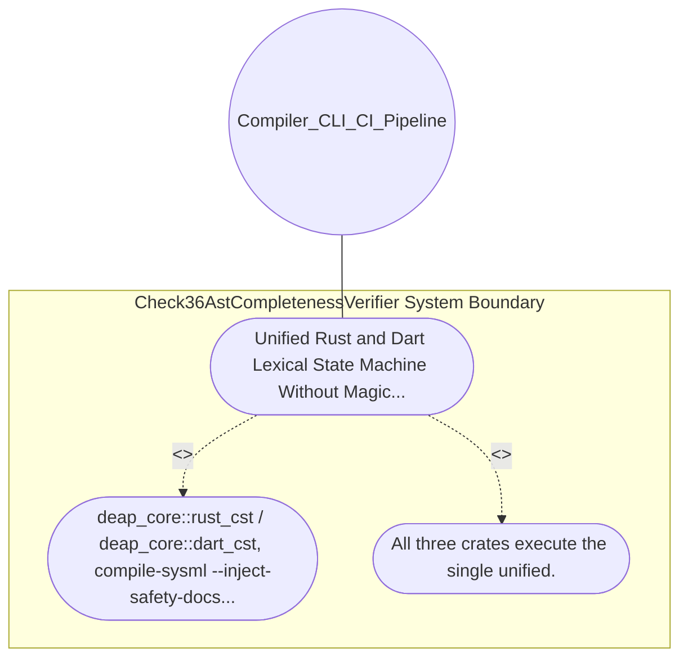

| Attribute | Specification Detail |
| :--- | :--- |
| **Issue ID** | #644 |
| **Title** | Use Case 21: Unified Rust and Dart Lexical State Machine Without Magic Offsets |
| **Type** | use-case |
| **Primary Actor** | Compiler_CLI_CI_Pipeline |
| **Scope** | Check36AstCompletenessVerifier |
| **Level** | User Goal |
| **Generation Mode** | subagent |
| **Specification Source** | [schema/model.sysml](../../schema/model.sysml) |

# Use Case 21: Unified Rust and Dart Lexical State Machine Without Magic Offsets

## UML Diagrams

## 1. Actors
- `Compiler_CLI_CI_Pipeline`

## 2. Preconditions
- .rs and .dart source files containing nested / * outer / * inner * / * / block comments, hashed raw strings r#\"...\"# and r##\"...\"##, Rust string literals containing \"{\", Dart interpolated strings \"value: {map['key']}\" containing nested quotes and comments, multi-byte UTF-8 character literals '↑', and multiple short lifetimes fn foo<'a, 'b>(x: &'a str, y: &'b str) within 10 bytes.

## 3. Trigger
- deap_core::rust_cst / deap_core::dart_cst, compile-sysml --inject-safety-docstrings, and verify-baseline Check 36 scan the files.

## 4. Main Success Scenario
1. `Compiler_CLI_CI_Pipeline` invokes `RunCompileSysmlInjectSafetyDocstrings` and `RunVerifyBaselineNoDomain` across `.rs` and `.dart` source files containing nested block comments, hashed raw strings, interpolated Dart strings, multi-byte UTF-8 character literals, and multiple lifetimes within 10 bytes.
2. `UnifiedRustDartCstParser` executes `ParseSourceCstViaRustAndDartCst` and `TokenizeRsAndDartFilesUsing` in `deap_core_rust_and_dart_cst` using `ra_ap_syntax`, `logos`, `rowan`, and `syn`.
3. `UnifiedRustDartCstParser` disambiguates multi-byte UTF-8 character literals from lifetime annotations and tracks nested comment and raw-string frames in linear `O(B)` time without magic byte offsets.
4. `UnifiedSafetyDocstringSynthesizer` and `Check36AstCompletenessVerifier` consume the resulting CST declaration items (`source_cst_in` on `BP_05_SafetyDocstringPortDef`) across all three workspace crates using the single shared lexical state machine.
5. `Check36AstCompletenessVerifier` confirms 100% lexical parity across `deap-core`, `compile-sysml`, and `verify-baseline` and emits `true` on `docstring_verdict_out` with exit code 0.

## 5. Alternate and Exception Flows
- 3a. Unterminated nested block comment or hashed raw string literal in source input:
  - `UnifiedRustDartCstParser` returns `Result::Err` with a byte-exact `ariadne` / `miette` span diagnostic (`E0100`) and halts execution fail-closed with exit code 1.
- 4a. Invalid UTF-8 byte sequence encountered while scanning `.rs` or `.dart` files:
  - `UnifiedRustDartCstParser` aborts CST extraction without partial file mutation, emits a deterministic `miette` I/O error to `Compiler_CLI_CI_Pipeline`, and exits fail-closed with code 1.
- 5a. Invariant violation under `Invariant_REQ_0605_Under_REQ_0605_and_parametric_constraints_C_DOC_01_through_C_DOC_04_lexical_scanning_schema_context_resolution_and_forward_docstring_injection_satisfy_the_following_linear_complexity_and_idempotency_bounds`:
  - `Check36AstCompletenessVerifier` aborts verification, preserves prior verified state, sets `docstring_verdict_out` to `false`, and exits fail-closed with code 1.

## 6. Postconditions
- All three crates execute the single unified.

## 8. Realization Matrix
| Specification Item | Type | Link / Reference |
| :--- | :--- | :--- |
| **#720** | User Story | [User Story 31: Run Compile Sysml Inject Safety Docstrings](../user-stories/US-31-RunCompileSysmlInjectSafetyDocstrings.md) |
| **#678** | Feature | [Feature 21: [BP 05 Unified AST Safety Docstring Synthesizer and Check 36 Verification Blueprint] Check36AstCompletenessVerifier](../features/FEAT-21-Check36AstCompletenessVerifier.md) |

## Source References
Use case operational flows and lifecycle activity references:
- System Architecture Model: `schema/model.sysml`
- Normative Systems Engineering Standard: ISO/IEC/IEEE 29148:2018 §6.4.2 Concept of Operations

Operational use case realization and traceability links derive from `schema/model.sysml` pursuant to ISO/IEC/IEEE 29148.
