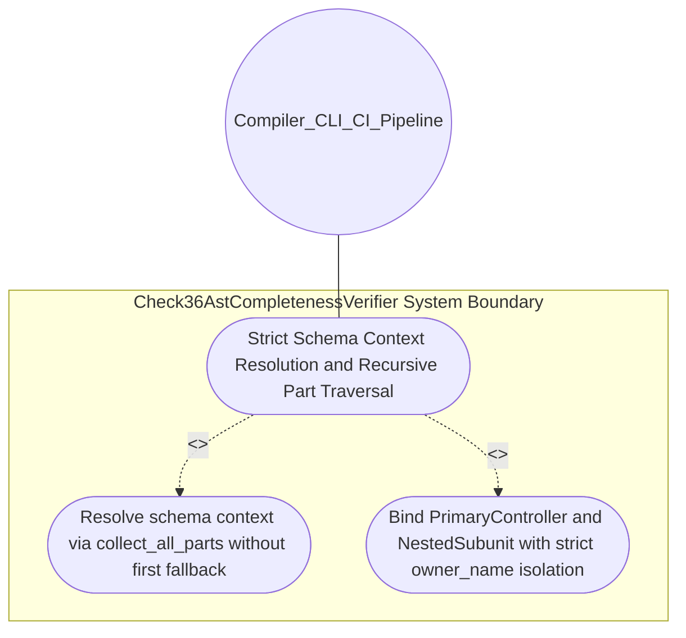

| Attribute | Specification Detail |
| :--- | :--- |
| **Issue ID** | #645 |
| **Title** | Use Case 22: Strict Schema Context Resolution and Recursive Part Traversal |
| **Type** | use-case |
| **Primary Actor** | Compiler_CLI_CI_Pipeline |
| **Scope** | Check36AstCompletenessVerifier |
| **Level** | User Goal |
| **Generation Mode** | subagent |
| **Specification Source** | [schema/model.sysml](../../schema/model.sysml) |

# Use Case 22: Strict Schema Context Resolution and Recursive Part Traversal

## UML Diagrams

## 1. Actors
- `Compiler_CLI_CI_Pipeline`

## 2. Preconditions
- A multi-part OMG SysML v2.0 + KerML 1.0 `package` / `library package` / `standard library package` model under **Contract A (100% Normative OMG SysML v2.0 + KerML 1.0 Grammar Coverage -- Zero 16-Construct Caps)** containing `PrimaryController` (`REQ-PC-001`, constraint `ThermalLimit`), a nested `part def` `NestedSubunit` (`REQ-NS-002`) inside `SecondaryMonitor.parts`, and an unmapped Rust struct `SecondaryMonitor` with method `pub fn primary_controller(&self)` and free function `pub fn unmapped_helper()`.

## 3. Trigger
- `resolve_schema_context` (`ResolveSchemaContextViaCollectAll`) is invoked under **Contract B (Official Rust Compiler & `rust-analyzer` Crate Stack -- Zero Hand-Rolled Scanners)** during `compile-sysml --inject-safety-docstrings`.

## 4. Main Success Scenario
1. `Compiler_CLI_CI_Pipeline` invokes `RunCompileSysmlInjectSafetyDocstrings` (`compile-sysml --inject-safety-docstrings`), transitioning `BP_05_Unified_AST_Safety_Docstring_Synthesizer_and_Check_36_Verification_Blueprint_LifecycleState` to `ScopedSchemaContextResolver_State`.
2. `ScopedSchemaContextResolver` parses the full OMG SysML v2.0 + KerML 1.0 `package` hierarchy (`part def`/`part`, `item def`/`item`, `attribute def`/`attribute`, `enum def`/`enum`, `port def`/`port`, `connection def`/`connection`, `interface def`/`interface`, `flow def`/`flow`, `allocation def`/`allocation`, `occurrence def`/`occurrence`, `action def`/`action`, `state def`/`state`, `calc def`/`calc`, `constraint def`/`constraint`, `requirement def`/`requirement`, `concern def`/`concern`, `use case def`/`use case`, `analysis def`/`analysis`, `verification def`/`verification`, `test case def`/`test case`, `interaction def`/`interaction`, `view def`/`view`, `viewpoint def`/`viewpoint`, `rendering def`/`rendering`, `variation`/`variant`, `metadata def`/`@Metadata`/`#user_keyword` (`#hazard`, `#risk`, `#capability`, `#rt_loop`, `#dal`, `#fls`), KerML specialization `:`, `:>`, `:>>`, `::>`, `~`, `ISQ`/`SI`/`ScalarValues`, zero 16-construct caps) via `deap_core::sysml_cst` (`logos` + `rowan` + `salsa`) and extracts Rust/Dart CST declaration items (`owner_name`, method names, parameters) via `ParseSourceCstViaRustAndDartCst` (`ra_ap_syntax` (`ast::HasDocComments`, `ast::HasAttrs`), `ra_ap_text_edit`, `ra_ap_line_index`, and `deap_core::dart_cst`) with zero hand-rolled scanners.
3. `ScopedSchemaContextResolver` executes `ResolveSchemaContextViaCollectAll` (`collect_all_parts`) to traverse top-level and nested `PartDef.parts` trees recursively without `.first()` fallback pollution.
4. `ScopedSchemaContextResolver` binds `PrimaryController` to `REQ-PC-001` and `ThermalLimit`, resolves nested `NestedSubunit` to `REQ-NS-002` via `collect_all_parts`, and isolates `SecondaryMonitor::primary_controller` and `unmapped_helper` via `owner_name` scoping for `<= 4`-line Tier-B/C `[REQ-*]`/`[FLS: fls_*]` docstrings and explicit `[DOC-TIER: A]` entrypoints.
5. `ScopedSchemaContextResolver` routes the resolved context across `BP_05_ContextToDocstringGeneratorConnection` (`resolved_context_out` to `SevenSectionDocstringGenerator.schema_context_in`) and transitions to `SevenSectionDocstringGenerator_State`.

## 5. Alternate and Exception Flows
- 3a. Ambiguous or cyclic nested `PartDef.parts` hierarchy encountered during `ResolveSchemaContextViaCollectAll`:
  - `ScopedSchemaContextResolver` returns `Result::Err` with a structured `ariadne` / `miette` diagnostic (`E0100`) and terminates fail-closed with exit code 1.
- 4a. Unmapped declaration attempts to inherit an unrelated component's requirement via `.first()` fallback:
  - `ScopedSchemaContextResolver` rejects the cross-owner fallback binding, preserves strict `owner_name` isolation, and emits a deterministic `miette` diagnostic with exit code 1.
- 5a. Invariant violation under `Invariant_REQ_0605_Under_REQ_0605_and_parametric_constraints_C_DOC_01_through_C_DOC_04_lexical_scanning_schema_context_resolution_and_forward_docstring_injection_satisfy_the_following_linear_complexity_and_idempotency_bounds`:
  - `Check36AstCompletenessVerifier` aborts execution without partial state mutation, preserves prior verified state, and notifies `Compiler_CLI_CI_Pipeline` with fail-closed exit status 1.

## 6. Postconditions
- **Success Guarantee**: `PrimaryController` resolves `REQ-PC-001` and `ThermalLimit`, `NestedSubunit` resolves `REQ-NS-002` via `collect_all_parts`, and both `SecondaryMonitor::primary_controller` and `unmapped_helper` remain isolated from cross-owner `.first()` fallback pollution while emitting `<= 4`-line Tier-B/C `[REQ-*]`/`[FLS: fls_*]` docstrings or `[DOC-TIER: A]` entrypoints via `ra_ap_text_edit` + `ra_ap_line_index`.
- **Failure Guarantee**: Cross-owner or cyclic resolution errors halt synthesis fail-closed with zero file mutations.
- **3-Layer Definition of Done (DoD)**:
  - **Layer 1 (Domain State & Data Model)**: Recursive `deap_core::sysml_cst` AST context model with full OMG SysML v2.0 + KerML 1.0 construct coverage (zero 16-construct caps) and `ra_ap_syntax` (`ast::HasDocComments`, `ast::HasAttrs`) declaration AST.
  - **Layer 2 (Logic & State Management)**: Strict `owner_name` and `collect_all_parts` resolution inside `< 380`-SLOC submodules (`./crates/compile-sysml/src/safety_docstrings/`, `./crates/deap-core/src/rust_cst/`, `./crates/deap-core/src/dart_cst/`) with explicit deletion of legacy hand-rolled scanners (`-800+` SLOC retired).
  - **Layer 3 (Presentation & Actuator Interface Binding)**: Context routing over `BP_05_ContextToDocstringGeneratorConnection` and `ariadne`/`miette` diagnostics.

## 8. Realization Matrix
| Specification Item | Type | Link / Reference |
| :--- | :--- | :--- |
| **#721** | User Story | [User Story 32: Parse Source Cst Via Rust And Dart Cst](../user-stories/US-32-ParseSourceCstViaRustAndDartCst.md) |
| **#678** | Feature | [Feature 21: [BP 05 Unified AST Safety Docstring Synthesizer and Check 36 Verification Blueprint] Check36AstCompletenessVerifier](../features/FEAT-21-Check36AstCompletenessVerifier.md) |

## Source References
Use case operational flows and lifecycle activity references:
- System Architecture Model: `schema/model.sysml`
- Normative Systems Engineering Standard: ISO/IEC/IEEE 29148:2018 §6.4.2 Concept of Operations

Operational use case realization and traceability links derive from `schema/model.sysml` pursuant to ISO/IEC/IEEE 29148.
