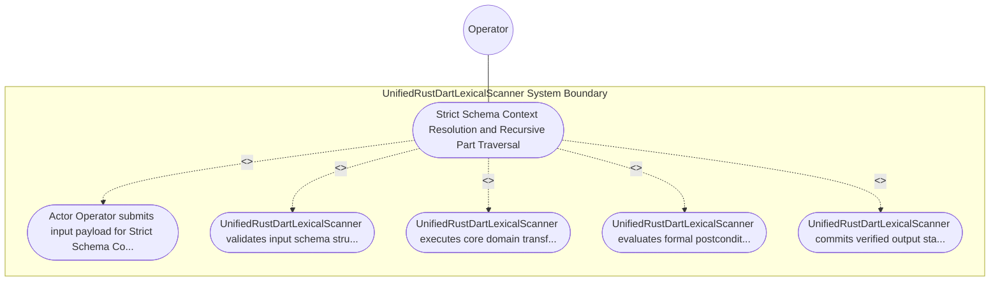

| Attribute | Specification Detail |
| :--- | :--- |
| **Issue ID** | #645 |
| **Title** | Use Case 22: Strict Schema Context Resolution and Recursive Part Traversal |
| **Type** | use-case |
| **Primary Actor** | Operator |
| **Scope** | UnifiedRustDartLexicalScanner |
| **Level** | User Goal |
| **Generation Mode** | subagent |
| **Specification Source** | [schema/model.sysml](../../schema/model.sysml) |

# Use Case 22: Strict Schema Context Resolution and Recursive Part Traversal

## UML Diagrams

## 1. Actors
- `Operator`

## 2. Preconditions
- The compiler execution environment is initialized in nominal operational state.
- Authoritative input schema files exist with read access.

## 3. Trigger
- Strict Schema Context Resolution and Recursive Part Traversal

## 4. Main Success Scenario
1. Actor `Operator` submits input payload for `Strict Schema Context Resolution and Recursive Part Traversal` to `UnifiedRustDartLexicalScanner`.
2. `UnifiedRustDartLexicalScanner` validates input schema structure and precondition guards for `Strict Schema Context Resolution and Recursive Part Traversal`.
3. `UnifiedRustDartLexicalScanner` executes core domain transformation and state transition logic for `Strict Schema Context Resolution and Recursive Part Traversal`.
4. `UnifiedRustDartLexicalScanner` evaluates formal postcondition assertions and structural invariants.
5. `UnifiedRustDartLexicalScanner` commits verified output state and emits completion telemetry to `Operator`.

## 5. Alternate and Exception Flows
- 5a. Input schema or precondition validation failure in `UnifiedRustDartLexicalScanner`:
  - `UnifiedRustDartLexicalScanner` rejects the malformed request and records a structured diagnostic event.
  - System preserves prior verified state without partial mutation.
- 5b. Formal invariant or constraint violation detected during `Strict Schema Context Resolution and Recursive Part Traversal` execution:
  - `UnifiedRustDartLexicalScanner` aborts the active transaction and transitions to safe fallback mode.
  - Diagnostic telemetry is emitted to `Operator`.
- 5c. Downstream resource timeout or communication fault in `UnifiedRustDartLexicalScanner`:
  - `UnifiedRustDartLexicalScanner` halts execution cleanly and reports deterministic fault status.

## 6. Postconditions
- All semantic models and generated artifacts satisfy formal invariant requirements.
- Output artifacts are deterministically emitted with bitwise reproducibility.

## 8. Realization Matrix
| Specification Item | Type | Link / Reference |
| :--- | :--- | :--- |
| **#602** | User Story | [User Story 41: [UnifiedRustDartLexicalScanner] Run](../user-stories/US-41-Run.md) |
| **#675** | Feature | [Feature 21: [BP 05 Unified AST Safety Docstring Synthesizer and Check 36 Verification Blueprint] UnifiedRustDartLexicalScanner](../features/FEAT-21-UnifiedRustDartLexicalScanner.md) |

## Source References
Use case operational flows and lifecycle activity references:
- System Architecture Model: `schema/model.sysml`
- Normative Systems Engineering Standard: ISO/IEC/IEEE 29148:2018 §6.4.2 Concept of Operations

Operational use case realization and traceability links derive from `schema/model.sysml` pursuant to ISO/IEC/IEEE 29148.
