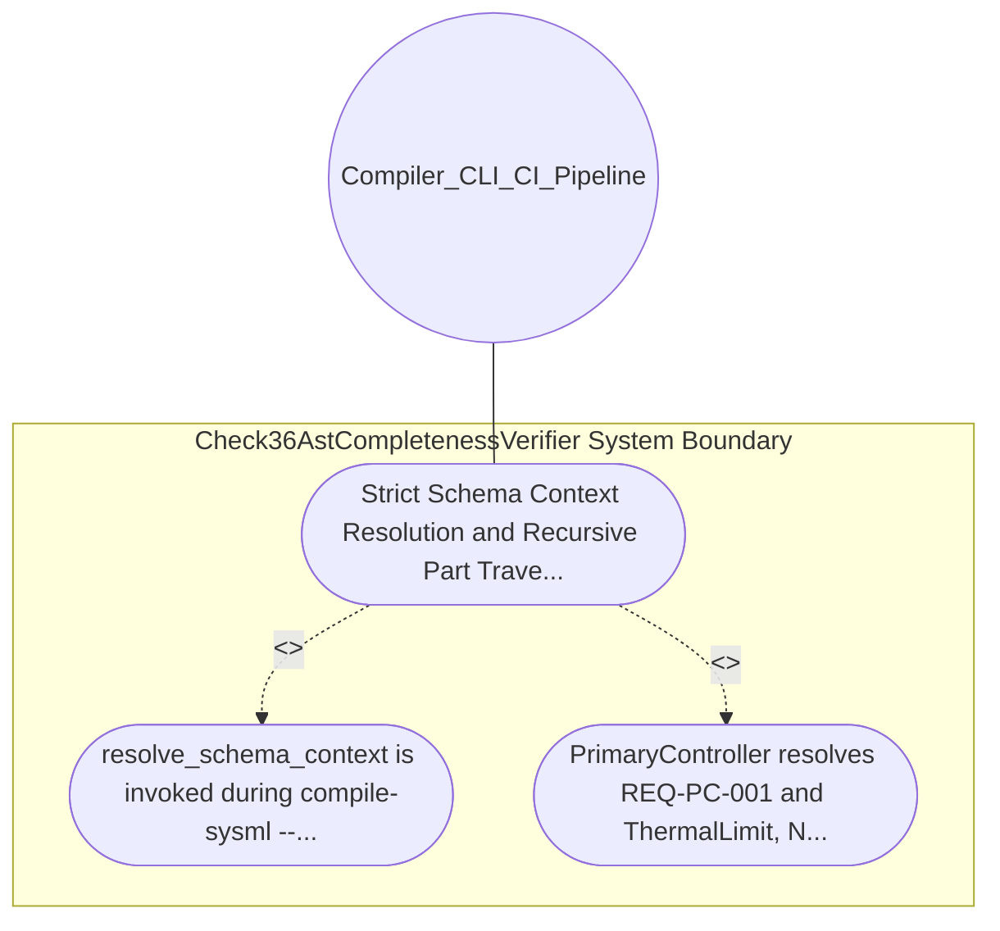

| Attribute | Specification Detail |
| :--- | :--- |
| **Issue ID** | #645 |
| **Title** | Use Case 22: Strict Schema Context Resolution and Recursive Part Traversal |
| **Type** | use-case |
| **Primary Actor** | Compiler_CLI_CI_Pipeline |
| **Scope** | Check36AstCompletenessVerifier |
| **Level** | User Goal |
| **Generation Mode** | subagent |
| **Specification Source** | [schema/model.sysml](../../schema/model.sysml) |

# Use Case 22: Strict Schema Context Resolution and Recursive Part Traversal

## UML Diagrams

## 1. Actors
- `Compiler_CLI_CI_Pipeline`

## 2. Preconditions
- A multi-part SysML v2 PackageDef containing PrimaryController (REQ-PC-001, constraint ThermalLimit), a nested PartDef NestedSubunit (REQ-NS-002) inside SecondaryMonitor.parts, and an unmapped Rust struct SecondaryMonitor with method pub fn primary_controller(&self) and free function pub fn unmapped_helper().

## 3. Trigger
- resolve_schema_context is invoked during compile-sysml --inject-safety-docstrings.

## 4. Main Success Scenario
1. resolve_schema_context is invoked during compile-sysml --inject-safety-docstrings.
2. PrimaryController resolves REQ-PC-001 and ThermalLimit, NestedSubunit resolves REQ-NS-002 via collect_all_parts, and both SecondaryMonitor::primary_controller and.

## 5. Alternate and Exception Flows
- Precondition guard failure in `Check36AstCompletenessVerifier`:
  - `Check36AstCompletenessVerifier` rejects the `Strict Schema Context Resolution and Recursive Part Traversal` request without partial state mutation and reports diagnostic status to `Compiler_CLI_CI_Pipeline`.
- Invariant violation while enforcing `Strict Schema Context Resolution and Recursive Part Traversal`:
  - `Check36AstCompletenessVerifier` aborts `Strict Schema Context Resolution and Recursive Part Traversal` execution, preserves prior verified state, and notifies `Compiler_CLI_CI_Pipeline`.

## 6. Postconditions
- PrimaryController resolves REQ-PC-001 and ThermalLimit, NestedSubunit resolves REQ-NS-002 via collect_all_parts, and both SecondaryMonitor::primary_controller and.

## 8. Realization Matrix
| Specification Item | Type | Link / Reference |
| :--- | :--- | :--- |
| **#721** | User Story | [User Story 32: Scan Source Lines Via Rust Dart Lex State And](../user-stories/US-32-ScanSourceLinesViaRustDartLexStateAnd.md) |
| **#678** | Feature | [Feature 21: [BP 05 Unified AST Safety Docstring Synthesizer and Check 36 Verification Blueprint] Check36AstCompletenessVerifier](../features/FEAT-21-Check36AstCompletenessVerifier.md) |

## Source References
Use case operational flows and lifecycle activity references:
- System Architecture Model: `schema/model.sysml`
- Normative Systems Engineering Standard: ISO/IEC/IEEE 29148:2018 §6.4.2 Concept of Operations

Operational use case realization and traceability links derive from `schema/model.sysml` pursuant to ISO/IEC/IEEE 29148.
