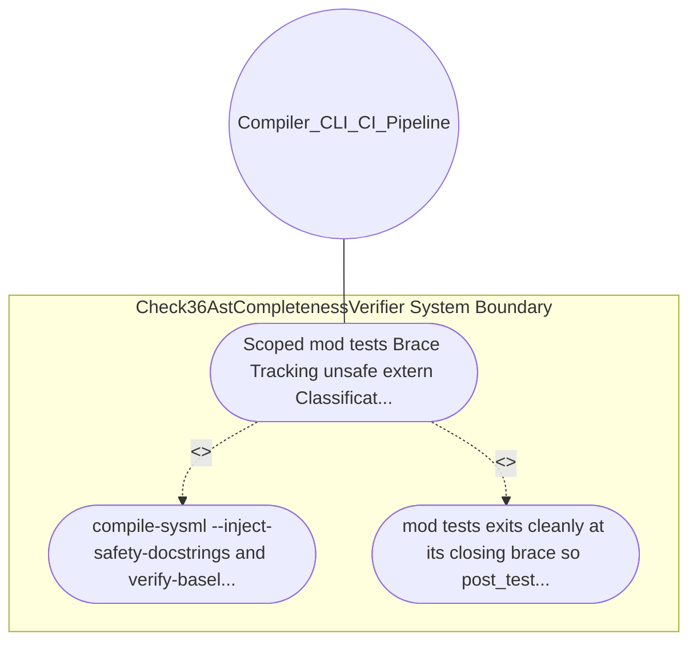

| Attribute | Specification Detail |
| :--- | :--- |
| **Issue ID** | #646 |
| **Title** | Use Case 23: Scoped mod tests Brace Tracking unsafe extern Classification and Arrow Aware impl Headers |
| **Type** | use-case |
| **Primary Actor** | Compiler_CLI_CI_Pipeline |
| **Scope** | Check36AstCompletenessVerifier |
| **Level** | User Goal |
| **Generation Mode** | subagent |
| **Specification Source** | [schema/model.sysml](../../schema/model.sysml) |

# Use Case 23: Scoped mod tests Brace Tracking unsafe extern Classification and Arrow Aware impl Headers

## UML Diagrams

## 1. Actors
- `Compiler_CLI_CI_Pipeline`

## 2. Preconditions
- A Rust module containing #[cfg(test)] mod tests { ... } followed by a production pub unsafe fn post_test_api(), a #[cfg(test)] impl MockHelper { ... } block, an impl<F: Fn(u32) -> bool> FilterEngine<F> block, and a Dart class method preceded by a multi-line @pragma( 'vm:prefer-inline',) annotation.

## 3. Trigger
- compile-sysml --inject-safety-docstrings and verify-baseline Check 36 inspect the files.

## 4. Main Success Scenario
1. compile-sysml --inject-safety-docstrings and verify-baseline Check 36 inspect the files.
2. mod tests exits cleanly at its closing brace so post_test_api is audited (and fail-closed rejected with a non-zero violation error if undocumented), #[cfg(test)] impl.

## 5. Alternate and Exception Flows
- Precondition guard failure in `Check36AstCompletenessVerifier`:
  - `Check36AstCompletenessVerifier` rejects the `Scoped mod tests Brace Tracking unsafe extern Classification and Arrow Aware impl Headers` request without partial state mutation and reports diagnostic status to `Compiler_CLI_CI_Pipeline`.
- Invariant violation while enforcing `Scoped mod tests Brace Tracking unsafe extern Classification and Arrow Aware impl Headers`:
  - `Check36AstCompletenessVerifier` aborts `Scoped mod tests Brace Tracking unsafe extern Classification and Arrow Aware impl Headers` execution, preserves prior verified state, and notifies `Compiler_CLI_CI_Pipeline`.

## 6. Postconditions
- mod tests exits cleanly at its closing brace so post_test_api is audited (and fail-closed rejected with a non-zero violation error if undocumented), #[cfg(test)] impl.

## 8. Realization Matrix
| Specification Item | Type | Link / Reference |
| :--- | :--- | :--- |
| **#722** | User Story | [User Story 33: Resolve Schema Context Via Collect All](../user-stories/US-33-ResolveSchemaContextViaCollectAll.md) |
| **#678** | Feature | [Feature 21: [BP 05 Unified AST Safety Docstring Synthesizer and Check 36 Verification Blueprint] Check36AstCompletenessVerifier](../features/FEAT-21-Check36AstCompletenessVerifier.md) |

## Source References
Use case operational flows and lifecycle activity references:
- System Architecture Model: `schema/model.sysml`
- Normative Systems Engineering Standard: ISO/IEC/IEEE 29148:2018 §6.4.2 Concept of Operations

Operational use case realization and traceability links derive from `schema/model.sysml` pursuant to ISO/IEC/IEEE 29148.
