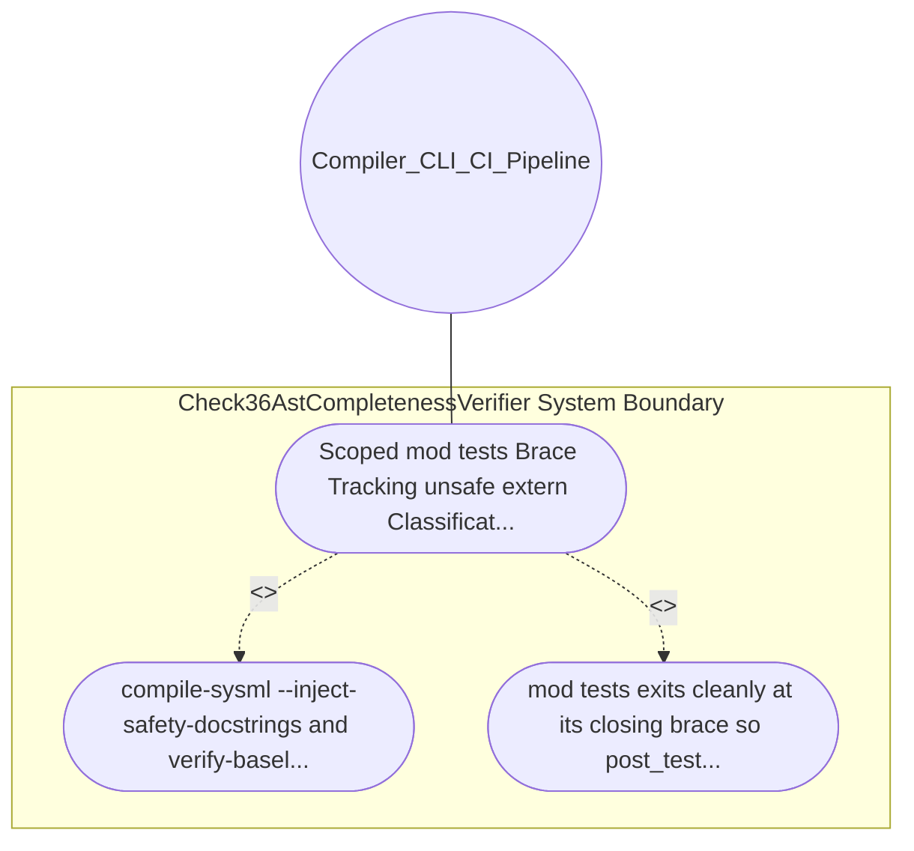

| Attribute | Specification Detail |
| :--- | :--- |
| **Issue ID** | #646 |
| **Title** | Use Case 23: Scoped mod tests Brace Tracking unsafe extern Classification and Arrow Aware impl Headers |
| **Type** | use-case |
| **Primary Actor** | Compiler_CLI_CI_Pipeline |
| **Scope** | Check36AstCompletenessVerifier |
| **Level** | User Goal |
| **Generation Mode** | subagent |
| **Specification Source** | [schema/model.sysml](../../schema/model.sysml) |

# Use Case 23: Scoped mod tests Brace Tracking unsafe extern Classification and Arrow Aware impl Headers

## UML Diagrams

## 1. Actors
- `Compiler_CLI_CI_Pipeline`

## 2. Preconditions
- A Rust module containing cfg(test) mod tests { ... } followed by a production pub unsafe fn post_test_api(), a cfg(test) impl MockHelper { ... } block, an impl<F: Fn(u32) -> bool> FilterEngine<F> block, and a Dart class method preceded by a multi-line @pragma( 'vm:prefer-inline',) annotation.

## 3. Trigger
- compile-sysml --inject-safety-docstrings and verify-baseline Check 36 inspect the files.

## 4. Main Success Scenario
1. `Compiler_CLI_CI_Pipeline` invokes `RunCompileSysmlInjectSafetyDocstrings` and `RunVerifyBaselineNoDomain` on `Check36AstCompletenessVerifier` and `UnifiedRustDartCstParser`.
2. `UnifiedRustDartCstParser` executes `TokenizeRsAndDartFilesUsing` (`ra_ap_syntax`, `rowan`, and `syn`) to track exact brace depth for `cfg(test) mod tests` and `cfg(test) impl MockHelper` blocks so test-only scopes exit cleanly at their closing brace.
3. `UnifiedRustDartCstParser` parses `impl<F: Fn(u32) -> bool> FilterEngine<F>` headers without truncating on the `->` return-type arrow inside generic trait bounds and tracks multi-line Dart `@pragma` annotations.
4. `Check36AstCompletenessVerifier` classifies `pub unsafe fn post_test_api()` and `extern` declarations appearing after `mod tests` as production items requiring full 7-section safety docstrings.
5. `Check36AstCompletenessVerifier` verifies all 7 docstring sections on `post_test_api()` and `FilterEngine<F>` methods (or rejects undocumented production declarations fail-closed with exit code 1) and emits the verdict on `docstring_verdict_out`.

## 5. Alternate and Exception Flows
- 3a. Production `pub unsafe fn` or `extern` item after `mod tests` lacks a 7-section safety docstring:
  - `Check36AstCompletenessVerifier` emits a file-and-line `ariadne` / `miette` Check 36 violation diagnostic (`E0100`), sets `docstring_verdict_out` to `false`, and exits fail-closed with code 1.
- 4a. Unbalanced brace depth in `mod tests` or malformed `impl` header on `source_cst_in`:
  - `UnifiedRustDartCstParser` returns `Result::Err` via `ra_ap_syntax` and `miette`, halting docstring synthesis without partial file writes and exiting with code 1.
- 5a. Invariant violation under `Invariant_REQ_0605_Under_REQ_0605_and_parametric_constraints_C_DOC_01_through_C_DOC_04_lexical_scanning_schema_context_resolution_and_forward_docstring_injection_satisfy_the_following_linear_complexity_and_idempotency_bounds`:
  - `Check36AstCompletenessVerifier` aborts execution, preserves prior verified state, and returns fail-closed status code 1 to `Compiler_CLI_CI_Pipeline`.

## 6. Postconditions
- mod tests exits cleanly at its closing brace so post_test_api is audited (and fail-closed rejected with a non-zero violation error if undocumented), cfg(test) impl.

## 8. Realization Matrix
| Specification Item | Type | Link / Reference |
| :--- | :--- | :--- |
| **#722** | User Story | [User Story 33: Resolve Schema Context Via Collect All](../user-stories/US-33-ResolveSchemaContextViaCollectAll.md) |
| **#678** | Feature | [Feature 21: [BP 05 Unified AST Safety Docstring Synthesizer and Check 36 Verification Blueprint] Check36AstCompletenessVerifier](../features/FEAT-21-Check36AstCompletenessVerifier.md) |

## Source References
Use case operational flows and lifecycle activity references:
- System Architecture Model: `schema/model.sysml`
- Normative Systems Engineering Standard: ISO/IEC/IEEE 29148:2018 §6.4.2 Concept of Operations

Operational use case realization and traceability links derive from `schema/model.sysml` pursuant to ISO/IEC/IEEE 29148.
