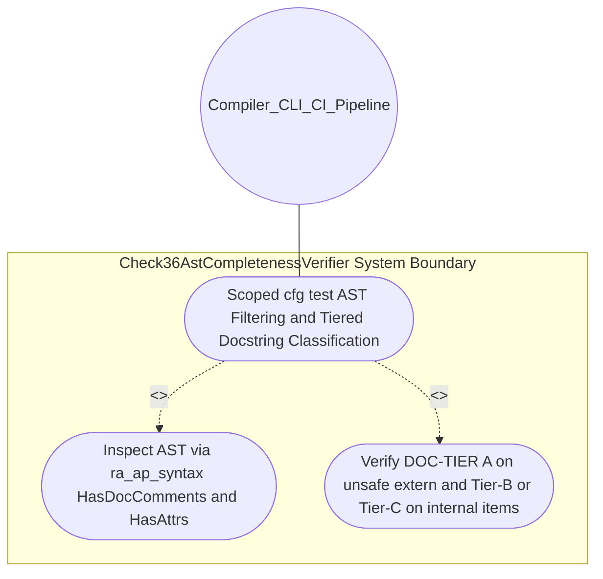

| Attribute | Specification Detail |
| :--- | :--- |
| **Issue ID** | #646 |
| **Title** | Use Case 23: Scoped mod tests Brace Tracking unsafe extern Classification and Arrow Aware impl Headers |
| **Type** | use-case |
| **Primary Actor** | Compiler_CLI_CI_Pipeline |
| **Scope** | Check36AstCompletenessVerifier |
| **Level** | User Goal |
| **Generation Mode** | subagent |
| **Specification Source** | [schema/model.sysml](../../schema/model.sysml) |

# Use Case 23: Scoped mod tests Brace Tracking unsafe extern Classification and Arrow Aware impl Headers

## UML Diagrams

## 1. Actors
- `Compiler_CLI_CI_Pipeline`

## 2. Preconditions
- A Rust module containing `outer cfg(test) mod tests { ... }` followed by a production `pub unsafe fn post_test_api()`, a `outer cfg(test) impl MockHelper { ... }` block, an `impl<F: Fn(u32) -> bool> FilterEngine<F>` block, and a Dart class method preceded by a multi-line `@pragma('vm:prefer-inline')` annotation bound to a full OMG SysML v2.0 + KerML 1.0 model (zero 16-construct caps).

## 3. Trigger
- `compile-sysml --inject-safety-docstrings` and `verify-baseline` Check 36 inspect the files using `ra_ap_syntax` (`ast::HasDocComments`, `ast::HasAttrs`), `ra_ap_text_edit`, `ra_ap_line_index`, and `deap_core::dart_cst` (`logos` + `rowan` + `salsa` + `ariadne`) with zero hand-rolled scanners.

## 4. Main Success Scenario
1. `Compiler_CLI_CI_Pipeline` invokes `RunCompileSysmlInjectSafetyDocstrings` and `RunVerifyBaselineNoDomain` on `Check36AstCompletenessVerifier` and `UnifiedRustDartCstParser`.
2. `UnifiedRustDartCstParser` executes `TokenizeRsAndDartFilesUsing` via `ra_ap_syntax` (`ast::HasDocComments`, `ast::HasAttrs`), `ra_ap_line_index`, `rowan`, and `deap_core::dart_cst` to isolate `outer cfg(test) mod tests` and `outer cfg(test) impl MockHelper` AST subtrees without hand-rolled brace counters.
3. `UnifiedRustDartCstParser` parses `impl<F: Fn(u32) -> bool> FilterEngine<F>` headers natively via `ra_ap_syntax` AST nodes without truncating on the `->` return-type arrow inside generic trait bounds and tracks multi-line Dart `@pragma` annotations via `deap_core::dart_cst`.
4. `Check36AstCompletenessVerifier` classifies `pub unsafe fn post_test_api()`, `extern` blocks, and `pub` crate entrypoints (`[DOC-TIER: A]`) as Tier-A items requiring 7-section safety docstrings, while classifying internal/private declarations as Tier-B/C items requiring `<= 4`-line `[REQ-*]`/`[FLS: fls_*]` docstrings injected via `ra_ap_text_edit` + `ra_ap_line_index`.
5. `Check36AstCompletenessVerifier` verifies `[DOC-TIER: A]` 7-section docstrings on `post_test_api()` and `<= 4`-line Tier-B/C `[REQ-*]`/`[FLS: fls_*]` docstrings on internal `FilterEngine<F>` methods (rejecting undocumented production declarations fail-closed with exit code 1) and emits the verdict on `docstring_verdict_out`.

## 5. Alternate and Exception Flows
- 3a. Production `pub unsafe fn`, `extern` item, or internal item after `mod tests` lacks its required `[DOC-TIER: A]` or `<= 4`-line Tier-B/C `[REQ-*]`/`[FLS: fls_*]` safety docstring:
  - `Check36AstCompletenessVerifier` emits a file-and-line `ariadne` / `miette` Check 36 violation diagnostic (`E0100`), sets `docstring_verdict_out` to `false`, and exits fail-closed with code 1.
- 4a. Malformed Rust or Dart syntax tree on `source_cst_in`:
  - `UnifiedRustDartCstParser` returns `Result::Err` via `ra_ap_syntax` and `miette`, halting docstring synthesis without partial file writes and exiting with code 1.
- 5a. Invariant violation under `Invariant_REQ_0605_Under_REQ_0605_and_parametric_constraints_C_DOC_01_through_C_DOC_04_lexical_scanning_schema_context_resolution_and_forward_docstring_injection_satisfy_the_following_linear_complexity_and_idempotency_bounds`:
  - `Check36AstCompletenessVerifier` aborts execution, preserves prior verified state, and returns fail-closed status code 1 to `Compiler_CLI_CI_Pipeline`.

## 6. Postconditions
- **Success Guarantee**: `outer cfg(test) mod tests` and `outer cfg(test) impl MockHelper` subtrees are isolated via `ra_ap_syntax` (`ast::HasAttrs`), `post_test_api` is audited as `[DOC-TIER: A]`, and `FilterEngine<F>` and Dart `@pragma`-annotated methods receive `<= 4`-line Tier-B/C `[REQ-*]`/`[FLS: fls_*]` or `[DOC-TIER: A]` docstrings via `ra_ap_text_edit` + `ra_ap_line_index` without corrupting attributes.
- **Failure Guarantee**: Undocumented production items fail closed with a byte-exact `ariadne`/`miette` diagnostic and exit code 1.
- **3-Layer Definition of Done (DoD)**:
  - **Layer 1 (Domain State & Data Model)**: Lossless `ra_ap_syntax` (`ast::HasDocComments`, `ast::HasAttrs`), `deap_core::dart_cst`, and `deap_core::sysml_cst` AST models covering 100% of the OMG SysML v2.0 + KerML 1.0 grammar (zero 16-construct caps).
  - **Layer 2 (Logic & State Management)**: AST attribute/scope filtering and tiered docstring synthesis (`<= 4`-line Tier-B/C `[REQ-*]`/`[FLS: fls_*]` + `[DOC-TIER: A]`) inside `< 380`-SLOC submodules (`./crates/compile-sysml/src/safety_docstrings/`, `./crates/deap-core/src/rust_cst/`, `./crates/deap-core/src/dart_cst/`) with explicit deletion of legacy hand-rolled brace/arrow scanners (`-800+` SLOC retired).
  - **Layer 3 (Presentation & Actuator Interface Binding)**: CLI verification (`verify-baseline . --no-domain`) and `ariadne`/`miette` diagnostics.

## 8. Realization Matrix
| Specification Item | Type | Link / Reference |
| :--- | :--- | :--- |
| **#722** | User Story | [User Story 33: Resolve Schema Context Via Collect All](../user-stories/US-33-ResolveSchemaContextViaCollectAll.md) |
| **#678** | Feature | [Feature 21: [BP 05 Unified AST Safety Docstring Synthesizer and Check 36 Verification Blueprint] Check36AstCompletenessVerifier](../features/FEAT-21-Check36AstCompletenessVerifier.md) |

## Source References
Use case operational flows and lifecycle activity references:
- System Architecture Model: `schema/model.sysml`
- Normative Systems Engineering Standard: ISO/IEC/IEEE 29148:2018 §6.4.2 Concept of Operations

Operational use case realization and traceability links derive from `schema/model.sysml` pursuant to ISO/IEC/IEEE 29148.
