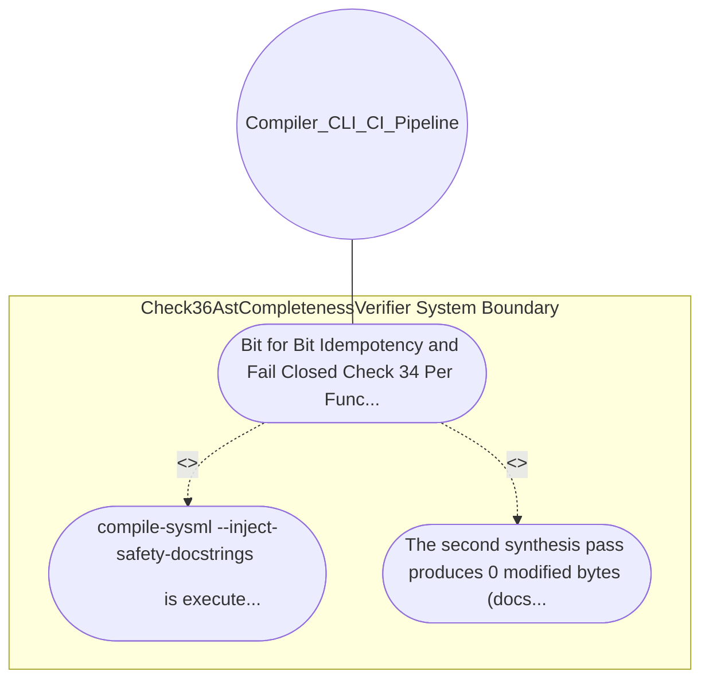

| Attribute | Specification Detail |
| :--- | :--- |
| **Issue ID** | #647 |
| **Title** | Use Case 24: Bit for Bit Idempotency and Fail Closed Check 34 Per Function Normalized Body Uniqueness |
| **Type** | use-case |
| **Primary Actor** | Compiler_CLI_CI_Pipeline |
| **Scope** | Check36AstCompletenessVerifier |
| **Level** | User Goal |
| **Generation Mode** | subagent |
| **Specification Source** | [schema/model.sysml](../../schema/model.sysml) |

# Use Case 24: Bit for Bit Idempotency and Fail Closed Check 34 Per Function Normalized Body Uniqueness

## UML Diagrams

## 1. Actors
- `Compiler_CLI_CI_Pipeline`

## 2. Preconditions
- Any Rust crate or Dart source directory enriched by compile-sysml --inject-safety-docstrings <DIR>, as well as a negative fixture containing duplicate normalized docstring bodies or missing sections.

## 3. Trigger
- compile-sysml --inject-safety-docstrings <DIR> is executed a second time and followed by ./target/release/verify-baseline . --no-domain.

## 4. Main Success Scenario
1. compile-sysml --inject-safety-docstrings <DIR> is executed a second time and followed by ./target/release/verify-baseline . --no-domain.
2. The second synthesis pass produces 0 modified bytes (docstring_idempotency_diff_bytes == 0), every synthesized docblock passes Check 36 7-section completeness and Check 34 seen_docblocks uniqueness, and any invalid, missing,.

## 5. Alternate and Exception Flows
- Precondition guard failure in `Check36AstCompletenessVerifier`:
  - `Check36AstCompletenessVerifier` rejects the `Bit for Bit Idempotency and Fail Closed Check 34 Per Function Normalized Body Uniqueness` request without partial state mutation and reports diagnostic status to `Compiler_CLI_CI_Pipeline`.
- Invariant violation while enforcing `Bit for Bit Idempotency and Fail Closed Check 34 Per Function Normalized Body Uniqueness`:
  - `Check36AstCompletenessVerifier` aborts `Bit for Bit Idempotency and Fail Closed Check 34 Per Function Normalized Body Uniqueness` execution, preserves prior verified state, and notifies `Compiler_CLI_CI_Pipeline`.

## 6. Postconditions
- The second synthesis pass produces 0 modified bytes (docstring_idempotency_diff_bytes == 0), every synthesized docblock passes Check 36 7-section completeness and Check 34 seen_docblocks uniqueness, and any invalid, missing,.

## 8. Realization Matrix
| Specification Item | Type | Link / Reference |
| :--- | :--- | :--- |
| **#723** | User Story | [User Story 34: Run Verify Baseline No Domain](../user-stories/US-34-RunVerifyBaselineNoDomain.md) |
| **#678** | Feature | [Feature 21: [BP 05 Unified AST Safety Docstring Synthesizer and Check 36 Verification Blueprint] Check36AstCompletenessVerifier](../features/FEAT-21-Check36AstCompletenessVerifier.md) |

## Source References
Use case operational flows and lifecycle activity references:
- System Architecture Model: `schema/model.sysml`
- Normative Systems Engineering Standard: ISO/IEC/IEEE 29148:2018 §6.4.2 Concept of Operations

Operational use case realization and traceability links derive from `schema/model.sysml` pursuant to ISO/IEC/IEEE 29148.
