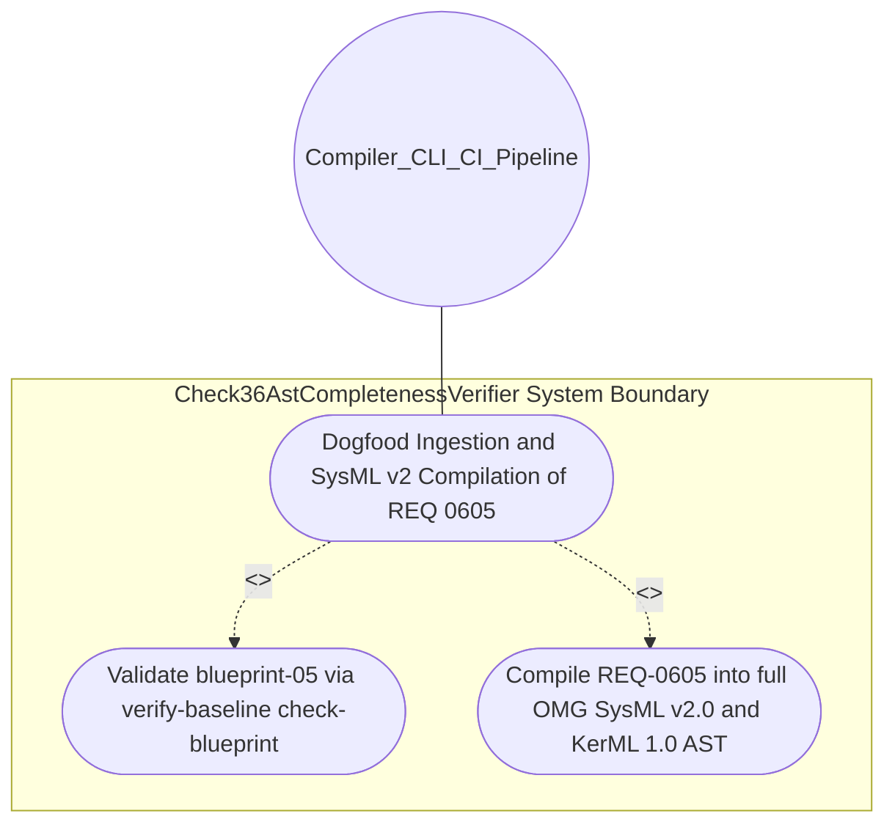

| Attribute | Specification Detail |
| :--- | :--- |
| **Issue ID** | #648 |
| **Title** | Use Case 25: Dogfood Ingestion and SysML v2 Compilation of REQ 0605 |
| **Type** | use-case |
| **Primary Actor** | Compiler_CLI_CI_Pipeline |
| **Scope** | Check36AstCompletenessVerifier |
| **Level** | User Goal |
| **Generation Mode** | subagent |
| **Specification Source** | [schema/model.sysml](../../schema/model.sysml) |

# Use Case 25: Dogfood Ingestion and SysML v2 Compilation of REQ 0605

## UML Diagrams

## 1. Actors
- `Compiler_CLI_CI_Pipeline`

## 2. Preconditions
- Engineering blueprint specification `./.pipeline/upstream/docs/designs/blueprint-05-deterministic-safety-docstring-synthesizer.md` (`docs/designs/blueprint-05-deterministic-safety-docstring-synthesizer.md`) modeling **Contract A (100% Normative OMG SysML v2.0 + KerML 1.0 Grammar Coverage -- Zero 16-Construct Caps)** and **Contract B (Official Rust Compiler & `rust-analyzer` Crate Stack -- Zero Hand-Rolled Scanners)**.

## 3. Trigger
- `./target/release/verify-baseline check-blueprint docs/designs/blueprint-05-deterministic-safety-docstring-synthesizer.md --dry-run` and `./target/release/ingest-sysml --schema docs/designs/blueprint-05-deterministic-safety-docstring-synthesizer.md --format markdown` are executed.

## 4. Main Success Scenario
1. `Compiler_CLI_CI_Pipeline` executes `./target/release/verify-baseline check-blueprint docs/designs/blueprint-05-deterministic-safety-docstring-synthesizer.md --dry-run` using `pulldown-cmark` to validate the 8-part engineering blueprint with zero hand-rolled scanners.
2. `Check36AstCompletenessVerifier` verifies all 12 mechanical blueprint gates, including KaTeX complexity and idempotency bounds, Mermaid state and sequence diagrams, 5-column STPA/FMECA tables, and Contract B `ra_ap_syntax` (`ast::HasDocComments`, `ast::HasAttrs`) + `ra_ap_text_edit` + `ra_ap_line_index` tiered docstring specifications (`<= 4`-line Tier-B/C `[REQ-*]`/`[FLS: fls_*]` and `[DOC-TIER: A]`).
3. `Compiler_CLI_CI_Pipeline` invokes `RunIngestSysmlSchemaBlueprint05` (`./target/release/ingest-sysml --schema docs/designs/blueprint-05-deterministic-safety-docstring-synthesizer.md --format markdown`) using `deap_core::sysml_cst` (`logos` + `rowan` + `salsa` + `ariadne`).
4. `ingest_sysml` parses `REQ-0605` (`REQ_0605_BP_05_Unified_AST_Safety_Docstring_Synthesizer_and_Check_36_Verification_Blueprint`), `UnifiedSafetyDocstringSynthesizer`, `Check36AstCompletenessVerifier`, `ScopedSchemaContextResolver`, `SevenSectionDocstringGenerator`, `UnifiedRustDartCstParser`, `BP_05_SafetyDocstringPortDef`, and `BP_05_ContextToDocstringGeneratorConnection` into canonical OMG SysML v2.0 + KerML 1.0 (`package`/`library package`/`standard library package`, `part def`/`part`, `item def`/`item`, `attribute def`/`attribute`, `enum def`/`enum`, `port def`/`port`, `connection def`/`connection`, `interface def`/`interface`, `flow def`/`flow`, `allocation def`/`allocation`, `occurrence def`/`occurrence`, `action def`/`action`, `state def`/`state`, `calc def`/`calc`, `constraint def`/`constraint`, `requirement def`/`requirement`, `concern def`/`concern`, `use case def`/`use case`, `analysis def`/`analysis`, `verification def`/`verification`, `test case def`/`test case`, `interaction def`/`interaction`, `view def`/`view`, `viewpoint def`/`viewpoint`, `rendering def`/`rendering`, `variation`/`variant`, `metadata def`/`@Metadata`/`#user_keyword` (`#hazard`, `#risk`, `#capability`, `#rt_loop`, `#dal`, `#fls`), and KerML specialization `:`, `:>`, `:>>`, `::>`, `~`, `ISQ`/`SI`/`ScalarValues`, zero 16-construct caps).
5. `Check36AstCompletenessVerifier` confirms bijective AST roundtrip parity with `schema/model.sysml` and exits with code 0.

## 5. Alternate and Exception Flows
- 3a. Blueprint Markdown fails any of the 12 mechanical verification gates in `check-blueprint`:
  - `verify-baseline` returns `Result::Err`, emits an `ariadne` / `miette` structural diagnostic (`E0100`), and terminates fail-closed with exit code 1.
- 4a. SysML v2 syntax or roundtrip mismatch during `RunIngestSysmlSchemaBlueprint05`:
  - `ingest_sysml` aborts compilation via `Result<T, E>`, preserves prior verified `schema/model.sysml` state without partial writes, and exits fail-closed with code 1.
- 5a. Invariant violation under `Invariant_REQ_0605_Under_REQ_0605_and_parametric_constraints_C_DOC_01_through_C_DOC_04_lexical_scanning_schema_context_resolution_and_forward_docstring_injection_satisfy_the_following_linear_complexity_and_idempotency_bounds`:
  - `Check36AstCompletenessVerifier` aborts execution, preserves prior verified state, and notifies `Compiler_CLI_CI_Pipeline` with fail-closed exit code 1.

## 6. Postconditions
- **Success Guarantee**: The translator parses **REQ-0605**, `UnifiedSafetyDocstringSynthesizer`, all four BOM subcomponents, all four interface ports, all four state attributes, all four parametric constraints, and all behavioral state/sequence/test-case constructs into canonical OMG SysML v2.0 + KerML 1.0 (zero 16-construct caps) with zero hand-rolled scanners.
- **Failure Guarantee**: Any blueprint gate or SysML v2 roundtrip failure preserves prior verified `schema/model.sysml` state and exits with code 1.
- **3-Layer Definition of Done (DoD)**:
  - **Layer 1 (Domain State & Data Model)**: Lossless `pulldown-cmark` Markdown AST and `deap_core::sysml_cst` (`logos` + `rowan` + `salsa`) AST with 100% OMG SysML v2.0 + KerML 1.0 grammar coverage.
  - **Layer 2 (Logic & State Management)**: Blueprint validation, SysML v2 compilation, and `ra_ap_syntax` (`ast::HasDocComments`, `ast::HasAttrs`) + `ra_ap_text_edit` + `ra_ap_line_index` tiered docstring synthesis (`<= 4`-line Tier-B/C `[REQ-*]`/`[FLS: fls_*]` and `[DOC-TIER: A]`) inside `< 380`-SLOC submodules (`./crates/compile-sysml/src/safety_docstrings/`, `./crates/deap-core/src/rust_cst/`, `./crates/deap-core/src/dart_cst/`) with explicit deletion of legacy hand-rolled scanners (`-800+` SLOC retired).
  - **Layer 3 (Presentation & Actuator Interface Binding)**: CLI bindings (`verify-baseline check-blueprint`, `ingest-sysml`) and `ariadne`/`miette` diagnostics.

## 8. Realization Matrix
| Specification Item | Type | Link / Reference |
| :--- | :--- | :--- |
| **#724** | User Story | [User Story 35: Tokenize Rs And Dart Files Using](../user-stories/US-35-TokenizeRsAndDartFilesUsing.md) |
| **#678** | Feature | [Feature 21: [BP 05 Unified AST Safety Docstring Synthesizer and Check 36 Verification Blueprint] Check36AstCompletenessVerifier](../features/FEAT-21-Check36AstCompletenessVerifier.md) |

## Source References
Use case operational flows and lifecycle activity references:
- System Architecture Model: `schema/model.sysml`
- Normative Systems Engineering Standard: ISO/IEC/IEEE 29148:2018 §6.4.2 Concept of Operations

Operational use case realization and traceability links derive from `schema/model.sysml` pursuant to ISO/IEC/IEEE 29148.
