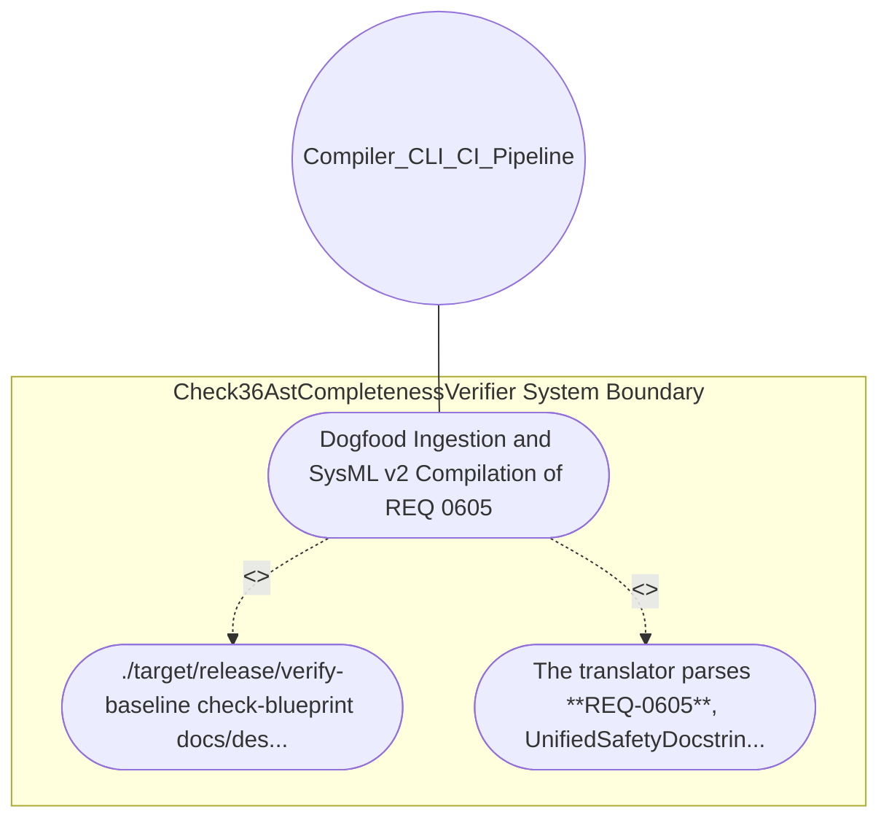

| Attribute | Specification Detail |
| :--- | :--- |
| **Issue ID** | #648 |
| **Title** | Use Case 25: Dogfood Ingestion and SysML v2 Compilation of REQ 0605 |
| **Type** | use-case |
| **Primary Actor** | Compiler_CLI_CI_Pipeline |
| **Scope** | Check36AstCompletenessVerifier |
| **Level** | User Goal |
| **Generation Mode** | subagent |
| **Specification Source** | [schema/model.sysml](../../schema/model.sysml) |

# Use Case 25: Dogfood Ingestion and SysML v2 Compilation of REQ 0605

## UML Diagrams

## 1. Actors
- `Compiler_CLI_CI_Pipeline`

## 2. Preconditions
- This blueprint specification docs/designs/blueprint-05-deterministic-safety-docstring-synthesizer.md.

## 3. Trigger
- ./target/release/verify-baseline check-blueprint docs/designs/blueprint-05-deterministic-safety-docstring-synthesizer.md --dry-run and ./target/release/ingest-sysml --schema docs/designs/blueprint-05-deterministic-safety-docstring-synthesizer.md --format markdown are executed.

## 4. Main Success Scenario
1. `Compiler_CLI_CI_Pipeline` executes `./target/release/verify-baseline check-blueprint docs/designs/blueprint-05-deterministic-safety-docstring-synthesizer.md --dry-run` using `pulldown-cmark` to validate the 8-part engineering blueprint.
2. `Check36AstCompletenessVerifier` verifies all 12 mechanical blueprint gates, including KaTeX complexity and idempotency bounds, Mermaid state and sequence diagrams, and 5-column STPA/FMECA tables.
3. `Compiler_CLI_CI_Pipeline` invokes `RunIngestSysmlSchemaBlueprint05` (`./target/release/ingest-sysml --schema docs/designs/blueprint-05-deterministic-safety-docstring-synthesizer.md --format markdown`) using `logos` and `rowan`.
4. `ingest_sysml` parses `REQ-0605` (`REQ_0605_BP_05_Unified_AST_Safety_Docstring_Synthesizer_and_Check_36_Verification_Blueprint`), `UnifiedSafetyDocstringSynthesizer`, `Check36AstCompletenessVerifier`, `ScopedSchemaContextResolver`, `SevenSectionDocstringGenerator`, `UnifiedRustDartCstParser`, `BP_05_SafetyDocstringPortDef`, and `BP_05_ContextToDocstringGeneratorConnection` into canonical SysML v2.
5. `Check36AstCompletenessVerifier` confirms bijective AST roundtrip parity with `schema/model.sysml` and exits with code 0.

## 5. Alternate and Exception Flows
- 3a. Blueprint Markdown fails any of the 12 mechanical verification gates in `check-blueprint`:
  - `verify-baseline` returns `Result::Err`, emits an `ariadne` / `miette` structural diagnostic (`E0100`), and terminates fail-closed with exit code 1.
- 4a. SysML v2 syntax or roundtrip mismatch during `RunIngestSysmlSchemaBlueprint05`:
  - `ingest_sysml` aborts compilation via `Result<T, E>`, preserves prior verified `schema/model.sysml` state without partial writes, and exits fail-closed with code 1.
- 5a. Invariant violation under `Invariant_REQ_0605_Under_REQ_0605_and_parametric_constraints_C_DOC_01_through_C_DOC_04_lexical_scanning_schema_context_resolution_and_forward_docstring_injection_satisfy_the_following_linear_complexity_and_idempotency_bounds`:
  - `Check36AstCompletenessVerifier` aborts execution, preserves prior verified state, and notifies `Compiler_CLI_CI_Pipeline` with fail-closed exit code 1.

## 6. Postconditions
- The translator parses **REQ-0605**, UnifiedSafetyDocstringSynthesizer, all four BOM subcomponents, all four interface ports, all four state attributes, all four parametric.

## 8. Realization Matrix
| Specification Item | Type | Link / Reference |
| :--- | :--- | :--- |
| **#724** | User Story | [User Story 35: Tokenize Rs And Dart Files Using](../user-stories/US-35-TokenizeRsAndDartFilesUsing.md) |
| **#678** | Feature | [Feature 21: [BP 05 Unified AST Safety Docstring Synthesizer and Check 36 Verification Blueprint] Check36AstCompletenessVerifier](../features/FEAT-21-Check36AstCompletenessVerifier.md) |

## Source References
Use case operational flows and lifecycle activity references:
- System Architecture Model: `schema/model.sysml`
- Normative Systems Engineering Standard: ISO/IEC/IEEE 29148:2018 §6.4.2 Concept of Operations

Operational use case realization and traceability links derive from `schema/model.sysml` pursuant to ISO/IEC/IEEE 29148.
