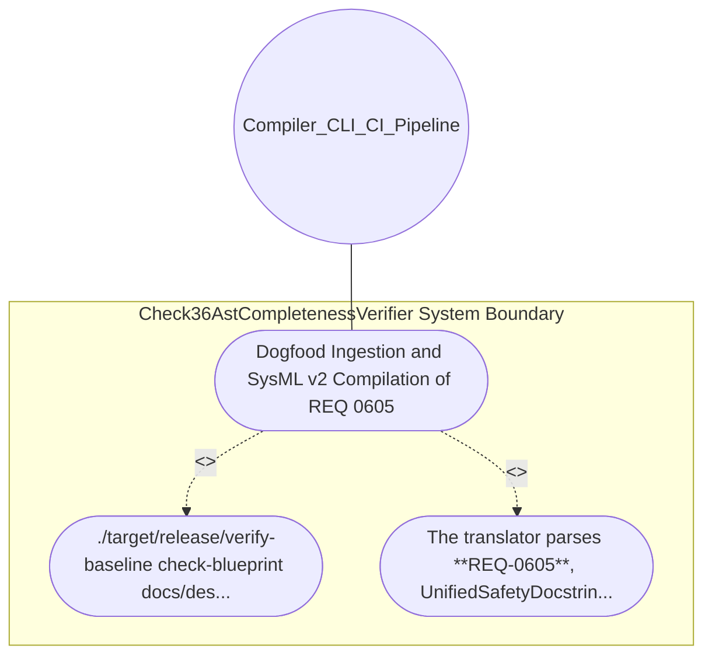

| Attribute | Specification Detail |
| :--- | :--- |
| **Issue ID** | #648 |
| **Title** | Use Case 25: Dogfood Ingestion and SysML v2 Compilation of REQ 0605 |
| **Type** | use-case |
| **Primary Actor** | Compiler_CLI_CI_Pipeline |
| **Scope** | Check36AstCompletenessVerifier |
| **Level** | User Goal |
| **Generation Mode** | subagent |
| **Specification Source** | [schema/model.sysml](../../schema/model.sysml) |

# Use Case 25: Dogfood Ingestion and SysML v2 Compilation of REQ 0605

## UML Diagrams

## 1. Actors
- `Compiler_CLI_CI_Pipeline`

## 2. Preconditions
- This blueprint specification docs/designs/blueprint-05-deterministic-safety-docstring-synthesizer.md.

## 3. Trigger
- ./target/release/verify-baseline check-blueprint docs/designs/blueprint-05-deterministic-safety-docstring-synthesizer.md --dry-run and ./target/release/ingest-sysml --schema docs/designs/blueprint-05-deterministic-safety-docstring-synthesizer.md --format markdown are executed.

## 4. Main Success Scenario
1. ./target/release/verify-baseline check-blueprint docs/designs/blueprint-05-deterministic-safety-docstring-synthesizer.md --dry-run and ./target/release/ingest-sysml --schema docs/designs/blueprint-05-deterministic-safety-docstring-synthesizer.md --format markdown are executed.
2. The translator parses **REQ-0605**, UnifiedSafetyDocstringSynthesizer, all four BOM subcomponents, all four interface ports, all four state attributes, all four parametric.

## 5. Alternate and Exception Flows
- Precondition guard failure in `Check36AstCompletenessVerifier`:
  - `Check36AstCompletenessVerifier` rejects the `Dogfood Ingestion and SysML v2 Compilation of REQ 0605` request without partial state mutation and reports diagnostic status to `Compiler_CLI_CI_Pipeline`.
- Invariant violation while enforcing `Dogfood Ingestion and SysML v2 Compilation of REQ 0605`:
  - `Check36AstCompletenessVerifier` aborts `Dogfood Ingestion and SysML v2 Compilation of REQ 0605` execution, preserves prior verified state, and notifies `Compiler_CLI_CI_Pipeline`.

## 6. Postconditions
- The translator parses **REQ-0605**, UnifiedSafetyDocstringSynthesizer, all four BOM subcomponents, all four interface ports, all four state attributes, all four parametric.

## 8. Realization Matrix
| Specification Item | Type | Link / Reference |
| :--- | :--- | :--- |
| **#724** | User Story | [User Story 35: Tokenize Rs And Dart Files Using](../user-stories/US-35-TokenizeRsAndDartFilesUsing.md) |
| **#678** | Feature | [Feature 21: [BP 05 Unified AST Safety Docstring Synthesizer and Check 36 Verification Blueprint] Check36AstCompletenessVerifier](../features/FEAT-21-Check36AstCompletenessVerifier.md) |

## Source References
Use case operational flows and lifecycle activity references:
- System Architecture Model: `schema/model.sysml`
- Normative Systems Engineering Standard: ISO/IEC/IEEE 29148:2018 §6.4.2 Concept of Operations

Operational use case realization and traceability links derive from `schema/model.sysml` pursuant to ISO/IEC/IEEE 29148.
