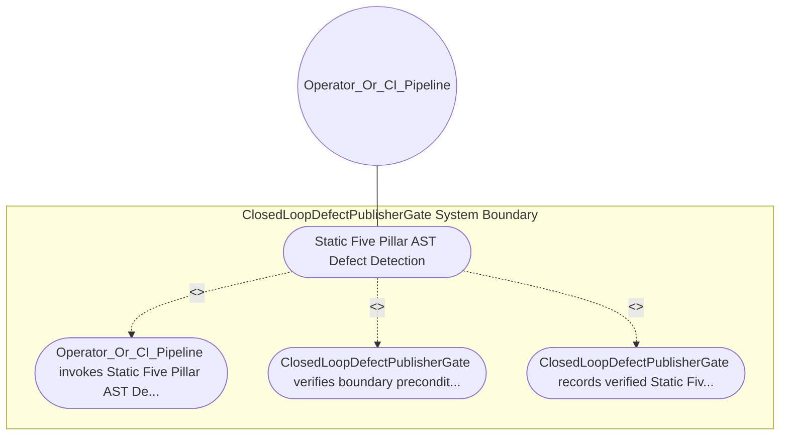

| Attribute | Specification Detail |
| :--- | :--- |
| **Issue ID** | #649 |
| **Title** | Use Case 26: Static Five Pillar AST Defect Detection |
| **Type** | use-case |
| **Primary Actor** | Operator_Or_CI_Pipeline |
| **Scope** | ClosedLoopDefectPublisherGate |
| **Level** | User Goal |
| **Generation Mode** | subagent |
| **Specification Source** | [schema/model.sysml](../../schema/model.sysml) |

# Use Case 26: Static Five Pillar AST Defect Detection

## UML Diagrams

## 1. Actors
- `Operator_Or_CI_Pipeline`

## 2. Preconditions
- `ClosedLoopDefectPublisherGate` is initialized and ready to enforce `Static Five Pillar AST Defect Detection`.
- `Operator_Or_CI_Pipeline` holds authorized operational access to `ClosedLoopDefectPublisherGate`.

## 3. Trigger
- Static Five Pillar AST Defect Detection

## 4. Main Success Scenario
1. `Operator_Or_CI_Pipeline` invokes `Static Five Pillar AST Defect Detection` on `ClosedLoopDefectPublisherGate` targeting objective `Static Five Pillar AST Defect Detection`.
2. `ClosedLoopDefectPublisherGate` verifies boundary preconditions and evaluates `Static Five Pillar AST Defect Detection` invariants (guarding `Diagnostic: E0601`).
3. `ClosedLoopDefectPublisherGate` records verified `Static Five Pillar AST Defect Detection` outcome and returns status to `Operator_Or_CI_Pipeline`.

## 5. Alternate and Exception Flows
- Diagnostic: E0601

## 6. Postconditions
- `ClosedLoopDefectPublisherGate` satisfies declared objective `Static Five Pillar AST Defect Detection` with all subsystem invariants intact.
- Verified `Static Five Pillar AST Defect Detection` completion status is recorded for `Operator_Or_CI_Pipeline`.

## 8. Realization Matrix
| Specification Item | Type | Link / Reference |
| :--- | :--- | :--- |
| **#726** | User Story | [User Story 37: Verify Baseline Audit Code Path Crates](../user-stories/US-37-VerifyBaselineAuditCodePathCrates.md) |
| **#680** | Feature | [Feature 26: [BP 06 Deterministic Static 5 Pillar Code Auditor and Defect Dossier Synthesizer Blueprint] ClosedLoopDefectPublisherGate](../features/FEAT-26-ClosedLoopDefectPublisherGate.md) |

## Source References
Use case operational flows and lifecycle activity references:
- System Architecture Model: `schema/model.sysml`
- Normative Systems Engineering Standard: ISO/IEC/IEEE 29148:2018 §6.4.2 Concept of Operations

Operational use case realization and traceability links derive from `schema/model.sysml` pursuant to ISO/IEC/IEEE 29148.
