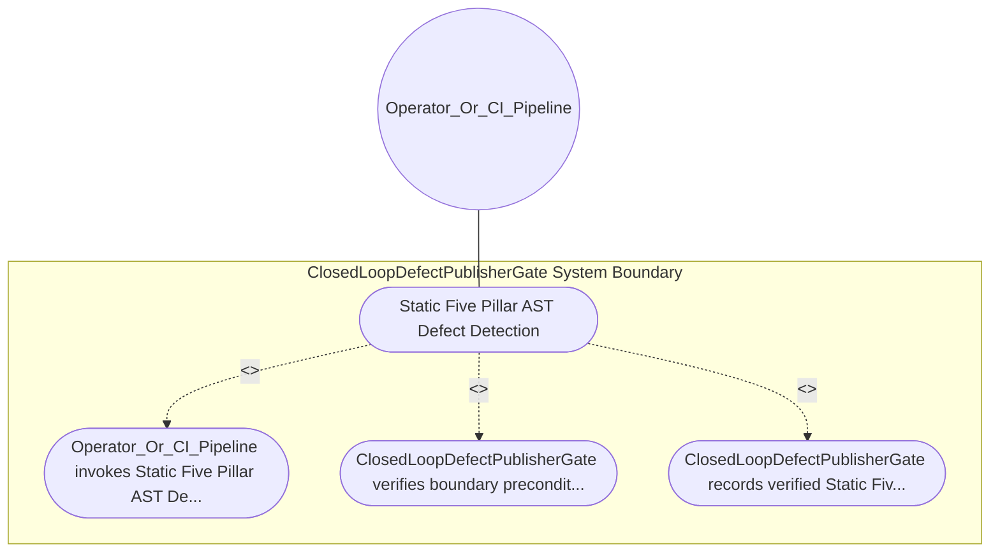

| Attribute | Specification Detail |
| :--- | :--- |
| **Issue ID** | #649 |
| **Title** | Use Case 26: Static Five Pillar AST Defect Detection |
| **Type** | use-case |
| **Primary Actor** | Operator_Or_CI_Pipeline |
| **Scope** | ClosedLoopDefectPublisherGate |
| **Level** | User Goal |
| **Generation Mode** | subagent |
| **Specification Source** | [schema/model.sysml](../../schema/model.sysml) |

# Use Case 26: Static Five Pillar AST Defect Detection

## UML Diagrams

## 1. Actors
- `Operator_Or_CI_Pipeline`

## 2. Preconditions
- `DeterministicStaticDefectAuditor`, `FivePillarStaticAstAnalyzer`, and `ClosedLoopDefectPublisherGate` are initialized and ready to enforce `Static Five Pillar AST Defect Detection` under **REQ-0606** (`BP-06`).
- **Contract A** (100% normative OMG SysML v2.0 + KerML 1.0 textual grammar coverage with full Definition and Usage symmetry and zero 16-construct artificial caps) and **Contract B** (`ra_ap_syntax` typed AST + Stage-2 isolated `Dylint` `rustc_middle::mir` (`TyCtxt`) 5-pillar defect dossier auditor in `./lints/deap-dylint-mir/` + isolated `deap_core::dart_cst` (`logos` + `rowan`) + complete deletion of `./crates/deap-core/src/source_ast.rs` (`source_ast.rs`) with zero hand-rolled scanners) are active across `< 380`-SLOC submodules.
- `Operator_Or_CI_Pipeline` holds authorized operational access to `ClosedLoopDefectPublisherGate`.

## 3. Trigger
- `Operator_Or_CI_Pipeline` invokes `./target/release/verify-baseline audit-code --path ./crates/` (`VerifyBaselineAuditCodePathCrates`).

## 4. Main Success Scenario
1. `Operator_Or_CI_Pipeline` invokes `VerifyBaselineAuditCodePathCrates` (`./target/release/verify-baseline audit-code --path ./crates/`) on `DeterministicStaticDefectAuditor` with `auditor_subagent_count == 0`, transitioning `BP_06_Deterministic_Static_5_Pillar_Code_Auditor_and_Defect_Dossier_Synthesizer_Blueprint_LifecycleState` from `Idle` to `IngestingRustAndDartCst`.
2. `DeterministicStaticDefectAuditor` invokes `ParseRustCstAndParseDartCst` on `TargetRustCstInputPort`, parsing Rust source files into lossless typed AST nodes via `ra_ap_syntax` (`ast::{MatchExpr, MatchArmList, CallExpr, MethodCallExpr, TryExpr, Fn, HasDocComments, HasAttrs}`, `ra_ap_vfs`, `ra_ap_line_index`, `rowan`) and Stage-2 `rustc_middle::mir` (`TyCtxt`) in `./lints/deap-dylint-mir/`, and parsing Dart source files in complete isolation via `deap_core::dart_cst` (`logos` + `rowan`), with `./crates/deap-core/src/source_ast.rs` (`source_ast.rs`) permanently deleted.
3. `FivePillarStaticAstAnalyzer` receives the parsed AST and MIR stream on `astStreamInPort` (`zeroRegexMode = true`, `activePillarCount = 5`) and transitions to `EvaluatingFivePillars`.
4. `FivePillarStaticAstAnalyzer` executes `EvaluateSourceFilePillarsAcross5` across all `pillar_coverage_count = 5` correctness risk pillars (`E0601` partial functions/panics, `E0602` unchecked arithmetic/IEEE-754 bounds, `E0603` silent error discarding/incomplete `MatchExpr`/`SwitchInt`, `E0604` unbounded recursion/real-time `#rt_loop` heap allocation, `E0605` unsynchronized shared state/FFI boundary violations) using `ra_ap_syntax` typed AST and Stage-2 `./lints/deap-dylint-mir/` `rustc_middle::mir` (`TyCtxt`) in linear single-pass `O(N)` complexity under `Invariant_REQ_0606_SC_02`.
5. `FivePillarStaticAstAnalyzer` emits line-exact `AuditFinding` records with diagnostic codes `E0601`--`E0605` via `findingStreamOutPort` to `DeterministicDossierSynthesizer` (or transitions to `Verified` on `zero_findings_detected`) and reports status to `Operator_Or_CI_Pipeline`.

## 5. Alternate and Exception Flows
- 3a. Unreadable source file or CST/MIR parse error on `TargetRustCstInputPort` (`Diagnostic: E0601`):
  - `DeterministicStaticDefectAuditor` transitions to `Rejected`, emits diagnostic `E0601` via `ariadne` / `miette`, and terminates fail-closed with exit code 1.
- 4a. Pillar coverage count falls below `pillar_coverage_count == 5` or `zeroRegexMode != true` under `Invariant_REQ_0606_SC_01` / `Invariant_REQ_0606_SC_02`:
  - `FivePillarStaticAstAnalyzer` returns `Result::Err`, aborts the static audit without partial state mutation, and exits fail-closed with code 1.
- 5a. Invariant violation while enforcing `Invariant_REQ_0606_SC_01` or `Invariant_REQ_0606_SC_02` in `ClosedLoopDefectPublisherGate`:
  - `ClosedLoopDefectPublisherGate` aborts execution, preserves prior verified state, and notifies `Operator_Or_CI_Pipeline` with fail-closed exit status 1.

## 6. Postconditions
- **3-Layer DoD Realization**: Layer 1 (Domain State & Data Model: typed `AuditFinding` records, `ra_ap_syntax` syntax trees, Stage-2 `rustc_middle::mir` `TyCtxt` control-flow graphs, and `deap_core::dart_cst` CSTs), Layer 2 (Logic & State Management: 5-pillar AST/MIR evaluation inside `< 380`-SLOC submodules under `./crates/verify-baseline/src/defect_auditor/`, `./lints/deap-dylint-mir/`, and `./crates/deap-core/src/dart_cst/` with `source_ast.rs` and all hand-rolled scanners deleted), and Layer 3 (Presentation & Actuator Interface Binding: `findingStreamOutPort` emission and `ariadne` / `miette` byte-span diagnostics) are satisfied.
- `ClosedLoopDefectPublisherGate` satisfies declared objective `Static Five Pillar AST Defect Detection` with all subsystem invariants intact.
- Verified `Static Five Pillar AST Defect Detection` completion status is recorded for `Operator_Or_CI_Pipeline`.

## 8. Realization Matrix
| Specification Item | Type | Link / Reference |
| :--- | :--- | :--- |
| **#726** | User Story | [User Story 37: Verify Baseline Audit Code Path Crates](../user-stories/US-37-VerifyBaselineAuditCodePathCrates.md) |
| **#727** | User Story | [User Story 38: Parse Rust Cst And Parse Dart Cst](../user-stories/US-38-ParseRustCstAndParseDartCst.md) |
| **#728** | User Story | [User Story 39: Evaluate Source File Pillars Across5](../user-stories/US-39-EvaluateSourceFilePillarsAcross5.md) |
| **#680** | Feature | [Feature 26: [BP 06 Deterministic Static 5 Pillar Code Auditor and Defect Dossier Synthesizer Blueprint] ClosedLoopDefectPublisherGate](../features/FEAT-26-ClosedLoopDefectPublisherGate.md) |
| **#682** | Feature | [Feature 28: [BP 06 Deterministic Static 5 Pillar Code Auditor and Defect Dossier Synthesizer Blueprint] DeterministicStaticDefectAuditor](../features/FEAT-28-DeterministicStaticDefectAuditor.md) |
| **#683** | Feature | [Feature 29: [BP 06 Deterministic Static 5 Pillar Code Auditor and Defect Dossier Synthesizer Blueprint] FivePillarStaticAstAnalyzer](../features/FEAT-29-FivePillarStaticAstAnalyzer.md) |

## Source References
Use case operational flows and lifecycle activity references:
- System Architecture Model: `schema/model.sysml`
- Normative Systems Engineering Standard: ISO/IEC/IEEE 29148:2018 §6.4.2 Concept of Operations

Operational use case realization and traceability links derive from `schema/model.sysml` pursuant to ISO/IEC/IEEE 29148.
