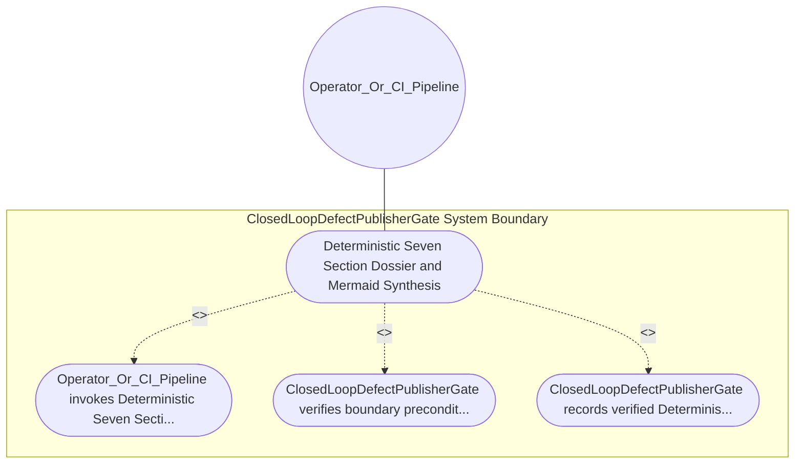

| Attribute | Specification Detail |
| :--- | :--- |
| **Issue ID** | #650 |
| **Title** | Use Case 27: Deterministic Seven Section Dossier and Mermaid Synthesis |
| **Type** | use-case |
| **Primary Actor** | Operator_Or_CI_Pipeline |
| **Scope** | ClosedLoopDefectPublisherGate |
| **Level** | User Goal |
| **Generation Mode** | subagent |
| **Specification Source** | [schema/model.sysml](../../schema/model.sysml) |

# Use Case 27: Deterministic Seven Section Dossier and Mermaid Synthesis

## UML Diagrams

## 1. Actors
- `Operator_Or_CI_Pipeline`

## 2. Preconditions
- `DeterministicDossierSynthesizer`, `MermaidUmlDiagramGenerator`, and `ClosedLoopDefectPublisherGate` are initialized and ready to enforce `Deterministic Seven Section Dossier and Mermaid Synthesis` under **REQ-0606** (`BP-06`).
- **Contract A** (100% normative OMG SysML v2.0 + KerML 1.0 textual grammar coverage with full Definition and Usage symmetry and zero 16-construct artificial caps) and **Contract B** (`ra_ap_syntax` typed AST + Stage-2 `./lints/deap-dylint-mir/` `rustc_middle::mir` (`TyCtxt`) 5-pillar defect dossier auditor + `deap_core::dart_cst` (`logos` + `rowan`) isolation + `pulldown-cmark` / `pulldown-cmark-to-cmark` + complete deletion of `./crates/deap-core/src/source_ast.rs` (`source_ast.rs`) with zero hand-rolled scanners) are active across `< 380`-SLOC submodules.
- `Operator_Or_CI_Pipeline` holds authorized operational access to `ClosedLoopDefectPublisherGate`.

## 3. Trigger
- `FivePillarStaticAstAnalyzer` emits an `AuditFinding` record from `ra_ap_syntax`, Stage-2 `./lints/deap-dylint-mir/` `rustc_middle::mir` (`TyCtxt`), or `deap_core::dart_cst` (`logos` + `rowan`).

## 4. Main Success Scenario
1. `FivePillarStaticAstAnalyzer` emits a line-exact `AuditFinding` record onto `findingInPort` and `umlSpecInPort`, transitioning `BP_06_Deterministic_Static_5_Pillar_Code_Auditor_and_Defect_Dossier_Synthesizer_Blueprint_LifecycleState` to `SynthesizingDossier`.
2. `DeterministicDossierSynthesizer` invokes `synthesize_defect_dossier_markdown` (`mandatorySectionCount = 7`, `whysChainDepth = 5`) using `pulldown-cmark`, `pulldown-cmark-to-cmark`, `ra_ap_syntax` typed AST span metadata, Stage-2 `./lints/deap-dylint-mir/` `rustc_middle::mir` (`TyCtxt`) control-flow provenance, and `deap_core::dart_cst` (`logos` + `rowan`) spans.
3. `DeterministicDossierSynthesizer` synthesizes all 7 canonical dossier sections starting with `## 1. Context and References`, a 5-step causal `Why ...? Because ...` root-cause chain in Section 2, workspace-relative file locators (zero hardcoded OS/user/machine paths and zero Unicode em dashes), and the `## Audit Source` footer.
4. `MermaidUmlDiagramGenerator` synthesizes a Section 4 Mermaid diagram on `mermaidBlockOutPort` with `forbidSemicolons = true` and `check13bCompliant = true` (or a severity-scoped non-applicable rationale declaration).
5. `DeterministicDossierSynthesizer` emits the complete 7-section Markdown payload via `dossierMarkdownOutPort` across `BP_06_DossierToPublisherGateConnection` to `ClosedLoopDefectPublisherGate.dossierCandidateInPort` and transitions to `Validating12Gates`.

## 5. Alternate and Exception Flows
- 3a. Synthesized dossier omits any of the `mandatorySectionCount = 7` headers or has fewer than `whysChainDepth = 5` causal steps (`Diagnostic: E0602`):
  - `ClosedLoopDefectPublisherGate` transitions to `Rejected` on `schema_or_Mermaid_check_violation`, emits diagnostic `E0602` via `ariadne` / `miette`, and exits fail-closed with code 1.
- 4a. Section 4 Mermaid block contains semicolons, unquoted special labels, or violates Check 13B Rules E1 through E5:
  - `MermaidUmlDiagramGenerator` and `ClosedLoopDefectPublisherGate` reject the dossier via `Result::Err` without writing to `DefectDossierArtifactPort`, terminating fail-closed with exit code 1.
- 5a. Invariant violation under `Invariant_REQ_0606_SC_01` (`dossier_schema_check_count != 12`) or `Invariant_REQ_0606_SC_02`:
  - `ClosedLoopDefectPublisherGate` aborts execution, preserves prior verified state, and returns fail-closed status code 1 to `Operator_Or_CI_Pipeline`.

## 6. Postconditions
- **3-Layer DoD Realization**: Layer 1 (Domain State & Data Model: 7-section `pulldown-cmark` AST and Check 13B UML descriptors), Layer 2 (Logic & State Management: deterministic `pulldown-cmark-to-cmark` and Mermaid synthesis inside `< 380`-SLOC submodules under `./crates/verify-baseline/src/defect_dossier/` with `source_ast.rs` and all legacy hand-rolled scanners deleted), and Layer 3 (Presentation & Actuator Interface Binding: `dossierMarkdownOutPort` and `mermaidBlockOutPort` delivery) are satisfied.
- `ClosedLoopDefectPublisherGate` satisfies declared objective `Deterministic Seven Section Dossier and Mermaid Synthesis` with all subsystem invariants intact.
- Verified `Deterministic Seven Section Dossier and Mermaid Synthesis` completion status is recorded for `Operator_Or_CI_Pipeline`.

## 8. Realization Matrix
| Specification Item | Type | Link / Reference |
| :--- | :--- | :--- |
| **#727** | User Story | [User Story 38: Parse Rust Cst And Parse Dart Cst](../user-stories/US-38-ParseRustCstAndParseDartCst.md) |
| **#615** | User Story | [User Story 40: Synthesize Defect Dossier Markdown](../user-stories/US-40-synthesize_defect_dossier_markdown.md) |
| **#680** | Feature | [Feature 26: [BP 06 Deterministic Static 5 Pillar Code Auditor and Defect Dossier Synthesizer Blueprint] ClosedLoopDefectPublisherGate](../features/FEAT-26-ClosedLoopDefectPublisherGate.md) |
| **#681** | Feature | [Feature 27: [BP 06 Deterministic Static 5 Pillar Code Auditor and Defect Dossier Synthesizer Blueprint] DeterministicDossierSynthesizer](../features/FEAT-27-DeterministicDossierSynthesizer.md) |
| **#684** | Feature | [Feature 30: [BP 06 Deterministic Static 5 Pillar Code Auditor and Defect Dossier Synthesizer Blueprint] MermaidUmlDiagramGenerator](../features/FEAT-30-MermaidUmlDiagramGenerator.md) |

## Source References
Use case operational flows and lifecycle activity references:
- System Architecture Model: `schema/model.sysml`
- Normative Systems Engineering Standard: ISO/IEC/IEEE 29148:2018 §6.4.2 Concept of Operations

Operational use case realization and traceability links derive from `schema/model.sysml` pursuant to ISO/IEC/IEEE 29148.
