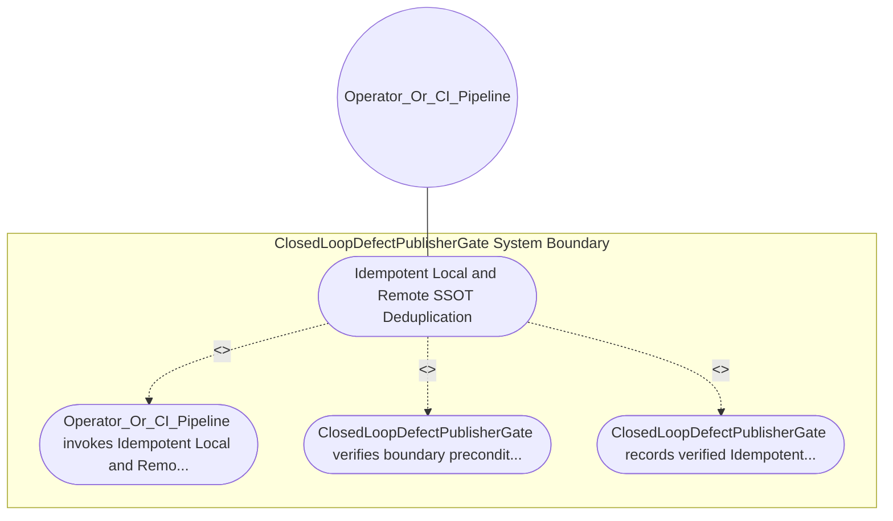

| Attribute | Specification Detail |
| :--- | :--- |
| **Issue ID** | #651 |
| **Title** | Use Case 28: Idempotent Local and Remote SSOT Deduplication |
| **Type** | use-case |
| **Primary Actor** | Operator_Or_CI_Pipeline |
| **Scope** | ClosedLoopDefectPublisherGate |
| **Level** | User Goal |
| **Generation Mode** | subagent |
| **Specification Source** | [schema/model.sysml](../../schema/model.sysml) |

# Use Case 28: Idempotent Local and Remote SSOT Deduplication

## UML Diagrams

## 1. Actors
- `Operator_Or_CI_Pipeline`

## 2. Preconditions
- `ClosedLoopDefectPublisherGate` is initialized and ready to enforce `Idempotent Local and Remote SSOT Deduplication`.
- `Operator_Or_CI_Pipeline` holds authorized operational access to `ClosedLoopDefectPublisherGate`.

## 3. Trigger
- Idempotent Local and Remote SSOT Deduplication

## 4. Main Success Scenario
1. `ClosedLoopDefectPublisherGate` receives a candidate 7-section dossier on `dossierCandidateInPort` and executes `run_check_defect` and `Execute12CheckValidateDefectDossier` (`schemaGateCount = 12`).
2. Upon passing all 12 validation checks (`all_12_checks_passed`), `BP_06_Deterministic_Static_5_Pillar_Code_Auditor_and_Defect_Dossier_Synthesizer_Blueprint_LifecycleState` transitions from `Validating12Gates` to `DeduplicatingSsot`.
3. `DeterministicStaticDefectAuditor` queries existing local `.pipeline/defects/*.md` records and live GitHub issue metadata via `GitHubIssueSsotQueryPort` using `pulldown-cmark` table extraction and normalized signature matching.
4. If an identical finding signature already exists locally and remotely, `DeterministicStaticDefectAuditor` transitions to `Verified` on `existing_finding_skipped` without creating duplicate files or duplicate GitHub issues.
5. If the finding is new, `DeterministicStaticDefectAuditor` writes the validated dossier atomically via `DefectDossierArtifactPort` (`new_finding_persisted_to_pipeline_defects`) and transitions to `PublishingClosedLoop`.

## 5. Alternate and Exception Flows
- 3a. Local `.pipeline/defects/` directory or GitHub SSOT query fails during `DeduplicatingSsot` (`Diagnostic: E0603`):
  - `DeterministicStaticDefectAuditor` transitions to `Rejected`, emits diagnostic `E0603` via `ariadne` / `miette`, and terminates fail-closed with exit code 1.
- 4a. Duplicate local defect files with conflicting finding signatures detected:
  - `ClosedLoopDefectPublisherGate` returns `Result::Err`, aborts publication without mutating remote GitHub issues, and exits fail-closed with code 1.
- 5a. Invariant violation under `Invariant_REQ_0606_SC_01` or `Invariant_REQ_0606_SC_02`:
  - `ClosedLoopDefectPublisherGate` aborts execution, preserves prior verified state, and notifies `Operator_Or_CI_Pipeline` with fail-closed exit status 1.

## 6. Postconditions
- `ClosedLoopDefectPublisherGate` satisfies declared objective `Idempotent Local and Remote SSOT Deduplication` with all subsystem invariants intact.
- Verified `Idempotent Local and Remote SSOT Deduplication` completion status is recorded for `Operator_Or_CI_Pipeline`.

## 8. Realization Matrix
| Specification Item | Type | Link / Reference |
| :--- | :--- | :--- |
| **#728** | User Story | [User Story 39: Evaluate Source File Pillars Across5](../user-stories/US-39-EvaluateSourceFilePillarsAcross5.md) |
| **#680** | Feature | [Feature 26: [BP 06 Deterministic Static 5 Pillar Code Auditor and Defect Dossier Synthesizer Blueprint] ClosedLoopDefectPublisherGate](../features/FEAT-26-ClosedLoopDefectPublisherGate.md) |

## Source References
Use case operational flows and lifecycle activity references:
- System Architecture Model: `schema/model.sysml`
- Normative Systems Engineering Standard: ISO/IEC/IEEE 29148:2018 §6.4.2 Concept of Operations

Operational use case realization and traceability links derive from `schema/model.sysml` pursuant to ISO/IEC/IEEE 29148.
