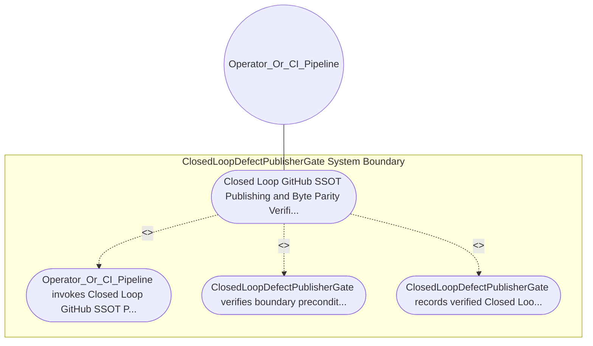

| Attribute | Specification Detail |
| :--- | :--- |
| **Issue ID** | #652 |
| **Title** | Use Case 29: Closed Loop GitHub SSOT Publishing and Byte Parity Verification |
| **Type** | use-case |
| **Primary Actor** | Operator_Or_CI_Pipeline |
| **Scope** | ClosedLoopDefectPublisherGate |
| **Level** | User Goal |
| **Generation Mode** | subagent |
| **Specification Source** | [schema/model.sysml](../../schema/model.sysml) |

# Use Case 29: Closed Loop GitHub SSOT Publishing and Byte Parity Verification

## UML Diagrams

## 1. Actors
- `Operator_Or_CI_Pipeline`

## 2. Preconditions
- `ClosedLoopDefectPublisherGate` is initialized and ready to enforce `Closed Loop GitHub SSOT Publishing and Byte Parity Verification`.
- `Operator_Or_CI_Pipeline` holds authorized operational access to `ClosedLoopDefectPublisherGate`.

## 3. Trigger
- Closed Loop GitHub SSOT Publishing and Byte Parity Verification

## 4. Main Success Scenario
1. `Operator_Or_CI_Pipeline` invokes `Closed Loop GitHub SSOT Publishing and Byte Parity Verification` on `ClosedLoopDefectPublisherGate` targeting objective `Closed Loop GitHub SSOT Publishing and Byte Parity Verification`.
2. `ClosedLoopDefectPublisherGate` verifies boundary preconditions and evaluates `Closed Loop GitHub SSOT Publishing and Byte Parity Verification` invariants (guarding `Diagnostic: E0604`).
3. `ClosedLoopDefectPublisherGate` records verified `Closed Loop GitHub SSOT Publishing and Byte Parity Verification` outcome and returns status to `Operator_Or_CI_Pipeline`.

## 5. Alternate and Exception Flows
- Diagnostic: E0604

## 6. Postconditions
- `ClosedLoopDefectPublisherGate` satisfies declared objective `Closed Loop GitHub SSOT Publishing and Byte Parity Verification` with all subsystem invariants intact.
- Verified `Closed Loop GitHub SSOT Publishing and Byte Parity Verification` completion status is recorded for `Operator_Or_CI_Pipeline`.

## 8. Realization Matrix
| Specification Item | Type | Link / Reference |
| :--- | :--- | :--- |
| **#615** | User Story | [User Story 40: synthesize defect dossier markdown](../user-stories/US-40-synthesize_defect_dossier_markdown.md) |
| **#680** | Feature | [Feature 26: [BP 06 Deterministic Static 5 Pillar Code Auditor and Defect Dossier Synthesizer Blueprint] ClosedLoopDefectPublisherGate](../features/FEAT-26-ClosedLoopDefectPublisherGate.md) |

## Source References
Use case operational flows and lifecycle activity references:
- System Architecture Model: `schema/model.sysml`
- Normative Systems Engineering Standard: ISO/IEC/IEEE 29148:2018 §6.4.2 Concept of Operations

Operational use case realization and traceability links derive from `schema/model.sysml` pursuant to ISO/IEC/IEEE 29148.
