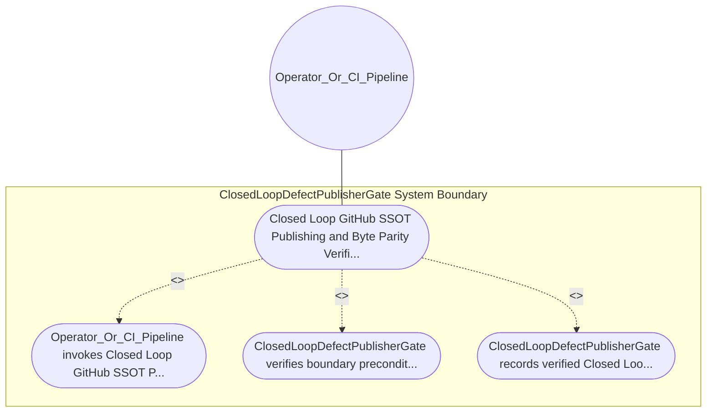

| Attribute | Specification Detail |
| :--- | :--- |
| **Issue ID** | #652 |
| **Title** | Use Case 29: Closed Loop GitHub SSOT Publishing and Byte Parity Verification |
| **Type** | use-case |
| **Primary Actor** | Operator_Or_CI_Pipeline |
| **Scope** | ClosedLoopDefectPublisherGate |
| **Level** | User Goal |
| **Generation Mode** | subagent |
| **Specification Source** | [schema/model.sysml](../../schema/model.sysml) |

# Use Case 29: Closed Loop GitHub SSOT Publishing and Byte Parity Verification

## UML Diagrams

## 1. Actors
- `Operator_Or_CI_Pipeline`

## 2. Preconditions
- `ClosedLoopDefectPublisherGate` and `DeterministicStaticDefectAuditor` are initialized and ready to enforce `Closed Loop GitHub SSOT Publishing and Byte Parity Verification` under **REQ-0606** (`BP-06`).
- **Contract A** (100% normative OMG SysML v2.0 + KerML 1.0 textual grammar coverage with full Definition and Usage symmetry and zero 16-construct artificial caps) and **Contract B** (`ra_ap_syntax` typed AST + Stage-2 `./lints/deap-dylint-mir/` `rustc_middle::mir` (`TyCtxt`) 5-pillar defect dossier auditor + `deap_core::dart_cst` (`logos` + `rowan`) isolation + `pulldown-cmark` + typed `serde_json` + complete deletion of `./crates/deap-core/src/source_ast.rs` (`source_ast.rs`) with zero hand-rolled scanners) are active across `< 380`-SLOC submodules.
- `Operator_Or_CI_Pipeline` holds authorized operational access to `ClosedLoopDefectPublisherGate`.

## 3. Trigger
- Validated 7-section defect dossier is persisted to `./.pipeline/defects/<NAME>.md` (`new_finding_persisted_to_pipeline_defects`).

## 4. Main Success Scenario
1. `ClosedLoopDefectPublisherGate` enters `PublishingClosedLoop` after a validated 7-section dossier is persisted via `DefectDossierArtifactPort`.
2. `ClosedLoopDefectPublisherGate` invokes `GhIssueCreateOrGhIssue` (`gh issue create --body-file` or `gh issue edit --body-file`) across `ClosedLoopTrackerPublishPort` to publish the local `./.pipeline/defects/<NAME>.md` dossier to `GitHub_SSOT_Tracker`.
3. `ClosedLoopDefectPublisherGate` invokes `GhIssueViewJsonTitleBody` (`gh issue view --json title,body,url`) via `GitHubIssueSsotQueryPort` and deserializes the live remote GitHub issue payload via typed `serde_json`.
4. `ClosedLoopDefectPublisherGate` normalizes CRLF to LF across both payloads and verifies `requireByteParity = true` (`closed_loop_mismatch_bytes == 0`) under `Invariant_REQ_0606_SC_02`.
5. `ClosedLoopDefectPublisherGate` transitions to `Verified` on `closed_loop_mismatch_bytes_0`, emits the verified GitHub issue URL on `verifiedReceiptOutPort`, and returns exit code 0 to `Operator_Or_CI_Pipeline`.

## 5. Alternate and Exception Flows
- 3a. `gh issue create`, `gh issue edit`, or `gh issue view` subprocess fails or times out (`Diagnostic: E0604`):
  - `ClosedLoopDefectPublisherGate` transitions to `Rejected`, emits diagnostic `E0604` via `ariadne` / `miette`, and terminates fail-closed with exit code 1.
- 4a. Non-zero byte discrepancy (`closed_loop_mismatch_bytes > 0`) between local `./.pipeline/defects/<NAME>.md` dossier and remote GitHub issue body:
  - `ClosedLoopDefectPublisherGate` transitions to `Rejected` on `remote_payload_mismatch`, emits a byte-diff `miette` diagnostic (`E0604`), and exits fail-closed with code 1.
- 5a. Invariant violation under `Invariant_REQ_0606_SC_01` or `Invariant_REQ_0606_SC_02`:
  - `ClosedLoopDefectPublisherGate` aborts execution without emitting a receipt on `verifiedReceiptOutPort`, preserves prior verified state, and exits fail-closed with code 1.

## 6. Postconditions
- **3-Layer DoD Realization**: Layer 1 (Domain State & Data Model: typed `serde_json` GitHub issue document and `closed_loop_mismatch_bytes == 0` parity state), Layer 2 (Logic & State Management: closed-loop LF-normalized byte comparison inside `< 380`-SLOC submodules under `./crates/verify-baseline/src/defect_dossier/` with `source_ast.rs` and all legacy hand-rolled scanners deleted), and Layer 3 (Presentation & Actuator Interface Binding: `ClosedLoopTrackerPublishPort`, `GitHubIssueSsotQueryPort`, and `verifiedReceiptOutPort` bindings) are satisfied.
- `ClosedLoopDefectPublisherGate` satisfies declared objective `Closed Loop GitHub SSOT Publishing and Byte Parity Verification` with all subsystem invariants intact.
- Verified `Closed Loop GitHub SSOT Publishing and Byte Parity Verification` completion status is recorded for `Operator_Or_CI_Pipeline`.

## 8. Realization Matrix
| Specification Item | Type | Link / Reference |
| :--- | :--- | :--- |
| **#615** | User Story | [User Story 40: synthesize defect dossier markdown](../user-stories/US-40-synthesize_defect_dossier_markdown.md) |
| **#730** | User Story | [User Story 43: Gh Issue Create Or Gh Issue](../user-stories/US-43-GhIssueCreateOrGhIssue.md) |
| **#731** | User Story | [User Story 44: Gh Issue View Json Title Body](../user-stories/US-44-GhIssueViewJsonTitleBody.md) |
| **#680** | Feature | [Feature 26: [BP 06 Deterministic Static 5 Pillar Code Auditor and Defect Dossier Synthesizer Blueprint] ClosedLoopDefectPublisherGate](../features/FEAT-26-ClosedLoopDefectPublisherGate.md) |
| **#682** | Feature | [Feature 28: [BP 06 Deterministic Static 5 Pillar Code Auditor and Defect Dossier Synthesizer Blueprint] DeterministicStaticDefectAuditor](../features/FEAT-28-DeterministicStaticDefectAuditor.md) |

## Source References
Use case operational flows and lifecycle activity references:
- System Architecture Model: `schema/model.sysml`
- Normative Systems Engineering Standard: ISO/IEC/IEEE 29148:2018 §6.4.2 Concept of Operations

Operational use case realization and traceability links derive from `schema/model.sysml` pursuant to ISO/IEC/IEEE 29148.
