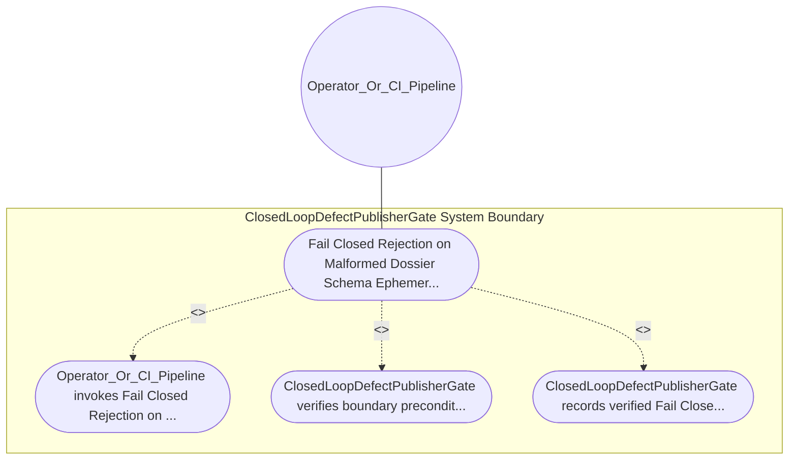

| Attribute | Specification Detail |
| :--- | :--- |
| **Issue ID** | #653 |
| **Title** | Use Case 30: Fail Closed Rejection on Malformed Dossier Schema Ephemeral Paths or Payload Divergence |
| **Type** | use-case |
| **Primary Actor** | Operator_Or_CI_Pipeline |
| **Scope** | ClosedLoopDefectPublisherGate |
| **Level** | User Goal |
| **Generation Mode** | subagent |
| **Specification Source** | [schema/model.sysml](../../schema/model.sysml) |

# Use Case 30: Fail Closed Rejection on Malformed Dossier Schema Ephemeral Paths or Payload Divergence

## UML Diagrams

## 1. Actors
- `Operator_Or_CI_Pipeline`

## 2. Preconditions
- `ClosedLoopDefectPublisherGate`, `DeterministicDossierSynthesizer`, and `MermaidUmlDiagramGenerator` are initialized and ready to enforce `Fail Closed Rejection on Malformed Dossier Schema Ephemeral Paths or Payload Divergence` under **REQ-0606** (`BP-06`).
- **Contract A** (100% normative OMG SysML v2.0 + KerML 1.0 textual grammar coverage with full Definition and Usage symmetry and zero 16-construct artificial caps) and **Contract B** (`ra_ap_syntax` typed AST + Stage-2 `./lints/deap-dylint-mir/` `rustc_middle::mir` (`TyCtxt`) 5-pillar defect dossier auditor + `deap_core::dart_cst` (`logos` + `rowan`) isolation + `pulldown-cmark` + complete deletion of `./crates/deap-core/src/source_ast.rs` (`source_ast.rs`) with zero hand-rolled scanners) are active across `< 380`-SLOC submodules.
- `Operator_Or_CI_Pipeline` holds authorized operational access to `ClosedLoopDefectPublisherGate`.

## 3. Trigger
- `Operator_Or_CI_Pipeline` invokes `./target/release/verify-baseline check-defect ./.pipeline/defects/<NAME>.md` (`run_check_defect`).

## 4. Main Success Scenario
1. `Operator_Or_CI_Pipeline` invokes `run_check_defect` (`./target/release/verify-baseline check-defect`) on `ClosedLoopDefectPublisherGate` with a candidate dossier payload supplied on `dossierCandidateInPort`.
2. `ClosedLoopDefectPublisherGate` transitions to `Validating12Gates` and executes `Execute12CheckValidateDefectDossier` (`schemaGateCount = 12`, `dossier_schema_check_count = 12`) using `pulldown-cmark` AST validation.
3. `ClosedLoopDefectPublisherGate` inspects the candidate dossier for ephemeral temporary directory or host-specific machine paths, missing `DossierSection` headers (`mandatorySectionCount < 7`), shallow `Why ...? Because ...` chains (`whysChainDepth < 5`), unquoted Mermaid labels or semicolons, or Unicode em dashes.
4. Upon detecting a schema violation, non-workspace-relative ephemeral path, or remote GitHub body divergence (`closed_loop_mismatch_bytes > 0` bytes), `ClosedLoopDefectPublisherGate` transitions to `Rejected` (`Diagnostic: E0605`).
5. `ClosedLoopDefectPublisherGate` emits a structured `ariadne` / `miette` diagnostic identifying the failed check among the 12 gates, blocks publication on `ClosedLoopTrackerPublishPort`, and exits fail-closed with code 1.

## 5. Alternate and Exception Flows
- 3a. Candidate dossier contains hardcoded host, user, or ephemeral temporary directory paths (`Diagnostic: E0605`):
  - `ClosedLoopDefectPublisherGate` transitions to `Rejected` on `schema_or_Mermaid_check_violation`, emits diagnostic `E0605` via `miette`, and terminates fail-closed with exit code 1.
- 4a. Candidate dossier fails any of the 12 structural or Mermaid E1--E5 checks in `validate_defect_dossier`:
  - `ClosedLoopDefectPublisherGate` returns `Result::Err` without writing to `DefectDossierArtifactPort` and exits fail-closed with code 1.
- 5a. Remote GitHub issue body diverges from local `./.pipeline/defects/` file after LF normalization (`closed_loop_mismatch_bytes != 0`):
  - `ClosedLoopDefectPublisherGate` transitions to `Rejected` on `remote_payload_mismatch`, preserves prior verified state, and exits fail-closed with status code 1.

## 6. Postconditions
- **3-Layer DoD Realization**: Layer 1 (Domain State & Data Model: `pulldown-cmark` 12-check diagnostic state and `schemaGateCount = 12` invariants), Layer 2 (Logic & State Management: fail-closed 12-check validation inside `< 380`-SLOC submodules under `./crates/verify-baseline/src/defect_dossier/` with `source_ast.rs` and all legacy hand-rolled scanners deleted), and Layer 3 (Presentation & Actuator Interface Binding: `ariadne` / `miette` `E0605` diagnostic emission and blocked `ClosedLoopTrackerPublishPort`) are satisfied.
- `ClosedLoopDefectPublisherGate` satisfies declared objective `Fail Closed Rejection on Malformed Dossier Schema Ephemeral Paths or Payload Divergence` with all subsystem invariants intact.
- Verified `Fail Closed Rejection on Malformed Dossier Schema Ephemeral Paths or Payload Divergence` completion status is recorded for `Operator_Or_CI_Pipeline`.

## 8. Realization Matrix
| Specification Item | Type | Link / Reference |
| :--- | :--- | :--- |
| **#617** | User Story | [User Story 41: Run Check Defect](../user-stories/US-41-run_check_defect.md) |
| **#729** | User Story | [User Story 42: Execute12 Check Validate Defect Dossier](../user-stories/US-42-Execute12CheckValidateDefectDossier.md) |
| **#680** | Feature | [Feature 26: [BP 06 Deterministic Static 5 Pillar Code Auditor and Defect Dossier Synthesizer Blueprint] ClosedLoopDefectPublisherGate](../features/FEAT-26-ClosedLoopDefectPublisherGate.md) |
| **#681** | Feature | [Feature 27: [BP 06 Deterministic Static 5 Pillar Code Auditor and Defect Dossier Synthesizer Blueprint] DeterministicDossierSynthesizer](../features/FEAT-27-DeterministicDossierSynthesizer.md) |
| **#684** | Feature | [Feature 30: [BP 06 Deterministic Static 5 Pillar Code Auditor and Defect Dossier Synthesizer Blueprint] MermaidUmlDiagramGenerator](../features/FEAT-30-MermaidUmlDiagramGenerator.md) |

## Source References
Use case operational flows and lifecycle activity references:
- System Architecture Model: `schema/model.sysml`
- Normative Systems Engineering Standard: ISO/IEC/IEEE 29148:2018 §6.4.2 Concept of Operations

Operational use case realization and traceability links derive from `schema/model.sysml` pursuant to ISO/IEC/IEEE 29148.
