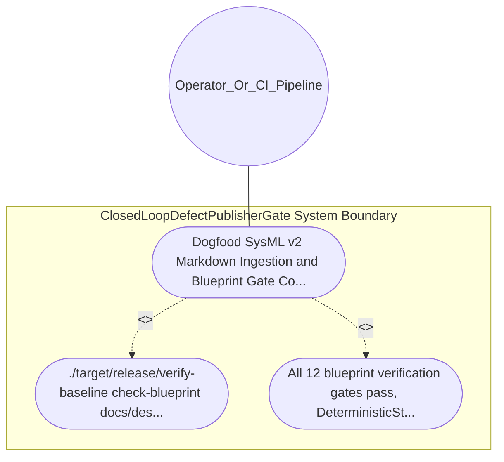

| Attribute | Specification Detail |
| :--- | :--- |
| **Issue ID** | #654 |
| **Title** | Use Case 31: Dogfood SysML v2 Markdown Ingestion and Blueprint Gate Conformance |
| **Type** | use-case |
| **Primary Actor** | Operator_Or_CI_Pipeline |
| **Scope** | ClosedLoopDefectPublisherGate |
| **Level** | User Goal |
| **Generation Mode** | subagent |
| **Specification Source** | [schema/model.sysml](../../schema/model.sysml) |

# Use Case 31: Dogfood SysML v2 Markdown Ingestion and Blueprint Gate Conformance

## UML Diagrams

## 1. Actors
- `Operator_Or_CI_Pipeline`

## 2. Preconditions
- This blueprint specification at docs/designs/blueprint-06-deterministic-static-defect-dossier-auditor.md.

## 3. Trigger
- ./target/release/verify-baseline check-blueprint docs/designs/blueprint-06-deterministic-static-defect-dossier-auditor.md --dry-run is executed.

## 4. Main Success Scenario
1. ./target/release/verify-baseline check-blueprint docs/designs/blueprint-06-deterministic-static-defect-dossier-auditor.md --dry-run is executed.
2. All 12 blueprint verification gates pass, DeterministicStaticDefectAuditor and its component metamodel are lowered into docs/designs/blueprint-06-deterministic-static-defect-dossier-auditor.sysml and .digest.json with bijective roundtrip parity, and the command exits with code 0.

## 5. Alternate and Exception Flows
- Precondition guard failure in `ClosedLoopDefectPublisherGate`:
  - `ClosedLoopDefectPublisherGate` rejects the `Dogfood SysML v2 Markdown Ingestion and Blueprint Gate Conformance` request without partial state mutation and reports diagnostic status to `Operator_Or_CI_Pipeline`.
- Invariant violation while enforcing `Dogfood SysML v2 Markdown Ingestion and Blueprint Gate Conformance`:
  - `ClosedLoopDefectPublisherGate` aborts `Dogfood SysML v2 Markdown Ingestion and Blueprint Gate Conformance` execution, preserves prior verified state, and notifies `Operator_Or_CI_Pipeline`.

## 6. Postconditions
- All 12 blueprint verification gates pass, DeterministicStaticDefectAuditor and its component metamodel are lowered into docs/designs/blueprint-06-deterministic-static-defect-dossier-auditor.sysml and .digest.json with bijective roundtrip parity, and the command exits with code 0.

## 8. Realization Matrix
| Specification Item | Type | Link / Reference |
| :--- | :--- | :--- |
| **#729** | User Story | [User Story 42: Execute12 Check Validate Defect Dossier](../user-stories/US-42-Execute12CheckValidateDefectDossier.md) |
| **#680** | Feature | [Feature 26: [BP 06 Deterministic Static 5 Pillar Code Auditor and Defect Dossier Synthesizer Blueprint] ClosedLoopDefectPublisherGate](../features/FEAT-26-ClosedLoopDefectPublisherGate.md) |

## Source References
Use case operational flows and lifecycle activity references:
- System Architecture Model: `schema/model.sysml`
- Normative Systems Engineering Standard: ISO/IEC/IEEE 29148:2018 §6.4.2 Concept of Operations

Operational use case realization and traceability links derive from `schema/model.sysml` pursuant to ISO/IEC/IEEE 29148.
