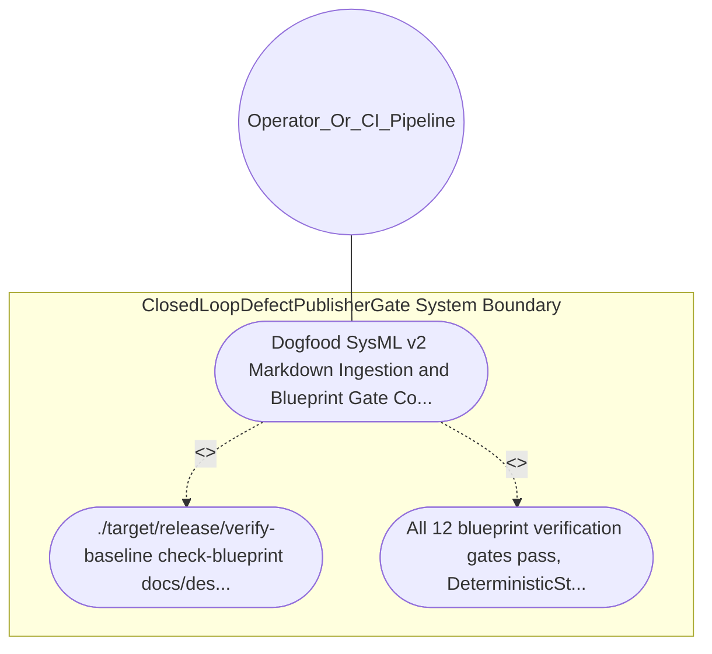

| Attribute | Specification Detail |
| :--- | :--- |
| **Issue ID** | #654 |
| **Title** | Use Case 31: Dogfood SysML v2 Markdown Ingestion and Blueprint Gate Conformance |
| **Type** | use-case |
| **Primary Actor** | Operator_Or_CI_Pipeline |
| **Scope** | ClosedLoopDefectPublisherGate |
| **Level** | User Goal |
| **Generation Mode** | subagent |
| **Specification Source** | [schema/model.sysml](../../schema/model.sysml) |

# Use Case 31: Dogfood SysML v2 Markdown Ingestion and Blueprint Gate Conformance

## UML Diagrams

## 1. Actors
- `Operator_Or_CI_Pipeline`

## 2. Preconditions
- This blueprint specification at docs/designs/blueprint-06-deterministic-static-defect-dossier-auditor.md.

## 3. Trigger
- ./target/release/verify-baseline check-blueprint docs/designs/blueprint-06-deterministic-static-defect-dossier-auditor.md --dry-run is executed.

## 4. Main Success Scenario
1. `Operator_Or_CI_Pipeline` executes `./target/release/verify-baseline check-blueprint docs/designs/blueprint-06-deterministic-static-defect-dossier-auditor.md --dry-run` using `pulldown-cmark` to parse the 8-part blueprint AST.
2. `ClosedLoopDefectPublisherGate` validates all 12 mechanical blueprint verification gates for `REQ-0606`, including KaTeX invariants (`Invariant_REQ_0606_SC_01`, `Invariant_REQ_0606_SC_02`), Mermaid state and sequence diagrams, and 5-column STPA/FMECA tables.
3. `Operator_Or_CI_Pipeline` invokes `ingest-sysml` using `logos` and `rowan` to lower `DeterministicStaticDefectAuditor`, `ClosedLoopDefectPublisherGate`, `DeterministicDossierSynthesizer`, `FivePillarStaticAstAnalyzer`, and `MermaidUmlDiagramGenerator` into canonical SysML v2.
4. `ingest-sysml` emits `docs/designs/blueprint-06-deterministic-static-defect-dossier-auditor.sysml` and `.digest.json` and verifies bijective roundtrip parity (`roundtrip_ast_mismatch_count == 0`).
5. `ClosedLoopDefectPublisherGate` confirms 100% schema conformance with `schema/model.sysml` and exits with code 0.

## 5. Alternate and Exception Flows
- 3a. Blueprint Markdown fails any of the 12 mechanical verification gates in `check-blueprint`:
  - `verify-baseline` returns `Result::Err`, emits an `ariadne` / `miette` structural diagnostic, and terminates fail-closed with exit code 1.
- 4a. Bijective SysML v2 roundtrip mismatch or unresolved port/part reference during `ingest-sysml`:
  - `ingest-sysml` aborts emission via `Result<T, E>`, preserves prior verified `.sysml` and `.digest.json` state, and exits fail-closed with code 1.
- 5a. Invariant violation under `Invariant_REQ_0606_SC_01` or `Invariant_REQ_0606_SC_02`:
  - `ClosedLoopDefectPublisherGate` aborts execution without partial state mutation, preserves prior verified state, and returns fail-closed status code 1 to `Operator_Or_CI_Pipeline`.

## 6. Postconditions
- All 12 blueprint verification gates pass, DeterministicStaticDefectAuditor and its component metamodel are lowered into docs/designs/blueprint-06-deterministic-static-defect-dossier-auditor.sysml and .digest.json with bijective roundtrip parity, and the command exits with code 0.

## 8. Realization Matrix
| Specification Item | Type | Link / Reference |
| :--- | :--- | :--- |
| **#729** | User Story | [User Story 42: Execute12 Check Validate Defect Dossier](../user-stories/US-42-Execute12CheckValidateDefectDossier.md) |
| **#680** | Feature | [Feature 26: [BP 06 Deterministic Static 5 Pillar Code Auditor and Defect Dossier Synthesizer Blueprint] ClosedLoopDefectPublisherGate](../features/FEAT-26-ClosedLoopDefectPublisherGate.md) |

## Source References
Use case operational flows and lifecycle activity references:
- System Architecture Model: `schema/model.sysml`
- Normative Systems Engineering Standard: ISO/IEC/IEEE 29148:2018 §6.4.2 Concept of Operations

Operational use case realization and traceability links derive from `schema/model.sysml` pursuant to ISO/IEC/IEEE 29148.
