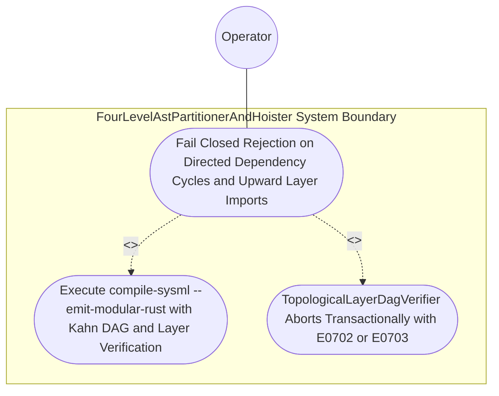

| Attribute | Specification Detail |
| :--- | :--- |
| **Issue ID** | #760 |
| **Title** | Use Case 32: Fail Closed Rejection on Directed Dependency Cycles and Upward Layer Imports |
| **Type** | use-case |
| **Primary Actor** | Operator |
| **Scope** | FourLevelAstPartitionerAndHoister |
| **Level** | User Goal |
| **Generation Mode** | subagent |
| **Specification Source** | [schema/model.sysml](../../schema/model.sysml) |

# Use Case 32: Fail Closed Rejection on Directed Dependency Cycles and Upward Layer Imports

## UML Diagrams

## 1. Actors
- `Operator`

## 2. Preconditions
- A SysML v2 `PackageDef` fixture parsed via `deap_core::sysml_cst` (`logos` + `rowan` + `salsa` + `ariadne`) under **Contract A** (100% normative OMG SysML v2.0 + KerML 1.0 textual grammar coverage with full Definition and Usage symmetry across `package`/`library package`/`standard library package`, `import`, `metadata def`/`@Metadata`/`#capability`/`#hazard`/`#risk`/`#rt_loop`/`#dal`/`#fls` and backward-compatible `hazard def`/`risk def`/`capability def`, `part def`/`part`, `item def`/`item`, `attribute def`/`attribute`, `enum def`/`enum`, `port def`/`port`, `connection def`/`connection`, `interface def`/`interface`, `flow def`/`flow`, `allocation def`/`allocation`, `occurrence def`/`occurrence`, `action def`/`action`, `state def`/`state`, `calc def`/`calc`, `constraint def`/`constraint`, `requirement def`/`requirement`, `concern def`/`concern`, `use case def`/`use case`, `analysis def`/`analysis`, `verification def`/`verification`, `test case def`/`test case`, `interaction def`/`interaction`, `view def`/`view`, `viewpoint def`/`viewpoint`, `rendering def`/`rendering`, `variation`/`variant`, and KerML specialization/multiplicity/expressions, with zero 16-construct artificial caps) containing either a directed dependency cycle across packages/classifiers or a `@Layer(Domain)` classifier referencing a `@Layer(Presentation)` or `@Layer(Application)` classifier.

## 3. Trigger
- `./target/release/compile-sysml --emit-modular-rust <OUT_DIR> --schema <FIXTURE>` is executed.

## 4. Main Success Scenario
1. `Operator` invokes `./target/release/compile-sysml --emit-modular-rust <OUT_DIR> --schema <FIXTURE>` on `SelfHostingModularCodegenCompiler` via `package_ast_in`, transitioning `BP_07_Self_Hosting_4_Level_Modular_Multi_File_Code_Generator_Blueprint_LifecycleState` from `Idle` to `VerifyingDagAndLayers`.
2. `SelfHostingModularCodegenCompiler` extracts classifier and package dependency edges across the full OMG SysML v2.0 + KerML 1.0 AST into `dependency_edges_in` and invokes `verify_dag_and_layers(node_layers, edges)` on `TopologicalLayerDagVerifier` (`max_layer_tier = 3`, `zero_recursion_kahn = true`).
3. `TopologicalLayerDagVerifier` executes iterative Kahn topological sorting and `@Layer` monotonicity verification under `Invariant_REQ_0607_SC_02` and **Contract B** (official Rust compiler and codegen stack `syn` + `proc-macro2` + `quote` + `prettyplease` + `ra_ap_syntax`, zero hand-rolled string/line/char-by-char scanners) inside `< 380` exec SLOC submodules (`./crates/compile-sysml/src/modular_codegen/` and `./crates/deap-core/src/rust_cst/`), while retiring legacy hand-rolled scanners and monolithic string-concatenation templates in `./crates/compile-sysml/src/driver.rs` (`-450+` SLOC) and `./crates/compile-sysml/src/flutter_codegen.rs` (`-650+` SLOC).
4. `TopologicalLayerDagVerifier` detects a directed dependency cycle across packages/classifiers or an illegal upward layer reference (`@Layer(Domain)` referencing `@Layer(Presentation)` or `@Layer(Application)`).
5. `TopologicalLayerDagVerifier` transitions to `RejectedFailClosed`, emits structured diagnostic `E0702` (cycle) or `E0703` (illegal upward layer dependency) via `diagnostic_out`, leaves `<OUT_DIR>` with zero generated files written, and exits fail-closed with code 1.

## 5. Alternate and Exception Flows
- 3a. Directed dependency cycle detected in `TopologicalLayerDagVerifier` (`Diagnostic: E0702`):
  - `TopologicalLayerDagVerifier` aborts Kahn topological ordering without recursion, transitions to `RejectedFailClosed`, emits `E0702` on `diagnostic_out` with exact cycle node spans, and terminates fail-closed with exit code 1.
- 4a. Upward architectural layer import detected under `Invariant_REQ_0607_SC_02` (`Diagnostic: E0703`):
  - `TopologicalLayerDagVerifier` rejects the `@Layer(Domain)` to `@Layer(Application)` / `@Layer(Presentation)` edge, preserves `<OUT_DIR>` untouched with zero partial writes, and exits fail-closed with code 1.
- 5a. Precondition or AST schema invariant violation while enforcing `C_MOD_01` through `C_MOD_05`:
  - `FourLevelAstPartitionerAndHoister` aborts `Fail Closed Rejection on Directed Dependency Cycles and Upward Layer Imports` execution via `Result::Err`, preserves prior verified state, and reports diagnostic status to `Operator`.

## 6. Postconditions
- **Success/Fail-Closed Guarantee (3-Layer DoD)**:
  - **Layer 1 (Domain State & Data Model)**: `TopologicalLayerDagVerifier` records the rejected cycle or upward `@Layer` edge in typed `ModularityDiagnostic` state without mutating committed schema or target trees.
  - **Layer 2 (Logic & State Management)**: `TopologicalLayerDagVerifier` aborts transactionally with exit code 1 inside `< 380` exec SLOC submodules (`./crates/compile-sysml/src/modular_codegen/`) with zero recursion and zero hand-rolled scanners.
  - **Layer 3 (Presentation & Actuator Interface Binding)**: Structured diagnostic `E0702` (cycle) or `E0703` (illegal upward layer dependency) is emitted on `diagnostic_out`, and `<OUT_DIR>` contains zero generated files.

## 8. Realization Matrix
| Specification Item | Type | Link / Reference |
| :--- | :--- | :--- |
| **#794** | User Story | [User Story 45: verify dag and layers](../user-stories/US-45-verify_dag_and_layers.md) (executes iterative Kahn DAG topological sorting and `@Layer` monotonicity verification) |
| **#737** | Feature | [Feature 31: [BP 07 Self Hosting 4 Level Modular Multi File Code Generator Blueprint] FourLevelAstPartitionerAndHoister](../features/FEAT-31-FourLevelAstPartitionerAndHoister.md) (enforces `Invariant_REQ_0607_SC_02` before 4-level AST lowering) |
| **#740** | Feature | [Feature 34: [BP 07 Self Hosting 4 Level Modular Multi File Code Generator Blueprint] SelfHostingModularCodegenCompiler](../features/FEAT-34-SelfHostingModularCodegenCompiler.md) (orchestrates fail-closed transactional abort and `diagnostic_out` reporting) |
| **#741** | Feature | [Feature 35: [BP 07 Self Hosting 4 Level Modular Multi File Code Generator Blueprint] TopologicalLayerDagVerifier](../features/FEAT-35-TopologicalLayerDagVerifier.md) (implements iterative zero-recursion Kahn sort and `@Layer` monotonicity guard) |

## Source References
Use case operational flows and lifecycle activity references:
- System Architecture Model: `schema/model.sysml`
- Normative Systems Engineering Standard: ISO/IEC/IEEE 29148:2018 §6.4.2 Concept of Operations

Operational use case realization and traceability links derive from `schema/model.sysml` pursuant to ISO/IEC/IEEE 29148.
