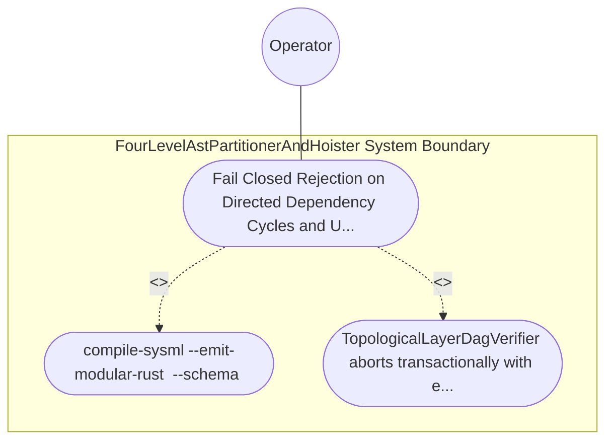

| Attribute | Specification Detail |
| :--- | :--- |
| **Issue ID** | #760 |
| **Title** | Use Case 32: Fail Closed Rejection on Directed Dependency Cycles and Upward Layer Imports |
| **Type** | use-case |
| **Primary Actor** | Operator |
| **Scope** | FourLevelAstPartitionerAndHoister |
| **Level** | User Goal |
| **Generation Mode** | subagent |
| **Specification Source** | [schema/model.sysml](../../schema/model.sysml) |

# Use Case 32: Fail Closed Rejection on Directed Dependency Cycles and Upward Layer Imports

## UML Diagrams

## 1. Actors
- `Operator`

## 2. Preconditions
- A SysML v2 PackageDef fixture containing either a directed dependency cycle across packages/classifiers or a @Layer(Domain) classifier referencing a @Layer(Presentation) or @Layer(Application) classifier.

## 3. Trigger
- compile-sysml --emit-modular-rust <OUT_DIR> --schema <FIXTURE> is executed.

## 4. Main Success Scenario
1. `Operator` invokes `compile-sysml --emit-modular-rust <OUT_DIR> --schema <FIXTURE>` on `SelfHostingModularCodegenCompiler` via `package_ast_in`, transitioning `BP_07_Self_Hosting_4_Level_Modular_Multi_File_Code_Generator_Blueprint_LifecycleState` from `Idle` to `VerifyingDagAndLayers`.
2. `SelfHostingModularCodegenCompiler` extracts classifier and package dependency edges into `dependency_edges_in` and invokes `verify_dag_and_layers(node_layers, edges)` on `TopologicalLayerDagVerifier` (`max_layer_tier = 3`, `zero_recursion_kahn = true`).
3. `TopologicalLayerDagVerifier` executes iterative Kahn topological sorting and `@Layer` monotonicity verification under `Invariant_REQ_0607_SC_02` inside `< 380` exec SLOC submodules (`crates/compile-sysml/src/modular_codegen/`).
4. `TopologicalLayerDagVerifier` detects a directed dependency cycle across packages/classifiers or an illegal upward layer reference (`@Layer(Domain)` referencing `@Layer(Presentation)` or `@Layer(Application)`).
5. `TopologicalLayerDagVerifier` transitions to `RejectedFailClosed`, emits structured diagnostic `E0702` (cycle) or `E0703` (illegal upward layer dependency) via `diagnostic_out`, leaves `<OUT_DIR>` with zero generated files written, and exits fail-closed with code 1.

## 5. Alternate and Exception Flows
- 3a. Directed dependency cycle detected in `TopologicalLayerDagVerifier` (`Diagnostic: E0702`):
  - `TopologicalLayerDagVerifier` aborts Kahn topological ordering without recursion, transitions to `RejectedFailClosed`, emits `E0702` on `diagnostic_out` with exact cycle node spans, and terminates fail-closed with exit code 1.
- 4a. Upward architectural layer import detected under `Invariant_REQ_0607_SC_02` (`Diagnostic: E0703`):
  - `TopologicalLayerDagVerifier` rejects the `@Layer(Domain)` to `@Layer(Application)` / `@Layer(Presentation)` edge, preserves `<OUT_DIR>` untouched with zero partial writes, and exits fail-closed with code 1.
- 5a. Precondition or AST schema invariant violation while enforcing `C_MOD_01` through `C_MOD_05`:
  - `FourLevelAstPartitionerAndHoister` aborts `Fail Closed Rejection on Directed Dependency Cycles and Upward Layer Imports` execution via `Result::Err`, preserves prior verified state, and reports diagnostic status to `Operator`.

## 6. Postconditions
- TopologicalLayerDagVerifier aborts transactionally with exit code 1, emits structured diagnostic E0702 (cycle) or E0703 (illegal upward layer dependency), and leaves <OUT_DIR> with zero generated files written.

## 8. Realization Matrix
| Specification Item | Type | Link / Reference |
| :--- | :--- | :--- |
| **TBD** | User Story | [User Story 45: verify dag and layers](../user-stories/US-45-verify_dag_and_layers.md) |
| **TBD** | Feature | [Feature 31: [BP 07 Self Hosting 4 Level Modular Multi File Code Generator Blueprint] FourLevelAstPartitionerAndHoister](../features/FEAT-31-FourLevelAstPartitionerAndHoister.md) |

## Source References
Use case operational flows and lifecycle activity references:
- System Architecture Model: `schema/model.sysml`
- Normative Systems Engineering Standard: ISO/IEC/IEEE 29148:2018 §6.4.2 Concept of Operations

Operational use case realization and traceability links derive from `schema/model.sysml` pursuant to ISO/IEC/IEEE 29148.
