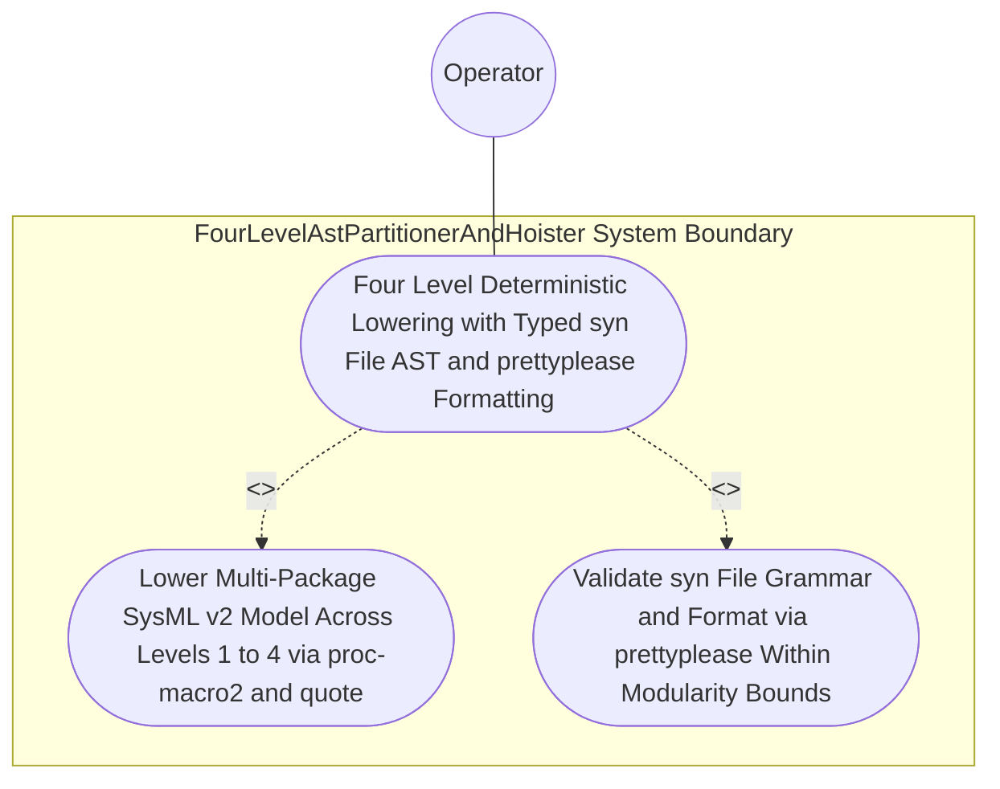

| Attribute | Specification Detail |
| :--- | :--- |
| **Issue ID** | #762 |
| **Title** | Use Case 33: Four Level Deterministic Lowering with Typed syn File AST and prettyplease Formatting |
| **Type** | use-case |
| **Primary Actor** | Operator |
| **Scope** | FourLevelAstPartitionerAndHoister |
| **Level** | User Goal |
| **Generation Mode** | subagent |
| **Specification Source** | [schema/model.sysml](../../schema/model.sysml) |

# Use Case 33: Four Level Deterministic Lowering with Typed syn File AST and prettyplease Formatting

## UML Diagrams

## 1. Actors
- `Operator`

## 2. Preconditions
- A valid multi-package SysML v2 model parsed via `deap_core::sysml_cst` (`logos` + `rowan` + `salsa` + `ariadne`) under **Contract A** (100% normative OMG SysML v2.0 + KerML 1.0 textual grammar coverage with full Definition and Usage symmetry across `package`/`library package`/`standard library package`, `import`, `metadata def`/`@Metadata`/`#capability`/`#hazard`/`#risk`/`#rt_loop`/`#dal`/`#fls` and backward-compatible `hazard def`/`risk def`/`capability def`, `part def`/`part`, `item def`/`item`, `attribute def`/`attribute`, `enum def`/`enum`, `port def`/`port`, `connection def`/`connection`, `interface def`/`interface`, `flow def`/`flow`, `allocation def`/`allocation`, `occurrence def`/`occurrence`, `action def`/`action`, `state def`/`state`, `calc def`/`calc`, `constraint def`/`constraint`, `requirement def`/`requirement`, `concern def`/`concern`, `use case def`/`use case`, `analysis def`/`analysis`, `verification def`/`verification`, `test case def`/`test case`, `interaction def`/`interaction`, `view def`/`view`, `viewpoint def`/`viewpoint`, `rendering def`/`rendering`, `variation`/`variant`, and KerML specialization/multiplicity/expressions, with zero 16-construct artificial caps) containing nested `PackageDef` hierarchies, multi-facet `PartDef` components, a 40-step `ActionDef` sequence, a 30-transition `StateDef` state machine, and a 25-clause `ConstraintDef` boolean `Expr` tree.

## 3. Trigger
- `./target/release/compile-sysml --emit-modular-rust <OUT_DIR> --schema <FIXTURE>` compiles and lowers the model across Levels 1 through 4 via `proc-macro2` + `quote::quote!` + `syn::parse2::<syn::File>` and `prettyplease::unparse`.

## 4. Main Success Scenario
1. `Operator` invokes `./target/release/compile-sysml --emit-modular-rust <OUT_DIR> --schema <FIXTURE>` on `SelfHostingModularCodegenCompiler`, which verifies DAG acyclicity via `verify_dag_and_layers` and transitions `BP_07_Self_Hosting_4_Level_Modular_Multi_File_Code_Generator_Blueprint_LifecycleState` to `LoweringFourLevels`.
2. `FourLevelAstPartitionerAndHoister` receives `validated_ast_in` and executes `partition_and_hoist(pkg)` across Levels 1 through 4 (`max_action_steps_per_stage = 6`, `max_transitions_per_handler = 6`, `anf_branch_budget = 6`), emitting `module_graph_out` and transitioning to `SynthesizingInMemoryUnits`.
3. `ModularRustMultiFileEmitter` receives `rust_module_graph_in` across `BP_07_PartitionerToRustEmitterConnection` and invokes `synthesize_module_tokens(module_name)` via `proc-macro2` and `quote::quote!` under **Contract B** (zero hand-rolled string/line/char-by-char scanners, zero `format!` / `push_str` string-concatenation code emitters) inside `< 380` exec SLOC submodules (`./crates/compile-sysml/src/modular_codegen/`), retiring legacy string templates in `./crates/compile-sysml/src/driver.rs` (`-450+` SLOC) and `./crates/compile-sysml/src/flutter_codegen.rs` (`-650+` SLOC).
4. `ModularRustMultiFileEmitter` validates every synthesized unit via `build_syn_file(tokens)` (`syn::parse2::<syn::File>`) and `ra_ap_syntax::SourceFile::parse`, and formats canonical LF source via `format_pretty_syn_file(file)` (`prettyplease::unparse`) under `Invariant_REQ_0607_SC_04`.
5. `ModularRustMultiFileEmitter` executes `emit_modular_rust_tree` to atomically persist hierarchical `mod.rs` barrels and facet submodules (`model.rs`, `invariants.rs`, `ports.rs`, `fsm.rs`, `stage_<i>()`, `step_from_<state>()`, and `eval_<constraint>_term_<i>()`) satisfying `C_MOD_01` (`max_file_lines <= 400`), `C_MOD_02` (`max_items_per_file <= 12`), and `C_MOD_03` (`max_cyclomatic_complexity <= 8`) with exit code 0.

## 5. Alternate and Exception Flows
- 3a. Synthesized token stream fails `syn::parse2::<syn::File>` grammar validation (`Diagnostic: E0704`):
  - `ModularRustMultiFileEmitter` transitions to `RejectedFailClosed`, emits structured diagnostic `E0704` on `diagnostic_out`, aborts before any filesystem write to `<OUT_DIR>`, and exits fail-closed with code 1.
- 4a. Lowered compilation unit exceeds `C_MOD_01` (`400` LOC), `C_MOD_02` (`12` items), or `C_MOD_03` (`v(G) <= 8`) under `Invariant_REQ_0607_SC_01` (`Diagnostic: E0701`):
  - `FourLevelAstPartitionerAndHoister` rejects the unpartitioned unit, emits diagnostic `E0701` on `diagnostic_out`, and terminates fail-closed with exit code 1.
- 5a. Transactional staging or filesystem persistence failure in `emit_modular_rust_tree`:
  - `SelfHostingModularCodegenCompiler` rolls back the staging directory without mutating `<OUT_DIR>`, preserves prior verified state, and reports diagnostic status to `Operator`.

## 6. Postconditions
- **Success/Fail-Closed Guarantee (3-Layer DoD)**:
  - **Layer 1 (Domain State & Data Model)**: All lowered Rust compilation units satisfy `C_MOD_01` (`50..=400` LOC), `C_MOD_02` (`1..=12` items), and `C_MOD_03` (`v(G) <= 8`) with SHA-256 manifest records.
  - **Layer 2 (Logic & State Management)**: Compilation succeeds with exit code 0 via `proc-macro2` + `quote::quote!` + `syn::parse2::<syn::File>` + `prettyplease::unparse` inside `< 380` exec SLOC submodules (`./crates/compile-sysml/src/modular_codegen/`) with legacy string-concatenation emitters in `./crates/compile-sysml/src/driver.rs` (`-450+` SLOC) and `./crates/compile-sysml/src/flutter_codegen.rs` (`-650+` SLOC) deleted.
  - **Layer 3 (Presentation & Actuator Interface Binding)**: Hierarchical `mod.rs` barrels, facet submodules (`model.rs`, `invariants.rs`, `ports.rs`, `fsm.rs`), chunked `stage_<i>()` / `step_from_<state>()` handlers, and ANF `eval_<constraint>_term_<i>()` helpers are atomically persisted to `<OUT_DIR>`.

## 8. Realization Matrix
| Specification Item | Type | Link / Reference |
| :--- | :--- | :--- |
| **#796** | User Story | [User Story 46: Partition And Hoist](../user-stories/US-46-partition_and_hoist.md) (lowers full SysML v2.0 + KerML 1.0 AST across Levels 1--4) |
| **#797** | User Story | [User Story 47: Synthesize Module Tokens](../user-stories/US-47-synthesize_module_tokens.md) (synthesizes `proc-macro2::TokenStream` via `quote::quote!`) |
| **#798** | User Story | [User Story 48: Build Syn File](../user-stories/US-48-build_syn_file.md) (validates `syn::parse2::<syn::File>` grammar) |
| **#799** | User Story | [User Story 49: Format Pretty Syn File](../user-stories/US-49-format_pretty_syn_file.md) (formats canonical LF Rust source via `prettyplease::unparse`) |
| **#800** | User Story | [User Story 50: Emit Modular Rust Tree](../user-stories/US-50-emit_modular_rust_tree.md) (atomically persists multi-file Rust module tree) |
| **#829** | Feature | [Feature 31: [BP 07 Self Hosting 4 Level Modular Multi File Code Generator Blueprint] FourLevelAstPartitionerAndHoister](../features/FEAT-31-FourLevelAstPartitionerAndHoister.md) (executes 4-level AST partitioning and ANF hoisting) |
| **#831** | Feature | [Feature 33: [BP 07 Self Hosting 4 Level Modular Multi File Code Generator Blueprint] ModularRustMultiFileEmitter](../features/FEAT-33-ModularRustMultiFileEmitter.md) (executes `proc-macro2` + `quote` + `syn::File` + `prettyplease` emission) |

## Source References
Use case operational flows and lifecycle activity references:
- System Architecture Model: `schema/model.sysml`
- Normative Systems Engineering Standard: ISO/IEC/IEEE 29148:2018 §6.4.2 Concept of Operations

Operational use case realization and traceability links derive from `schema/model.sysml` pursuant to ISO/IEC/IEEE 29148.
