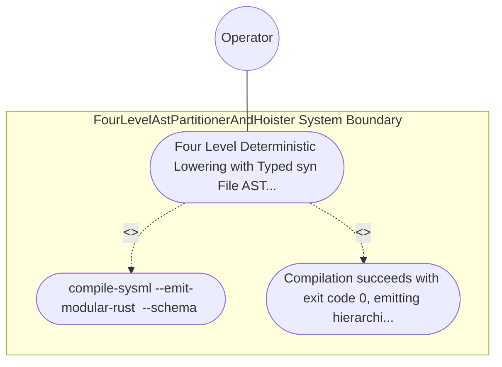

| Attribute | Specification Detail |
| :--- | :--- |
| **Issue ID** | #761 |
| **Title** | Use Case 33: Four Level Deterministic Lowering with Typed syn File AST and prettyplease Formatting |
| **Type** | use-case |
| **Primary Actor** | Operator |
| **Scope** | FourLevelAstPartitionerAndHoister |
| **Level** | User Goal |
| **Generation Mode** | subagent |
| **Specification Source** | [schema/model.sysml](../../schema/model.sysml) |

# Use Case 33: Four Level Deterministic Lowering with Typed syn File AST and prettyplease Formatting

## UML Diagrams

## 1. Actors
- `Operator`

## 2. Preconditions
- A valid multi-package SysML v2 model containing nested PackageDef hierarchies, multi-facet PartDef components, a 40-step ActionDef sequence, a 30-transition StateDef state machine, and a 25-clause ConstraintDef boolean Expr tree.

## 3. Trigger
- compile-sysml --emit-modular-rust <OUT_DIR> --schema <FIXTURE> compiles and lowers the model across Levels 1 through 4 via proc-macro2 + quote::quote! + syn::parse2::<syn::File> and prettyplease::unparse.

## 4. Main Success Scenario
1. `Operator` invokes `compile-sysml --emit-modular-rust <OUT_DIR> --schema <FIXTURE>` on `SelfHostingModularCodegenCompiler`, which verifies DAG acyclicity via `verify_dag_and_layers` and transitions `BP_07_Self_Hosting_4_Level_Modular_Multi_File_Code_Generator_Blueprint_LifecycleState` to `LoweringFourLevels`.
2. `FourLevelAstPartitionerAndHoister` receives `validated_ast_in` and executes `partition_and_hoist(pkg)` across Levels 1 through 4 (`max_action_steps_per_stage = 6`, `max_transitions_per_handler = 6`, `anf_branch_budget = 6`), emitting `module_graph_out` and transitioning to `SynthesizingInMemoryUnits`.
3. `ModularRustMultiFileEmitter` receives `rust_module_graph_in` across `BP_07_PartitionerToRustEmitterConnection` and invokes `synthesize_module_tokens(module_name)` via `proc-macro2` and `quote::quote!` inside `< 380` exec SLOC submodules (`compile_sysml_codegen_ast_token_builder`), retiring legacy string templates in `driver.rs` (`-450+` SLOC).
4. `ModularRustMultiFileEmitter` validates every synthesized unit via `build_syn_file(tokens)` (`syn::parse2::<syn::File>`) and formats canonical LF source via `format_pretty_syn_file(file)` (`prettyplease::unparse`) under `Invariant_REQ_0607_SC_04`.
5. `ModularRustMultiFileEmitter` executes `emit_modular_rust_tree` to atomically persist hierarchical `mod.rs` barrels and facet submodules (`model`, `invariants`, `ports`, `fsm`) satisfying `C_MOD_01` (`max_file_lines <= 400`), `C_MOD_02` (`max_items_per_file <= 12`), and `C_MOD_03` (`max_cyclomatic_complexity <= 8`) with exit code 0.

## 5. Alternate and Exception Flows
- 3a. Synthesized token stream fails `syn::parse2::<syn::File>` grammar validation (`Diagnostic: E0704`):
  - `ModularRustMultiFileEmitter` transitions to `RejectedFailClosed`, emits structured diagnostic `E0704` on `diagnostic_out`, aborts before any filesystem write to `<OUT_DIR>`, and exits fail-closed with code 1.
- 4a. Lowered compilation unit exceeds `C_MOD_01` (`400` LOC), `C_MOD_02` (`12` items), or `C_MOD_03` (`v(G) <= 8`) under `Invariant_REQ_0607_SC_01` (`Diagnostic: E0701`):
  - `FourLevelAstPartitionerAndHoister` rejects the unpartitioned unit, emits diagnostic `E0701` on `diagnostic_out`, and terminates fail-closed with exit code 1.
- 5a. Transactional staging or filesystem persistence failure in `emit_modular_rust_tree`:
  - `SelfHostingModularCodegenCompiler` rolls back the staging directory without mutating `<OUT_DIR>`, preserves prior verified state, and reports diagnostic status to `Operator`.

## 6. Postconditions
- Compilation succeeds with exit code 0, emitting hierarchical mod.rs barrels, facet submodules (model, invariants, ports, fsm,.

## 8. Realization Matrix
| Specification Item | Type | Link / Reference |
| :--- | :--- | :--- |
| **TBD** | User Story | [User Story 46: partition and hoist](../user-stories/US-46-partition_and_hoist.md) |
| **TBD** | Feature | [Feature 31: [BP 07 Self Hosting 4 Level Modular Multi File Code Generator Blueprint] FourLevelAstPartitionerAndHoister](../features/FEAT-31-FourLevelAstPartitionerAndHoister.md) |

## Source References
Use case operational flows and lifecycle activity references:
- System Architecture Model: `schema/model.sysml`
- Normative Systems Engineering Standard: ISO/IEC/IEEE 29148:2018 §6.4.2 Concept of Operations

Operational use case realization and traceability links derive from `schema/model.sysml` pursuant to ISO/IEC/IEEE 29148.
