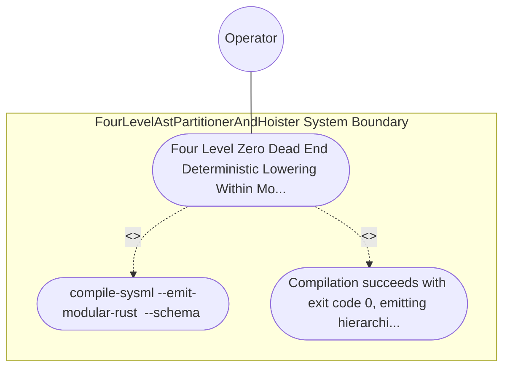

| Attribute | Specification Detail |
| :--- | :--- |
| **Issue ID** | TBD |
| **Title** | Use Case 33: Four Level Zero Dead End Deterministic Lowering Within Modularity Bounds |
| **Type** | use-case |
| **Primary Actor** | Operator |
| **Scope** | FourLevelAstPartitionerAndHoister |
| **Level** | User Goal |
| **Generation Mode** | subagent |
| **Specification Source** | [schema/model.sysml](../../schema/model.sysml) |

# Use Case 33: Four Level Zero Dead End Deterministic Lowering Within Modularity Bounds

## UML Diagrams

## 1. Actors
- `Operator`

## 2. Preconditions
- A valid multi-package SysML v2 model containing nested PackageDef hierarchies, multi-facet PartDef components, a 40-step ActionDef sequence, a 30-transition StateDef state machine, and a 25-clause ConstraintDef boolean Expr tree.

## 3. Trigger
- compile-sysml --emit-modular-rust <OUT_DIR> --schema <FIXTURE> compiles and lowers the model across Levels 1 through 4.

## 4. Main Success Scenario
1. compile-sysml --emit-modular-rust <OUT_DIR> --schema <FIXTURE> compiles and lowers the model across Levels 1 through 4.
2. Compilation succeeds with exit code 0, emitting hierarchical mod.rs barrels, facet submodules (model, invariants, ports, fsm, actions, calcs), sequential action stages, step_from_<state>() handlers, and.

## 5. Alternate and Exception Flows
- Precondition guard failure in `FourLevelAstPartitionerAndHoister`:
  - `FourLevelAstPartitionerAndHoister` rejects the `Four Level Zero Dead End Deterministic Lowering Within Modularity Bounds` request without partial state mutation and reports diagnostic status to `Operator`.
- Invariant violation while enforcing `Four Level Zero Dead End Deterministic Lowering Within Modularity Bounds`:
  - `FourLevelAstPartitionerAndHoister` aborts `Four Level Zero Dead End Deterministic Lowering Within Modularity Bounds` execution, preserves prior verified state, and notifies `Operator`.

## 6. Postconditions
- Compilation succeeds with exit code 0, emitting hierarchical mod.rs barrels, facet submodules (model, invariants, ports, fsm, actions, calcs), sequential action stages, step_from_<state>() handlers, and.

## 8. Realization Matrix
| Specification Item | Type | Link / Reference |
| :--- | :--- | :--- |
| **TBD** | User Story | [User Story 46: partition And Hoist](../user-stories/US-46-partitionAndHoist.md) |
| **TBD** | Feature | [Feature 36: [BP 07 Self Hosting 4 Level Modular Multi File Code Generator Blueprint] FourLevelAstPartitionerAndHoister](../features/FEAT-36-FourLevelAstPartitionerAndHoister.md) |

## Source References
Use case operational flows and lifecycle activity references:
- System Architecture Model: `schema/model.sysml`
- Normative Systems Engineering Standard: ISO/IEC/IEEE 29148:2018 §6.4.2 Concept of Operations

Operational use case realization and traceability links derive from `schema/model.sysml` pursuant to ISO/IEC/IEEE 29148.
