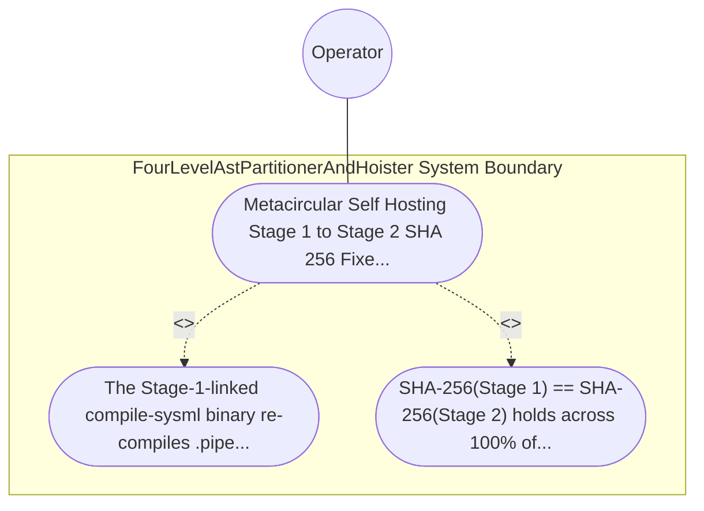

| Attribute | Specification Detail |
| :--- | :--- |
| **Issue ID** | TBD |
| **Title** | Use Case 34: Metacircular Self Hosting Stage 1 to Stage 2 SHA 256 Fixed Point Identity |
| **Type** | use-case |
| **Primary Actor** | Operator |
| **Scope** | FourLevelAstPartitionerAndHoister |
| **Level** | User Goal |
| **Generation Mode** | subagent |
| **Specification Source** | [schema/model.sysml](../../schema/model.sysml) |

# Use Case 34: Metacircular Self Hosting Stage 1 to Stage 2 SHA 256 Fixed Point Identity

## UML Diagrams

## 1. Actors
- `Operator`

## 2. Preconditions
- The authoritative self-hosting compiler schema .pipeline/upstream/schema/modular_codegen.sysml and the committed Stage-1 tree under crates/compile-sysml/src/modular_codegen/generated/ wired into compile-sysml.

## 3. Trigger
- The Stage-1-linked compile-sysml binary re-compiles .pipeline/upstream/schema/modular_codegen.sysml into an isolated Stage-2 temporary directory and compares GeneratedTreeManifest SHA-256 digests.

## 4. Main Success Scenario
1. The Stage-1-linked compile-sysml binary re-compiles .pipeline/upstream/schema/modular_codegen.sysml into an isolated Stage-2 temporary directory and compares GeneratedTreeManifest SHA-256 digests.
2. SHA-256(Stage 1) == SHA-256(Stage 2) holds across 100% of relative paths and file contents (**C-MOD-04** stage_fixed_point_mismatch_files == 0), whereas.

## 5. Alternate and Exception Flows
- Precondition guard failure in `FourLevelAstPartitionerAndHoister`:
  - `FourLevelAstPartitionerAndHoister` rejects the `Metacircular Self Hosting Stage 1 to Stage 2 SHA 256 Fixed Point Identity` request without partial state mutation and reports diagnostic status to `Operator`.
- Invariant violation while enforcing `Metacircular Self Hosting Stage 1 to Stage 2 SHA 256 Fixed Point Identity`:
  - `FourLevelAstPartitionerAndHoister` aborts `Metacircular Self Hosting Stage 1 to Stage 2 SHA 256 Fixed Point Identity` execution, preserves prior verified state, and notifies `Operator`.

## 6. Postconditions
- SHA-256(Stage 1) == SHA-256(Stage 2) holds across 100% of relative paths and file contents (**C-MOD-04** stage_fixed_point_mismatch_files == 0), whereas.

## 8. Realization Matrix
| Specification Item | Type | Link / Reference |
| :--- | :--- | :--- |
| **TBD** | User Story | [User Story 47: emit Modular Rust Tree](../user-stories/US-47-emitModularRustTree.md) |
| **TBD** | Feature | [Feature 36: [BP 07 Self Hosting 4 Level Modular Multi File Code Generator Blueprint] FourLevelAstPartitionerAndHoister](../features/FEAT-36-FourLevelAstPartitionerAndHoister.md) |

## Source References
Use case operational flows and lifecycle activity references:
- System Architecture Model: `schema/model.sysml`
- Normative Systems Engineering Standard: ISO/IEC/IEEE 29148:2018 §6.4.2 Concept of Operations

Operational use case realization and traceability links derive from `schema/model.sysml` pursuant to ISO/IEC/IEEE 29148.
