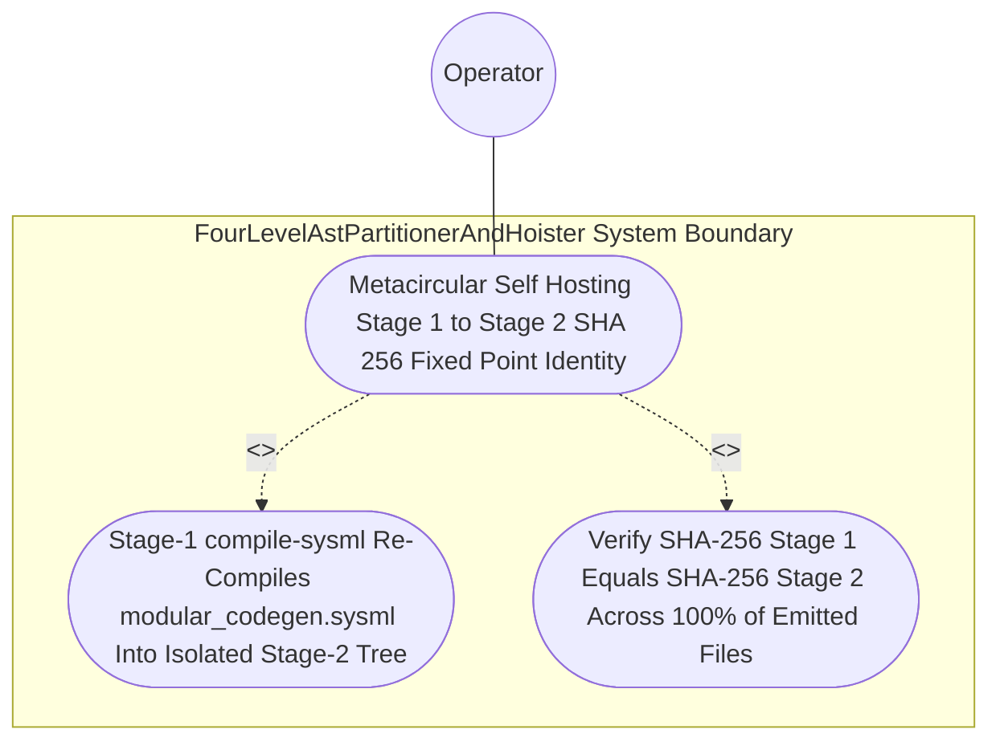

| Attribute | Specification Detail |
| :--- | :--- |
| **Issue ID** | #762 |
| **Title** | Use Case 34: Metacircular Self Hosting Stage 1 to Stage 2 SHA 256 Fixed Point Identity |
| **Type** | use-case |
| **Primary Actor** | Operator |
| **Scope** | FourLevelAstPartitionerAndHoister |
| **Level** | User Goal |
| **Generation Mode** | subagent |
| **Specification Source** | [schema/model.sysml](../../schema/model.sysml) |

# Use Case 34: Metacircular Self Hosting Stage 1 to Stage 2 SHA 256 Fixed Point Identity

## UML Diagrams

## 1. Actors
- `Operator`

## 2. Preconditions
- The authoritative self-hosting compiler schema `./.pipeline/upstream/schema/modular_codegen.sysml` parsed via `deap_core::sysml_cst` (`logos` + `rowan` + `salsa` + `ariadne`) under **Contract A** (100% normative OMG SysML v2.0 + KerML 1.0 textual grammar coverage with full Definition and Usage symmetry across `package`/`library package`/`standard library package`, `import`, `metadata def`/`@Metadata`/`#capability`/`#hazard`/`#risk`/`#rt_loop`/`#dal`/`#fls` and backward-compatible `hazard def`/`risk def`/`capability def`, `part def`/`part`, `item def`/`item`, `attribute def`/`attribute`, `enum def`/`enum`, `port def`/`port`, `connection def`/`connection`, `interface def`/`interface`, `flow def`/`flow`, `allocation def`/`allocation`, `occurrence def`/`occurrence`, `action def`/`action`, `state def`/`state`, `calc def`/`calc`, `constraint def`/`constraint`, `requirement def`/`requirement`, `concern def`/`concern`, `use case def`/`use case`, `analysis def`/`analysis`, `verification def`/`verification`, `test case def`/`test case`, `interaction def`/`interaction`, `view def`/`view`, `viewpoint def`/`viewpoint`, `rendering def`/`rendering`, `variation`/`variant`, and KerML specialization/multiplicity/expressions, with zero 16-construct artificial caps) and the committed Stage-1 tree under `./crates/compile-sysml/src/modular_codegen/generated/` verified parse-clean by `ra_ap_syntax` and wired into `compile-sysml`.

## 3. Trigger
- The Stage-1-linked `./target/release/compile-sysml` binary re-compiles `./.pipeline/upstream/schema/modular_codegen.sysml` into an isolated Stage-2 temporary directory and compares `GeneratedTreeManifest` SHA-256 digests.

## 4. Main Success Scenario
1. `Operator` invokes the Stage-1-linked `./target/release/compile-sysml` binary on `./.pipeline/upstream/schema/modular_codegen.sysml` via `SelfHostingModularCodegenCompiler` (`package_ast_in`), with the committed Stage-1 tree under `./crates/compile-sysml/src/modular_codegen/generated/` verified parse-clean by `ra_ap_syntax`.
2. `FourLevelAstPartitionerAndHoister` and `ModularRustMultiFileEmitter` lower `./.pipeline/upstream/schema/modular_codegen.sysml` across Levels 1 through 4 via `partition_and_hoist`, `synthesize_module_tokens` (`proc-macro2` + `quote::quote!`), `build_syn_file` (`syn::parse2::<syn::File>`), and `format_pretty_syn_file` (`prettyplease::unparse`) under **Contract B** (zero hand-rolled string/line/char-by-char scanners, zero `format!` / `push_str` string-concatenation code emitters).
3. `ModularRustMultiFileEmitter` executes `emit_modular_rust_tree` into an isolated Stage-2 temporary directory (`std::env::temp_dir()`), producing a Stage-2 `GeneratedTreeManifest` on `rust_manifest_out` and transitioning to `VerifyingSelfHostFixedPoint`.
4. `ModularRustMultiFileEmitter` invokes `verify_fixed_point_digest(stage1, stage2)` inside `compile_sysml_codegen_ast_fixed_point_gate` (`< 380` exec SLOC under `./crates/compile-sysml/src/modular_codegen/`, with legacy string-concatenation templates in `./crates/compile-sysml/src/driver.rs` `-450+` SLOC and `./crates/compile-sysml/src/flutter_codegen.rs` `-650+` SLOC deleted) to compare relative file paths and SHA-256 digests between Stage 1 and Stage 2 under `Invariant_REQ_0607_SC_03`.
5. `SelfHostingModularCodegenCompiler` confirms `SHA-256(Stage 1) == SHA-256(Stage 2)` across 100% of relative paths and file contents with `stage_fixed_point_mismatch_files == 0` (`C_MOD_04`) and `runtime_llm_subagent_count == 0` (`C_MOD_05`), transitions to `VerifiedFixedPoint`, and exits 0.

## 5. Alternate and Exception Flows
- 3a. Stage-1 or Stage-2 generated Rust unit fails `ra_ap_syntax` or `syn::parse2::<syn::File>` parse verification (`Diagnostic: E0704`):
  - `ModularRustMultiFileEmitter` transitions to `RejectedFailClosed`, emits diagnostic `E0704` on `diagnostic_out`, cleans up the temporary Stage-2 directory, and exits fail-closed with code 1.
- 4a. Stage-1 and Stage-2 `GeneratedTreeManifest` SHA-256 digests or file sets diverge (`stage_fixed_point_mismatch_files > 0`, `Diagnostic: E0705`):
  - `ModularRustMultiFileEmitter` transitions to `RejectedFailClosed`, emits diagnostic `E0705` enumerating every mismatched relative path, and terminates fail-closed with exit code 1.
- 5a. Invariant violation while enforcing `C_MOD_04` or `C_MOD_05` (`runtime_llm_subagent_count == 0`):
  - `FourLevelAstPartitionerAndHoister` aborts execution without mutating committed Stage-1 artifacts, preserves prior verified state, and notifies `Operator`.

## 6. Postconditions
- **Success/Fail-Closed Guarantee (3-Layer DoD)**:
  - **Layer 1 (Domain State & Data Model)**: `GeneratedTreeManifest` records identical sorted relative paths and SHA-256 file digests for Stage 1 and Stage 2 (`stage_fixed_point_mismatch_files == 0` under **C-MOD-04** and `runtime_llm_subagent_count == 0` under **C-MOD-05**).
  - **Layer 2 (Logic & State Management)**: `verify_fixed_point_digest(stage1, stage2)` confirms bit-identical `SHA-256(Stage 1) == SHA-256(Stage 2)` fixed-point convergence via `syn` + `proc-macro2` + `quote` + `prettyplease` inside `< 380` exec SLOC submodules (`./crates/compile-sysml/src/modular_codegen/`) with legacy hand-rolled scanners and string-concatenation emitters retired.
  - **Layer 3 (Presentation & Actuator Interface Binding)**: Verified `GeneratedTreeManifest` is emitted on `rust_manifest_out`, the Stage-2 temporary directory is cleaned up via RAII, and the process exits with code 0.

## 8. Realization Matrix
| Specification Item | Type | Link / Reference |
| :--- | :--- | :--- |
| **#796** | User Story | [User Story 47: synthesize module tokens](../user-stories/US-47-synthesize_module_tokens.md) (synthesizes deterministic `proc-macro2::TokenStream` units) |
| **#801** | User Story | [User Story 52: verify fixed point digest](../user-stories/US-52-verify_fixed_point_digest.md) (verifies Stage-1 == Stage-2 SHA-256 fixed-point equality) |
| **#737** | Feature | [Feature 31: [BP 07 Self Hosting 4 Level Modular Multi File Code Generator Blueprint] FourLevelAstPartitionerAndHoister](../features/FEAT-31-FourLevelAstPartitionerAndHoister.md) (enforces `Invariant_REQ_0607_SC_03` fixed-point lowering contract) |
| **#739** | Feature | [Feature 33: [BP 07 Self Hosting 4 Level Modular Multi File Code Generator Blueprint] ModularRustMultiFileEmitter](../features/FEAT-33-ModularRustMultiFileEmitter.md) (executes Stage-2 emission and `fixed_point_sha256_verification`) |
| **#740** | Feature | [Feature 34: [BP 07 Self Hosting 4 Level Modular Multi File Code Generator Blueprint] SelfHostingModularCodegenCompiler](../features/FEAT-34-SelfHostingModularCodegenCompiler.md) (enforces `stage_fixed_point_mismatch_files == 0` and `runtime_llm_subagent_count == 0`) |

## Source References
Use case operational flows and lifecycle activity references:
- System Architecture Model: `schema/model.sysml`
- Normative Systems Engineering Standard: ISO/IEC/IEEE 29148:2018 §6.4.2 Concept of Operations

Operational use case realization and traceability links derive from `schema/model.sysml` pursuant to ISO/IEC/IEEE 29148.
