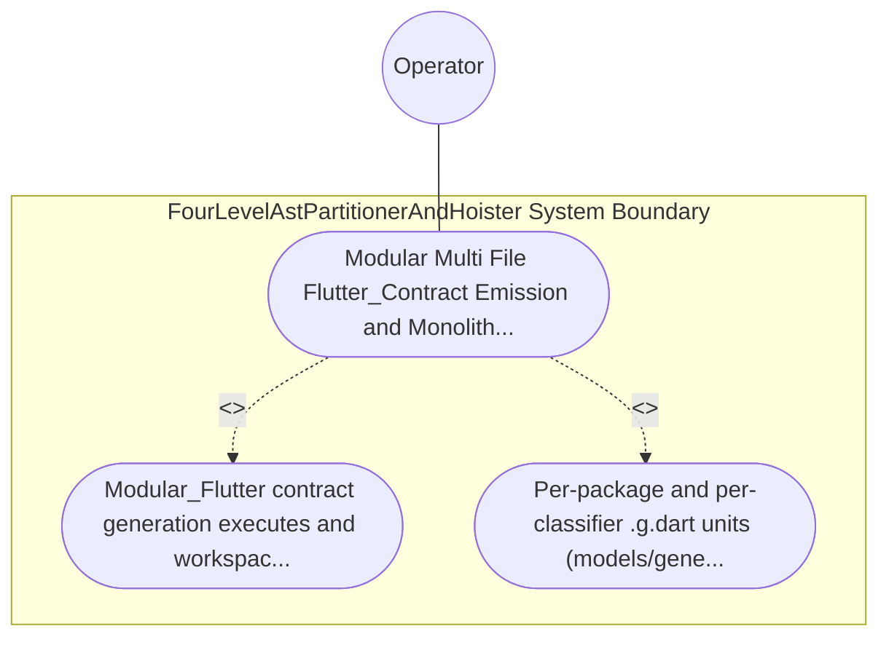

| Attribute | Specification Detail |
| :--- | :--- |
| **Issue ID** | #763 |
| **Title** | Use Case 35: Modular Multi File Flutter_Contract Emission and Monolith Barrel Decomposition |
| **Type** | use-case |
| **Primary Actor** | Operator |
| **Scope** | FourLevelAstPartitionerAndHoister |
| **Level** | User Goal |
| **Generation Mode** | subagent |
| **Specification Source** | [schema/model.sysml](../../schema/model.sysml) |

# Use Case 35: Modular Multi File Flutter_Contract Emission and Monolith Barrel Decomposition

## UML Diagrams

## 1. Actors
- `Operator`

## 2. Preconditions
- A multi-package SysML v2 schema compiled via compile-sysml --emit-flutter-contracts <APP_DIR> --schema <FIXTURE> and the Rust workspace source file crates/compile-sysml/src/flutter_codegen.rs.

## 3. Trigger
- Modular_Flutter contract generation executes and workspace modularity tests inspect both the emitted Dart tree and crates/compile-sysml/src/.

## 4. Main Success Scenario
1. `Operator` invokes `compile-sysml --emit-flutter-contracts <APP_DIR> --schema <FIXTURE>` on `SelfHostingModularCodegenCompiler`, which validates DAG acyclicity via `verify_dag_and_layers` and partitions the schema via `FourLevelAstPartitionerAndHoister` (`partition_and_hoist`).
2. `ModularFlutterMultiFileEmitter` receives the lowered module graph on `flutter_module_graph_in` (`emit_barrel_reexports = true`, `facade_max_lines = 80`) and invokes `emit_modular_flutter_tree(graph)`.
3. `ModularFlutterMultiFileEmitter` synthesizes per-package and per-classifier `.g.dart` units (`models/generated/<pkg>/<part>_view.g.dart`, `data/generated/ffi/*.g.dart`, `data/generated/dto/<pkg>/<dto>_dto.g.dart`, `data/seeds/generated/*.g.dart`, `test/generated/support/*.g.dart`) along with backward-compatible barrel re-export facades (`<= 80` LOC).
4. Workspace modularity refactoring decomposes monolithic templates in `crates/compile-sysml/src/flutter_codegen.rs` (`-650+` SLOC deleted) into bounded `< 380` exec SLOC submodules under `crates/compile-sysml/src/modular_codegen/`.
5. `ModularFlutterMultiFileEmitter` emits the verified `GeneratedTreeManifest` on `flutter_manifest_out` and `flutter_tree_out`, satisfying `C_MOD_01` (`<= 400` LOC per file) and `C_MOD_02` (`<= 12` items per file) with exit code 0.

## 5. Alternate and Exception Flows
- 3a. Emitted `.g.dart` unit or barrel facade violates `C_MOD_01` (`> 400` LOC) or `facade_max_lines > 80` (`Diagnostic: E0701`):
  - `ModularFlutterMultiFileEmitter` transitions to `RejectedFailClosed`, emits diagnostic `E0701` on `diagnostic_out`, and aborts transactionally with exit code 1.
- 4a. Directed cycle or upward layer violation detected in target UI/DTO graph (`Diagnostic: E0702` / `E0703`):
  - `TopologicalLayerDagVerifier` rejects the module graph before `emit_modular_flutter_tree`, leaves `<APP_DIR>` unmodified, and exits fail-closed with code 1.
- 5a. Invariant violation while enforcing `Invariant_REQ_0607_SC_01` in `FourLevelAstPartitionerAndHoister`:
  - `FourLevelAstPartitionerAndHoister` aborts `Modular Multi File Flutter_Contract Emission and Monolith Barrel Decomposition` execution, preserves prior verified state, and notifies `Operator`.

## 6. Postconditions
- Per-package and per-classifier .g.dart units (models/generated/<pkg>/<part>_view.g.dart, data/generated/ffi/ *.g.dart, data/generated/dto/<pkg>/<dto>_dto.g.dart, data/seeds/generated/ *.g.dart, test/generated/support/ *.g.dart).

## 8. Realization Matrix
| Specification Item | Type | Link / Reference |
| :--- | :--- | :--- |
| **TBD** | User Story | [User Story 48: build syn file](../user-stories/US-48-build_syn_file.md) |
| **TBD** | Feature | [Feature 31: [BP 07 Self Hosting 4 Level Modular Multi File Code Generator Blueprint] FourLevelAstPartitionerAndHoister](../features/FEAT-31-FourLevelAstPartitionerAndHoister.md) |

## Source References
Use case operational flows and lifecycle activity references:
- System Architecture Model: `schema/model.sysml`
- Normative Systems Engineering Standard: ISO/IEC/IEEE 29148:2018 §6.4.2 Concept of Operations

Operational use case realization and traceability links derive from `schema/model.sysml` pursuant to ISO/IEC/IEEE 29148.
