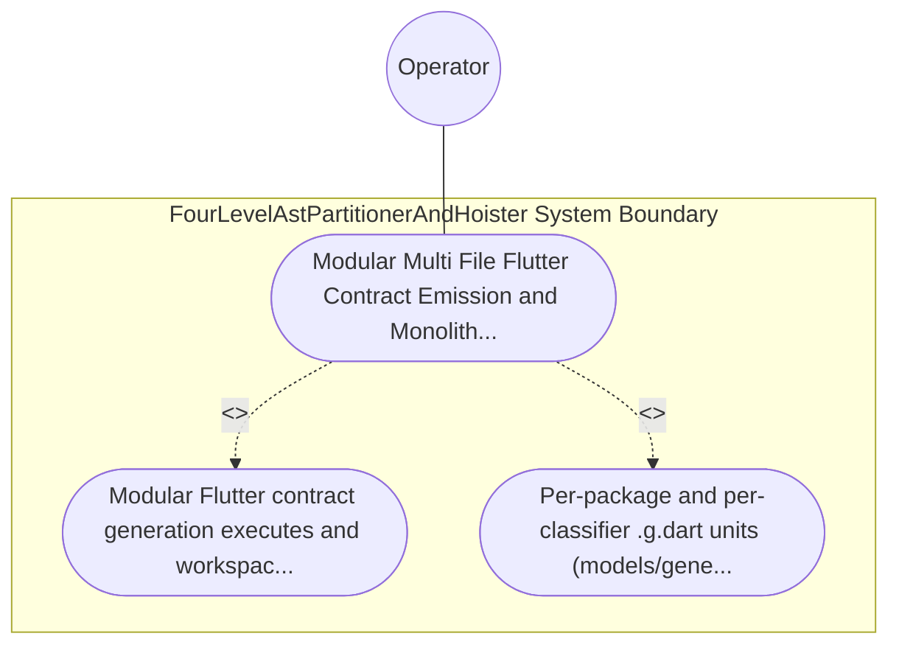

| Attribute | Specification Detail |
| :--- | :--- |
| **Issue ID** | TBD |
| **Title** | Use Case 35: Modular Multi File Flutter Contract Emission and Monolith Barrel Decomposition |
| **Type** | use-case |
| **Primary Actor** | Operator |
| **Scope** | FourLevelAstPartitionerAndHoister |
| **Level** | User Goal |
| **Generation Mode** | subagent |
| **Specification Source** | [schema/model.sysml](../../schema/model.sysml) |

# Use Case 35: Modular Multi File Flutter Contract Emission and Monolith Barrel Decomposition

## UML Diagrams

## 1. Actors
- `Operator`

## 2. Preconditions
- A multi-package SysML v2 schema compiled via compile-sysml --emit-flutter-contracts <APP_DIR> --schema <FIXTURE> and the Rust workspace source file crates/compile-sysml/src/flutter_codegen.rs.

## 3. Trigger
- Modular Flutter contract generation executes and workspace modularity tests inspect both the emitted Dart tree and crates/compile-sysml/src/.

## 4. Main Success Scenario
1. Modular Flutter contract generation executes and workspace modularity tests inspect both the emitted Dart tree and crates/compile-sysml/src/.
2. Per-package and per-classifier .g.dart units (models/generated/<pkg>/<part>_view.g.dart, data/generated/ffi/ *.g.dart, data/generated/dto/<pkg>/<dto>_dto.g.dart, data/seeds/generated/ *.g.dart, test/generated/support/ *.g.dart).

## 5. Alternate and Exception Flows
- Precondition guard failure in `FourLevelAstPartitionerAndHoister`:
  - `FourLevelAstPartitionerAndHoister` rejects the `Modular Multi File Flutter Contract Emission and Monolith Barrel Decomposition` request without partial state mutation and reports diagnostic status to `Operator`.
- Invariant violation while enforcing `Modular Multi File Flutter Contract Emission and Monolith Barrel Decomposition`:
  - `FourLevelAstPartitionerAndHoister` aborts `Modular Multi File Flutter Contract Emission and Monolith Barrel Decomposition` execution, preserves prior verified state, and notifies `Operator`.

## 6. Postconditions
- Per-package and per-classifier .g.dart units (models/generated/<pkg>/<part>_view.g.dart, data/generated/ffi/ *.g.dart, data/generated/dto/<pkg>/<dto>_dto.g.dart, data/seeds/generated/ *.g.dart, test/generated/support/ *.g.dart).

## 8. Realization Matrix
| Specification Item | Type | Link / Reference |
| :--- | :--- | :--- |
| **TBD** | User Story | [User Story 48: emit Modular Flutter Tree](../user-stories/US-48-emitModularFlutterTree.md) |
| **TBD** | Feature | [Feature 36: [BP 07 Self Hosting 4 Level Modular Multi File Code Generator Blueprint] FourLevelAstPartitionerAndHoister](../features/FEAT-36-FourLevelAstPartitionerAndHoister.md) |

## Source References
Use case operational flows and lifecycle activity references:
- System Architecture Model: `schema/model.sysml`
- Normative Systems Engineering Standard: ISO/IEC/IEEE 29148:2018 §6.4.2 Concept of Operations

Operational use case realization and traceability links derive from `schema/model.sysml` pursuant to ISO/IEC/IEEE 29148.
