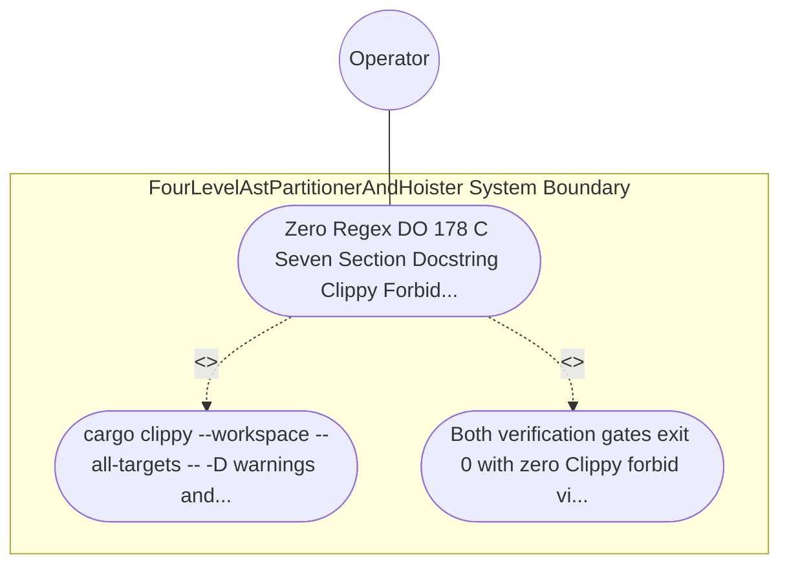

| Attribute | Specification Detail |
| :--- | :--- |
| **Issue ID** | TBD |
| **Title** | Use Case 36: Zero Regex DO 178 C Seven Section Docstring Clippy Forbid and Audit Code Compliance |
| **Type** | use-case |
| **Primary Actor** | Operator |
| **Scope** | FourLevelAstPartitionerAndHoister |
| **Level** | User Goal |
| **Generation Mode** | subagent |
| **Specification Source** | [schema/model.sysml](../../schema/model.sysml) |

# Use Case 36: Zero Regex DO 178 C Seven Section Docstring Clippy Forbid and Audit Code Compliance

## UML Diagrams

## 1. Actors
- `Operator`

## 2. Preconditions
- All hand-authored modules under crates/compile-sysml/src/modular_codegen/ ** and all Stage-1 generated Rust modules under crates/compile-sysml/src/modular_codegen/generated/ **.

## 3. Trigger
- cargo clippy --workspace --all-targets -- -D warnings and ./target/release/verify-baseline audit-code --path crates/compile-sysml/src/modular_codegen --dry-run are executed.

## 4. Main Success Scenario
1. cargo clippy --workspace --all-targets -- -D warnings and ./target/release/verify-baseline audit-code --path crates/compile-sysml/src/modular_codegen --dry-run are executed.
2. Both verification gates exit 0 with zero Clippy forbid violations, zero Check 34 violation tokens, zero Check 19 hardcoded domain concepts, and 100% Check 36 unique 7-section DO-178C safety docstrings.

## 5. Alternate and Exception Flows
- Precondition guard failure in `FourLevelAstPartitionerAndHoister`:
  - `FourLevelAstPartitionerAndHoister` rejects the `Zero Regex DO 178 C Seven Section Docstring Clippy Forbid and Audit Code Compliance` request without partial state mutation and reports diagnostic status to `Operator`.
- Invariant violation while enforcing `Zero Regex DO 178C Seven Section Docstring Clippy Forbid and Audit Code Compliance`:
  - `FourLevelAstPartitionerAndHoister` aborts `Zero Regex DO 178 C Seven Section Docstring Clippy Forbid and Audit Code Compliance` execution, preserves prior verified state, and notifies `Operator`.

## 6. Postconditions
- Both verification gates exit 0 with zero Clippy forbid violations, zero Check 34 violation tokens, zero Check 19 hardcoded domain concepts, and 100% Check 36 unique 7-section DO-178C safety docstrings.

## 8. Realization Matrix
| Specification Item | Type | Link / Reference |
| :--- | :--- | :--- |
| **TBD** | User Story | [User Story 49: verify Fixed Point Hash](../user-stories/US-49-verifyFixedPointHash.md) |
| **TBD** | Feature | [Feature 36: [BP 07 Self Hosting 4 Level Modular Multi File Code Generator Blueprint] FourLevelAstPartitionerAndHoister](../features/FEAT-36-FourLevelAstPartitionerAndHoister.md) |

## Source References
Use case operational flows and lifecycle activity references:
- System Architecture Model: `schema/model.sysml`
- Normative Systems Engineering Standard: ISO/IEC/IEEE 29148:2018 §6.4.2 Concept of Operations

Operational use case realization and traceability links derive from `schema/model.sysml` pursuant to ISO/IEC/IEEE 29148.
