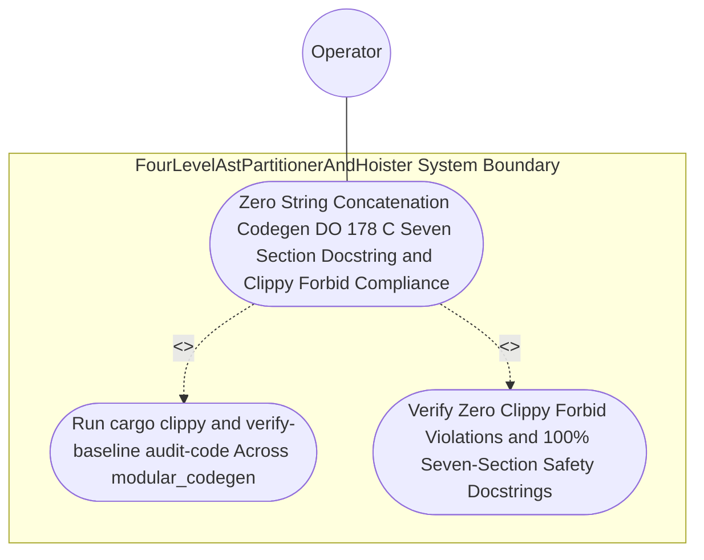

| Attribute | Specification Detail |
| :--- | :--- |
| **Issue ID** | #765 |
| **Title** | Use Case 36: Zero String Concatenation Codegen DO 178 C Seven Section Docstring and Clippy Forbid Compliance |
| **Type** | use-case |
| **Primary Actor** | Operator |
| **Scope** | FourLevelAstPartitionerAndHoister |
| **Level** | User Goal |
| **Generation Mode** | subagent |
| **Specification Source** | [schema/model.sysml](../../schema/model.sysml) |

# Use Case 36: Zero String Concatenation Codegen DO 178 C Seven Section Docstring and Clippy Forbid Compliance

## UML Diagrams

## 1. Actors
- `Operator`

## 2. Preconditions
- All hand-authored modules under `./crates/compile-sysml/src/modular_codegen/**` and all Stage-1 generated Rust modules under `./crates/compile-sysml/src/modular_codegen/generated/**` lowered from the full OMG SysML v2.0 + KerML 1.0 grammar under **Contract A** (zero 16-construct artificial caps) and synthesized via `proc-macro2` + `quote` + `syn::File` + `prettyplease` under **Contract B** (zero hand-rolled scanners).

## 3. Trigger
- `cargo clippy --workspace --all-targets -- -D warnings` and `./target/release/verify-baseline audit-code --path crates/compile-sysml/src/modular_codegen --dry-run` are executed.

## 4. Main Success Scenario
1. `Operator` invokes `cargo clippy --workspace --all-targets -- -D warnings` and `./target/release/verify-baseline audit-code --path crates/compile-sysml/src/modular_codegen --dry-run` across all hand-authored and Stage-1 generated modules under `./crates/compile-sysml/src/modular_codegen/`.
2. `ModularRustMultiFileEmitter` verifies that all Rust code generation uses `synthesize_module_tokens`, `build_syn_file` (`syn::parse2::<syn::File>`), and `format_pretty_syn_file` (`prettyplease::unparse`) with `enforce_syn_parse_grammar = true` and `canonical_prettyplease_format = true`, having retired `-450+` SLOC of legacy string-concatenation templates in `./crates/compile-sysml/src/driver.rs` and `-650+` SLOC in `./crates/compile-sysml/src/flutter_codegen.rs`.
3. `SevenSectionDocstringGenerator` and `Check36AstCompletenessVerifier` verify via `ra_ap_syntax` (`HasDocComments`, `HasAttrs`) that every generated public and private type, struct, enum, trait, and function carries a complete 7-section safety docstring (`/// Realises`, `/// Preconditions`, `/// Postconditions`, `/// Invariants`, `/// Failure Modes`, `/// Complexity`, `/// Safety_Standard`).
4. `Check34AstPurityAndAntiGamingGate` and `FivePillarStaticAstAnalyzer` audit `./crates/compile-sysml/src/modular_codegen/` to confirm every submodule is `< 380` exec SLOC (`submodule_max_exec_sloc = 380`) with zero Check 34 violation tokens, zero hand-rolled string/line/char-by-char scanners, and zero Check 19 hardcoded domain concepts.
5. Both verification gates exit 0 with zero Clippy `forbid` violations (`unwrap_used`, `expect_used`, `panic`, `indexing_slicing`, `type_complexity`, `disallowed_types`), confirming `Invariant_REQ_0607_SC_01` and `Invariant_REQ_0607_SC_04`.

## 5. Alternate and Exception Flows
- 3a. Legacy string-concatenation (`format!` / `push_str`) or unparsed token emission detected in `./crates/compile-sysml/src/modular_codegen/` (`Diagnostic: E0704`):
  - `verify-baseline` and `ModularRustMultiFileEmitter` reject the module, emit diagnostic `E0704`, and terminate fail-closed with exit code 1.
- 4a. Any hand-authored or generated item in `./crates/compile-sysml/src/modular_codegen/` lacks a complete 7-section safety docstring or exceeds `380` exec SLOC (`Diagnostic: E0701`):
  - `verify-baseline` fails closed with non-zero exit code 1 and reports the exact file and line span to `Operator`.
- 5a. Clippy `forbid` lint or Check 34 AST purity violation detected during workspace verification:
  - `cargo clippy` or `verify-baseline` aborts execution without partial state mutation, preserves prior verified state, and exits with code 1.

## 6. Postconditions
- **Success/Fail-Closed Guarantee (3-Layer DoD)**:
  - **Layer 1 (Domain State & Data Model)**: 100% of generated and hand-authored items under `./crates/compile-sysml/src/modular_codegen/` carry verified 7-section DO-178C safety docstrings and satisfy `C_MOD_01..05`.
  - **Layer 2 (Logic & State Management)**: Zero legacy string-concatenation (`format!` / `push_str`) code emitters, zero hand-rolled scanners, `< 380` exec SLOC per submodule, and `-1,100+` SLOC of legacy emitters retired from `./crates/compile-sysml/src/driver.rs` and `./crates/compile-sysml/src/flutter_codegen.rs`.
  - **Layer 3 (Presentation & Actuator Interface Binding)**: Both `cargo clippy --workspace --all-targets -- -D warnings` and `./target/release/verify-baseline audit-code` exit with code 0 and zero violations.

## 8. Realization Matrix
| Specification Item | Type | Link / Reference |
| :--- | :--- | :--- |
| **#799** | User Story | [User Story 49: Format Pretty Syn File](../user-stories/US-49-format_pretty_syn_file.md) (formats validated `syn::File` ASTs via `prettyplease::unparse`) |
| **#829** | Feature | [Feature 31: [BP 07 Self Hosting 4 Level Modular Multi File Code Generator Blueprint] FourLevelAstPartitionerAndHoister](../features/FEAT-31-FourLevelAstPartitionerAndHoister.md) (enforces `Invariant_REQ_0607_SC_01` and `Invariant_REQ_0607_SC_04` across lowered units) |
| **#831** | Feature | [Feature 33: [BP 07 Self Hosting 4 Level Modular Multi File Code Generator Blueprint] ModularRustMultiFileEmitter](../features/FEAT-33-ModularRustMultiFileEmitter.md) (enforces `enforce_syn_parse_grammar`, `canonical_prettyplease_format`, `submodule_max_exec_sloc = 380`, and `legacy_string_codegen_deleted_sloc = 1100`) |

## Source References
Use case operational flows and lifecycle activity references:
- System Architecture Model: `schema/model.sysml`
- Normative Systems Engineering Standard: ISO/IEC/IEEE 29148:2018 §6.4.2 Concept of Operations

Operational use case realization and traceability links derive from `schema/model.sysml` pursuant to ISO/IEC/IEEE 29148.
