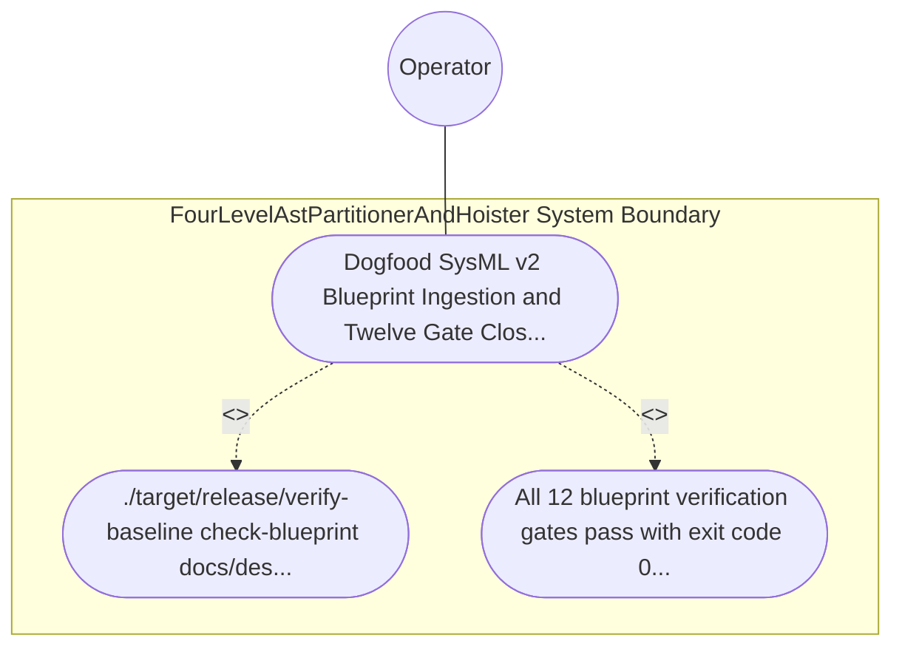

| Attribute | Specification Detail |
| :--- | :--- |
| **Issue ID** | #765 |
| **Title** | Use Case 37: Dogfood SysML v2 Blueprint Ingestion and Twelve Gate Closed Loop Conformance |
| **Type** | use-case |
| **Primary Actor** | Operator |
| **Scope** | FourLevelAstPartitionerAndHoister |
| **Level** | User Goal |
| **Generation Mode** | subagent |
| **Specification Source** | [schema/model.sysml](../../schema/model.sysml) |

# Use Case 37: Dogfood SysML v2 Blueprint Ingestion and Twelve Gate Closed Loop Conformance

## UML Diagrams

## 1. Actors
- `Operator`

## 2. Preconditions
- This engineering blueprint at docs/designs/blueprint-07-self-hosting-modular-codegen-compiler.md.

## 3. Trigger
- ./target/release/verify-baseline check-blueprint docs/designs/blueprint-07-self-hosting-modular-codegen-compiler.md is executed.

## 4. Main Success Scenario
1. `Operator` executes `./target/release/verify-baseline check-blueprint docs/designs/blueprint-07-self-hosting-modular-codegen-compiler.md` on the upstream blueprint specification.
2. `verify-baseline` evaluates all 12 mechanical blueprint verification gates (8-part structural headers, metadata table, 5-column STPA/FMECA table, KaTeX math blocks, Mermaid diagrams, and 6 Given-When-Then acceptance criteria).
3. `ingest-sysml` deterministically extracts the SysML v2 package `BP_07_Self_Hosting_4_Level_Modular_Multi_File_Code_Generator_Blueprint` (`REQ-0607`, `C_MOD_01..05`, `FourLevelAstPartitionerAndHoister`, `ModularRustMultiFileEmitter`, `ModularFlutterMultiFileEmitter`, `SelfHostingModularCodegenCompiler`, `TopologicalLayerDagVerifier`).
4. `compile-sysml` compiles the extracted `.sysml` model, verifies bijective AST roundtrip equivalence, and persists `.pipeline/upstream/schema/model.sysml` and `.pipeline/upstream/schema/model-digest.json`.
5. All 12 blueprint verification gates pass with exit code 0 and zero Check 34 / Check 36 / Check 37 baseline violations, recording closed-loop conformance for `Operator`.

## 5. Alternate and Exception Flows
- 3a. Any of the 12 mechanical blueprint verification gates fails on `blueprint-07-self-hosting-modular-codegen-compiler.md`:
  - `verify-baseline check-blueprint` emits a structured gate failure diagnostic, leaves `.sysml` and `.digest.json` artifacts untouched, and exits fail-closed with code 1.
- 4a. Bijective SysML v2 AST roundtrip or constraint compilation fails during dogfood ingestion (`Diagnostic: E0704`):
  - `compile-sysml` aborts compilation via `Result::Err`, preserves prior verified schema state, and terminates fail-closed with exit code 1.
- 5a. Invariant violation while enforcing `Invariant_REQ_0607_REQ_0607` in `FourLevelAstPartitionerAndHoister`:
  - `FourLevelAstPartitionerAndHoister` aborts execution, preserves prior verified state, and notifies `Operator`.

## 6. Postconditions
- All 12 blueprint verification gates pass with exit code 0, deterministically synthesizing docs/designs/blueprint-07-self-hosting-modular-codegen-compiler.sysml and .digest.json via roundtrip SysML v2 compilation and verifying closed-loop GitHub SSOT parity.

## 8. Realization Matrix
| Specification Item | Type | Link / Reference |
| :--- | :--- | :--- |
| **TBD** | User Story | [User Story 50: emit modular rust tree](../user-stories/US-50-emit_modular_rust_tree.md) |
| **TBD** | Feature | [Feature 31: [BP 07 Self Hosting 4 Level Modular Multi File Code Generator Blueprint] FourLevelAstPartitionerAndHoister](../features/FEAT-31-FourLevelAstPartitionerAndHoister.md) |

## Source References
Use case operational flows and lifecycle activity references:
- System Architecture Model: `schema/model.sysml`
- Normative Systems Engineering Standard: ISO/IEC/IEEE 29148:2018 §6.4.2 Concept of Operations

Operational use case realization and traceability links derive from `schema/model.sysml` pursuant to ISO/IEC/IEEE 29148.
