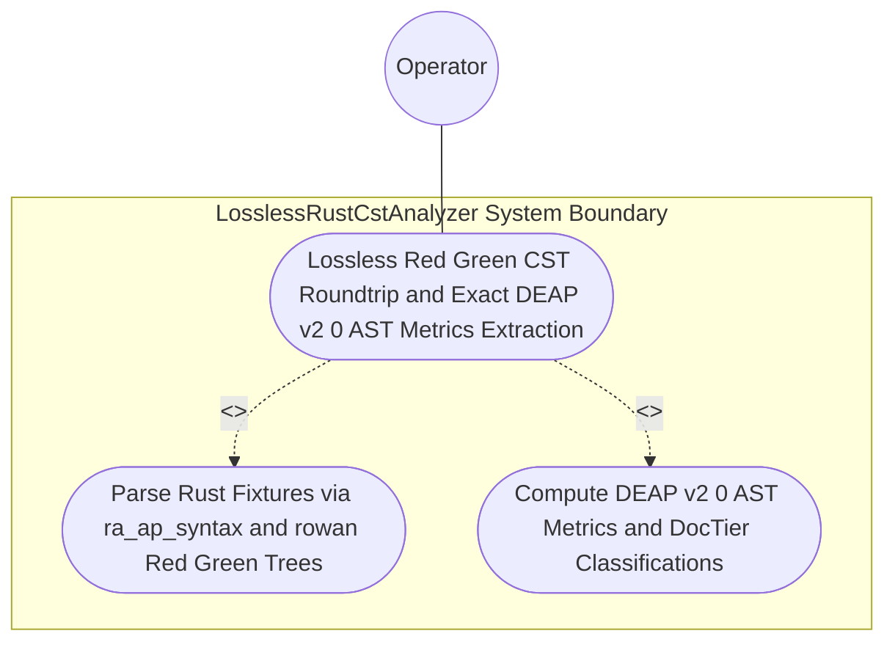

| Attribute | Specification Detail |
| :--- | :--- |
| **Issue ID** | #766 |
| **Title** | Use Case 38: Lossless Red Green CST Roundtrip and Exact DEAP v2 0 AST Metrics Extraction |
| **Type** | use-case |
| **Primary Actor** | Operator |
| **Scope** | AirGappedCargoLockGovernor |
| **Level** | User Goal |
| **Generation Mode** | subagent |
| **Specification Source** | [schema/model.sysml](../../schema/model.sysml) |

# Use Case 38: Lossless Red Green CST Roundtrip and Exact DEAP v2 0 AST Metrics Extraction

## UML Diagrams

### Use Case Diagram


### State Machine Diagram
```sysml
stateDiagram-v2
    [*] --> Idle
    Idle --> ParsingLosslessCst : "parseRustCst"
    ParsingLosslessCst --> AnalyzingMetricsAndTiers : "losslessRedGreenTreeReady"
    AnalyzingMetricsAndTiers --> EmittingJsonDiagnostics : "rejectCstMetricViolation"
    AnalyzingMetricsAndTiers --> VerifiedClean : "metricsAndRoundtripVerified"
    EmittingJsonDiagnostics --> [*]
    VerifiedClean --> [*]
```

## 1. Actors
- `Operator`

## 2. Preconditions
- A Rust `.rs` fixture containing outer/inner docblocks, inline and block comments, raw strings containing braces, outer `rt_loop` and `cfg(test)` modules, methods taking `&self` and `&mut self`, a function with `let mut flag: bool = false`, a 4-clause compound boolean predicate, a `pub fn` returning `Result<usize, String>`, and a `pub(crate) fn` helper (plus a second fixture with an incomplete trailing expression).

## 3. Trigger
- LosslessRustCstAnalyzer parses both fixtures into ra_ap_syntax + rowan Red/Green syntax trees and computes DEAP v2.0 metrics and DocTier classifications.

## 4. Main Success Scenario
1. `Operator` supplies the Rust `.rs` source buffer on `rust_source_in` to `LosslessRustCstAnalyzer` (`lossless_roundtrip_required = true`, `max_fn_exec_sloc = 50`, `max_fn_param_count = 5`, `max_mut_bool_flags = 0`, `max_predicate_arity = 3`).
2. `LosslessRustCstAnalyzer` parses the UTF-8 buffer via `ra_ap_syntax::SourceFile::parse` into a `rowan` Red/Green syntax tree inside `< 380` exec SLOC submodules (`crates/deap-core/src/rust_cst/`) and verifies bit-for-bit root `GreenNode` roundtrip identity under `Invariant_REQ_0608_SC_01`.
3. `LosslessRustCstAnalyzer` executes `list_rust_items` to classify top-level and `impl`-associated items into `DocTier::RustTierA` (`pub` items outside test/rt_loop) and `DocTier::RustTierBC` (`pub(crate)` and private helpers) with exact `TextRange` spans emitted on `item_inventory_out`.
4. `LosslessRustCstAnalyzer` invokes `analyze_metrics` to compute `production_exec_sloc` (excluding comments, docblocks, attributes, and `cfg(test)` modules), per-function `exec_sloc`, formal parameter counts (excluding `self`, `&self`, and `&mut self`), mutable boolean flag counts (`let mut flag: bool`), and compound boolean predicate clause arity.
5. `LosslessRustCstAnalyzer` emits the `DeapV2AstMetrics` report on `metrics_report_out` (and for the second fixture with an incomplete trailing expression, preserves 100% of tokens losslessly while recording exact syntax error byte spans).

## 5. Alternate and Exception Flows
- 3a. Root `rowan::GreenNode` byte projection diverges from the input `.rs` buffer under `Invariant_REQ_0608_SC_01`:
  - `LosslessRustCstAnalyzer` rejects the CST parse, emits structured JSON diagnostic `DEAP-E0803` via `UnifiedRustcJsonDiagnosticEmitter`, and exits fail-closed with code 1.
- 4a. Audited function violates `C_CST_01` (`exec_sloc > 50`), `C_CST_02` (`param_count > 5`), or `C_CST_03` (`mut_bool_flags > 0` or `predicate_arity > 3`):
  - `LosslessRustCstAnalyzer` records the exact `TextRange` span violation in `metrics_report_out` and signals `UnifiedRustcJsonDiagnosticEmitter` to fail closed with exit code 1.
- 5a. Precondition or syntax tree invariant violation in `AirGappedCargoLockGovernor`:
  - `AirGappedCargoLockGovernor` aborts execution without partial state mutation, preserves prior verified state, and reports diagnostic status to `Operator`.

## 6. Postconditions
- **Success Guarantee:** Root `rowan::GreenNode` text equals the input `.rs` buffer bit-for-bit, and `DeapV2AstMetrics` accurately reports `DocTier` classifications, `production_exec_sloc`, parameter counts, mutable bool flags, and predicate arity across `< 380`-SLOC submodules (`crates/deap-core/src/rust_cst/`).
- **Failure Guarantee:** Execution fails closed with exit code 1, emits single-line `rustc`-compatible NDJSON diagnostic `DEAP-E0803`, and preserves prior verified state without partial mutation.

## 7. Operational Context
- **Contract A (100% Normative OMG SysML v2.0 + KerML 1.0 Grammar Coverage)**: Enforces full Definition and Usage symmetry across all OMG SysML v2.0 and KerML 1.0 constructs (`package`, `library package`, `standard library package`, `import`, `metadata def` / `@Metadata` / `#capability` / `#hazard` / `#risk` / `#rt_loop` / `#dal` / `#fls`, `part def`/`part`, `item def`/`item`, `attribute def`/`attribute`, `enum def`/`enum`, `port def`/`port`, `interface def`/`interface`, `connection def`/`connection`, `flow def`/`flow`, `allocation def`/`allocation`, `occurrence def`/`occurrence`, `action def`/`action`, `state def`/`state`, `calc def`/`calc`, `constraint def`/`constraint`, `requirement def`/`requirement`, `concern def`/`concern`, `use case def`/`use case`, `analysis def`/`analysis`, `verification def`/`verification`, `test case def`/`test case`, `interaction def`/`interaction`, `view def`/`view`, `viewpoint def`/`viewpoint`, `rendering def`/`rendering`, `variation`/`variant`, and KerML specialization/expressions with zero 16-construct artificial caps).
- **Contract B (Official Rust Compiler, Cargo & `rust-analyzer` Crate Stack)**: Uses `ra_ap_syntax` (`ast::{MatchExpr, MatchArmList, CallExpr, MethodCallExpr, TryExpr, Fn, HasDocComments, HasAttrs}`), `ra_ap_vfs`, `ra_ap_paths`, `ra_ap_line_index`, `ra_ap_text_edit`, `rowan`, `camino`, `ignore`, `cargo-lock`, `cargo_metadata`, `cargo-util-schemas`, `cargo-platform`, `toml_edit`, `pulldown-cmark`, and `pulldown-cmark-to-cmark` with explicit net-negative deletion of ~19,700+ lines of hand-rolled scanners (deleting `crates/deap-core/src/rust_cst.rs` (599 lines), `crates/compile-sysml/src/docstring.rs` (549 lines), `crates/verify-baseline/src/checks/docstring_tier_rules.rs` (729 lines), `crates/verify-baseline/src/checks/structural.rs` (980 lines), `crates/deap-core/src/workspace.rs` (356 lines), and `crates/verify-baseline/src/ratchet_table.rs`).
- **3-Layer Definition of Done (DoD)**:
  - **Layer 1 (Domain State & Data Model)**: `rowan::GreenNode` / `ra_ap_syntax::SourceFile`, `ra_ap_line_index::LineIndex`, `RustItemInventory`, and `DeapV2AstMetrics`.
  - **Layer 2 (Logic & State Management)**: Enforces `C_CST_01` (`1 <= max_fn_exec_sloc <= 50`), `C_CST_02` (`0 <= max_fn_param_count <= 5`), `C_CST_03` (`max_mut_bool_flags == 0`), and `Invariant_REQ_0608_SC_01` inside `< 380`-SLOC submodules (`crates/deap-core/src/rust_cst/{mod,vfs,parse,items}.rs`).
  - **Layer 3 (Presentation & Actuator Interface Binding)**: Binds `rust_source_in`, `item_inventory_out`, and `metrics_report_out` on `LosslessRustCstAnalyzer` to `UnifiedRustcJsonDiagnosticEmitter`.

## 8. Realization Matrix
| Specification Item | Type | Link / Reference |
| :--- | :--- | :--- |
| **#803** | User Story | [User Story 54: list rust items](../user-stories/US-54-list_rust_items.md) |
| **#807** | User Story | [User Story 58: analyze metrics](../user-stories/US-58-analyze_metrics.md) |
| **#743** | Feature | [Feature 37: [BP 08 Lossless Rust CST Codemod Engine and Unified rustc Compatible JSON Diagnostics] LosslessRustCstAnalyzer](../features/FEAT-37-LosslessRustCstAnalyzer.md) |
| **#742** | Feature | [Feature 36: [BP 08 Lossless Rust CST Codemod Engine and Unified rustc Compatible JSON Diagnostics] AirGappedCargoLockGovernor](../features/FEAT-36-AirGappedCargoLockGovernor.md) |

### Required User Stories
- [ ] #803 - [User Story 54: list rust items](../user-stories/US-54-list_rust_items.md) (classifies `DocTier::RustTierA` and `DocTier::RustTierBC` items with exact `TextRange` byte/line spans)
- [ ] #807 - [User Story 58: analyze metrics](../user-stories/US-58-analyze_metrics.md) (computes `DeapV2AstMetrics` enforcing `C_CST_01`, `C_CST_02`, and `C_CST_03` via `ra_ap_syntax` and `rowan`)

### Required Features
- [ ] #743 - [Feature 37: [BP 08 Lossless Rust CST Codemod Engine and Unified rustc Compatible JSON Diagnostics] LosslessRustCstAnalyzer](../features/FEAT-37-LosslessRustCstAnalyzer.md) (provides the lossless `ra_ap_syntax` + `rowan` CST parser and AST metrics analyzer)
- [ ] #742 - [Feature 36: [BP 08 Lossless Rust CST Codemod Engine and Unified rustc Compatible JSON Diagnostics] AirGappedCargoLockGovernor](../features/FEAT-36-AirGappedCargoLockGovernor.md) (enforces `Invariant_REQ_0608_SC_01` and `REQ-0608` governance invariants)

## Source References
Use case operational flows and lifecycle activity references:
- System Architecture Model: `schema/model.sysml`
- Normative Systems Engineering Standard: ISO/IEC/IEEE 29148:2018 §6.4.2 Concept of Operations

Operational use case realization and traceability links derive from `schema/model.sysml` pursuant to ISO/IEC/IEEE 29148.
