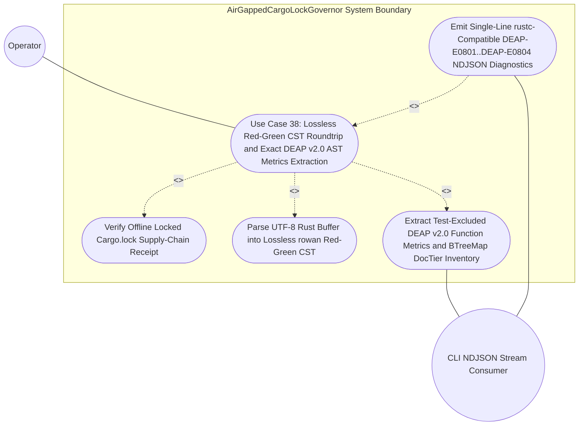

| Attribute | Specification Detail |
| :--- | :--- |
| **Issue ID** | TBD |
| **Title** | Use Case 38: Lossless Red Green CST Roundtrip and Exact DEAP v2 0 AST Metrics Extraction |
| **Type** | use-case |
| **Parent Epic** | [Epic 08: BP 08 Lossless Rust CST Codemod Engine and Unified rustc Compatible JSON Diagnostics](../epics/EPIC-08-BP_08_Lossless_Rust_CST_Codemod_Engine_and_Unified_rustc_Compatible_JSON_Diagnostics.md) |
| **Schema Containers** | `BP_08_Lossless_Rust_CST_Codemod_Engine_and_Unified_rustc_Compatible_JSON_Diagnostics::UC_AC_01_Lossless_Red_Green_CST_Roundtrip_and_Exact_DEAP_v2_0_AST_Metrics_Extraction` |
| **Primary Actor** | Operator |
| **Scope** | AirGappedCargoLockGovernor |
| **Level** | User Goal |
| **Generation Mode** | subagent |
| **Specification Source** | [schema/model.sysml](../../schema/model.sysml) |

# Use Case 38: Lossless Red Green CST Roundtrip and Exact DEAP v2 0 AST Metrics Extraction

## Parent Epic
- [ ] TBD - [Epic 08: BP 08 Lossless Rust CST Codemod Engine and Unified rustc Compatible JSON Diagnostics](../epics/EPIC-08-BP_08_Lossless_Rust_CST_Codemod_Engine_and_Unified_rustc_Compatible_JSON_Diagnostics.md) (establishes the BP-08 **REQ-0608** lossless `ra_ap_syntax` and `rowan` Red-Green CST architecture and single-line `rustc`-compatible NDJSON diagnostic envelope governing Use Case 38)

## UML Diagrams

## 1. Actors
- **Primary Actor:** `Operator` (invoking `compile-sysml --list-rust-items` in `crates/compile-sysml/src/cli.rs` or `verify-baseline audit-code` with `--message-format=json` in `crates/verify-baseline/src/audit_code.rs` against Rust source compilation units).
- **Secondary Actors:**
  - `AirGappedCargoLockGovernor` (verifies pinned `Cargo.toml` and `Cargo.lock` SHA-256 package checksums via `manifest_lock_in` using `CargoTomlAndLockfile` protocol and seals `SupplyChainVerificationReceipt` on `lock_receipt_out`).
  - `LosslessRustCstAnalyzer` (ingests UTF-8 `.rs` buffers on `rust_source_in` in `crates/deap-core/src/source_ast.rs` and emits `BTreeOrderedItemInventory` on `item_inventory_out` plus `DeapV2AstMetricsReport` on `metrics_report_out`).
  - `UnifiedRustcJsonDiagnosticEmitter` (serializes structured findings from `finding_in` onto `ndjson_out` as single-line zero-ANSI `RustcNdjsonLineStream` records in `crates/deap-core/src/diagnostics.rs`).

## 2. Preconditions
- `AirGappedCargoLockGovernor` is initialized in `Idle` state with `offline_locked_enforced == true` and `vendor_bundle_supported == true`, and workspace `Cargo.toml` plus `Cargo.lock` manifests are accessible on `manifest_lock_in` (`**SC-BP08-01**`).
- `LosslessRustCstAnalyzer` (`deterministic_uuid == "6ba7b810-9dad-11d1-80b4-00c04fd430c8"`) is configured with immutable envelope thresholds: `lossless_roundtrip_required == true`, `max_fn_exec_sloc == 50` (`**C-CST-01**`, within the workspace `<= 80` executable SLOC hard ceiling), `max_fn_param_count == 5` (`**C-CST-02**`), `max_mut_bool_flags == 0` (`**C-CST-03**`), `max_predicate_arity == 3`, and bounded traversal limit `MAX_AST_DEPTH = 64` (`**SC-BP08-05**`, `**SC-BP08-07**`).
- Input Rust `.rs` fixtures are staged for ingestion on `rust_source_in` (`Utf8RustSourceBuffer`), including a comprehensive fixture containing outer (`///`) and inner (`//!`) docblocks, inline (`//`) and block (`/* ... */`) comments, raw string literals containing brace characters, `# [rt_loop]` annotated functions, `# [cfg(test)]` modules with `# [test]` unit functions, methods taking `self`, `&self`, and `&mut self`, a function declaring `let mut flag: bool = false`, a 4-clause compound boolean predicate, a `pub fn` returning `Result<usize, String>`, and a `pub(crate) fn` helper, paired with a negative syntax fixture containing an incomplete trailing expression.

## 3. Trigger
- `Operator` dispatches CST item inventory or DEAP v2.0 AST metrics analysis (`analyzeMetrics` or `listRustItems`, optionally with `--message-format=json`), causing `AirGappedCargoLockGovernor` and `UnifiedRustcJsonDiagnosticEmitter` to invoke `LosslessRustCstAnalyzer` over the target `.rs` source buffers on `rust_source_in`.

## 4. Main Success Scenario
1. `AirGappedCargoLockGovernor` executes `verifyOfflineLockedBuild` over `manifest_lock_in` (`CargoTomlAndLockfile`), validates 64-hex-digit SHA-256 package checksums under `--offline --locked` air-gapped supply-chain rules, and returns `reply_SupplyChainVerificationReceipt` on `lock_receipt_out` (`**SC-BP08-01**`, `**SC-BP08-02**`).
2. `LosslessRustCstAnalyzer` transitions from `Idle` to `ParsingLosslessCst` upon `parseRustCst`, validates strict UTF-8 encoding of the incoming `Utf8RustSourceBuffer` on `rust_source_in`, and constructs an immutable `ra_ap_syntax::SourceFile::parse` and `rowan` Red-Green Concrete Syntax Tree preserving 100% of whitespace, outer/inner docblocks, inline/block comments, attributes, and raw-string tokens (`**REQ-0608**`).
3. `LosslessRustCstAnalyzer` verifies zero CST syntax errors (`errors().is_empty()`) and asserts bit-for-bit lossless round-trip identity between the root `rowan` `GreenNode` byte projection and the original input `.rs` byte buffer (`Invariant_REQ_0608_SC_01`, `**SC-BP08-05**`, `**SC-BP08-08**`), sealing `losslessRedGreenTreeReady` and transitioning to `AnalyzingMetricsAndTiers`.
4. `LosslessRustCstAnalyzer` executes an iterative/bounded Red-tree traversal strictly capped at `MAX_AST_DEPTH = 64` (`**SC-BP08-07**`), isolating subtree-scoped `# [cfg(test)]` modules and `# [test]` items from production accumulators while retaining `# [rt_loop]` real-time loop attribute bindings and outer `///` or `# [doc]` trivia spans (`**SC-BP08-06**`).
5. `LosslessRustCstAnalyzer` computes `production_exec_sloc` across non-trivia, non-test syntax tokens (ignoring braces and keywords embedded inside comments or raw string literals) and extracts exact per-callable DEAP v2.0 metrics: `exec_sloc` against `**C-CST-01**` (`<= 50`), formal `param_count` excluding `self`, `&self`, and `&mut self` receivers against `**C-CST-02**` (`<= 5`), local mutable boolean declarations (`let mut flag: bool`) against `**C-CST-03**` (`== 0`), maximum unhoisted boolean predicate clause arity against `max_predicate_arity <= 3`, and `Result<T, String>` return-signature detection flags (`returns_result_string`).
6. `LosslessRustCstAnalyzer` classifies each non-test AST item into `DocTier::RustTierA` (`pub` items requiring 7-section safety docblocks) or `DocTier::RustTierBC` (private and `pub(crate)` helpers eligible for 2-line `/// Realises: [REQ-*]` contracts) and materializes a deterministic `BTreeMap`-ordered item inventory (`BTreeOrderedItemInventory`) containing UTF-8 `is_char_boundary`-verified `TextRange` byte and 1-based line/column spans (`**SC-BP08-06**`, `**SC-BP08-08**`).
7. `LosslessRustCstAnalyzer` emits `reply_RustItemInventory` on `item_inventory_out` and `reply_DeapV2AstMetrics` on `metrics_report_out` to `UnifiedRustcJsonDiagnosticEmitter`, transitions to `VerifiedClean`, and delivers deterministic metrics or single-line zero-ANSI `compiler-message` NDJSON records (`formatNdjsonLine` -> `reply_RustcNdjsonLineStream`) to `Operator` with `runtime_llm_token_count == 0` (`**C-CST-05**`).

## 5. Alternate and Exception Flows
- 5a. **Unlocked or Drifted Air-Gapped `Cargo.lock` Manifest (`FM-BP08-001`, `FM-BP08-002` -- Input-Boundary and State-Ordering Categories, branches from Main Success Scenario step 1):**
  1. `AirGappedCargoLockGovernor` detects `offline_locked_enforced == false`, missing or malformed `Cargo.toml` / `Cargo.lock` syntax, unpinned wildcard/git dependency specifiers, truncated SHA-256 package checksums, or concurrent lockfile drift during `verifyOfflineLockedBuild` (`**SC-BP08-01**`, `**SC-BP08-02**`).
  2. `AirGappedCargoLockGovernor` withholds `reply_SupplyChainVerificationReceipt`, blocks `LosslessRustCstAnalyzer` from entering `ParsingLosslessCst`, and transitions directly from `Idle` to `EmittingJsonDiagnostics`.
  3. `UnifiedRustcJsonDiagnosticEmitter` emits a single-line zero-ANSI `DEAP-E0804` `compiler-message` NDJSON diagnostic on `ndjson_out` and terminates fail-closed with exit code `1` and zero workspace mutations (`**SC-BP08-04**`).
- 5b. **Malformed UTF-8 Buffer, Incomplete Trailing Expression Syntax Error, or Out-of-Envelope Threshold (`FM-BP08-005` -- Input-Boundary and Malformed Syntax Category, branches from Main Success Scenario steps 2 and 3):**
  1. `LosslessRustCstAnalyzer` detects invalid UTF-8 bytes or NUL corruption on `rust_source_in`, mutated configuration thresholds violating `**C-CST-01**`..`**C-CST-03**`, or non-empty `ra_ap_syntax::SourceFile::parse` `errors()` (such as the negative `.rs` fixture containing an incomplete trailing expression, while confirming the underlying `rowan` `GreenNode` still preserves lossless source bytes).
  2. `LosslessRustCstAnalyzer` halts in `ParsingLosslessCst` prior to `losslessRedGreenTreeReady`, suppressing `BTreeOrderedItemInventory` and `DeapV2AstMetricsReport` emission so downstream codemod engines cannot splice error-recovery CST nodes (`**SC-BP08-05**`).
  3. `LosslessRustCstAnalyzer` transitions to `EmittingJsonDiagnostics`, routes structured UTF-8 `TextRange` error spans to `UnifiedRustcJsonDiagnosticEmitter` as `DEAP-E0803`, emits single-line `rustc`-compatible NDJSON on `ndjson_out`, and exits fail-closed with code `1`.
- 5c. **Out-of-Order Analysis Dispatch or Unbalanced `# [cfg(test)]` Scope Boundary (`FM-BP08-006` -- State-Concurrency and Ordering Category, branches from Main Success Scenario step 4):**
  1. `LosslessRustCstAnalyzer` detects an out-of-order `analyzeMetrics` or `listRustItems` call arriving before `losslessRedGreenTreeReady` is sealed, or encounters malformed/unbalanced `# [cfg(test)]`, `# [test]`, or `# [rt_loop]` attribute subtree spans that would leak test scopes into or out of `production_exec_sloc` and `DocTier` accumulators (`**SC-BP08-06**`).
  2. `LosslessRustCstAnalyzer` aborts `AnalyzingMetricsAndTiers` over the immutable `rowan` Green tree snapshot and discards uncommitted `BTreeMap` inventory and metric accumulators in memory.
  3. `UnifiedRustcJsonDiagnosticEmitter` serializes a single-line `DEAP-E0801` `compiler-message` NDJSON diagnostic identifying the offending scope span and exits fail-closed with code `1`.
- 5d. **CST Nesting Exceeding `MAX_AST_DEPTH = 64` or Checked Counter Overflow (`FM-BP08-007` -- Resource-Depth and Arithmetic Exhaustion Category, branches from Main Success Scenario steps 4 and 5):**
  1. During bounded Red-tree traversal, `LosslessRustCstAnalyzer` detects syntax-node nesting depth exceeding `MAX_AST_DEPTH = 64` or a `checked_add` / `checked_sub` overflow on `TextRange` UTF-8 byte offsets, `production_exec_sloc`, per-function `exec_sloc`, receiver-excluded `param_count`, mutable `bool` flag counts, or compound boolean predicate arity counters (`**SC-BP08-07**`).
  2. `LosslessRustCstAnalyzer` immediately terminates iterative CST descent without call-stack recursion overflow or wrapped integer state, preserving memory safety under `#![forbid(unsafe_code)]`.
  3. `LosslessRustCstAnalyzer` transitions to `EmittingJsonDiagnostics`, emits a single-line `DEAP-E0804` resource-bound diagnostic via `UnifiedRustcJsonDiagnosticEmitter`, and exits fail-closed with code `1`.
- 5e. **Lossy `GreenNode` Byte Projection, Mid-Codepoint `TextRange`, or NDJSON Control-Byte Contamination (`FM-BP08-008`, `FM-BP08-013`, `FM-BP08-016` -- Output-Serialization and Partial-Write Integrity Category, branches from Main Success Scenario steps 3, 6, and 7):**
  1. `LosslessRustCstAnalyzer` or `UnifiedRustcJsonDiagnosticEmitter` detects root `rowan` `GreenNode` byte divergence from `rust_source_in`, a `TextRange` endpoint failing `str::is_char_boundary` or truncating leading `///` / `# [doc]` outer attributes, or unescaped newline (`0x0A`) / ANSI escape (`0x1B`) bytes in a serialized diagnostic frame (`**SC-BP08-08**`, `**SC-BP08-13**`, `**SC-BP08-16**`).
  2. The engine blocks publication on `item_inventory_out`, `metrics_report_out`, and `ndjson_out`, preventing misaligned UTF-8 span splices or torn NDJSON streams across the 5 workspace CLIs.
  3. `UnifiedRustcJsonDiagnosticEmitter` emits a sanitized single-line `DEAP-E0802` or `DEAP-E0803` `compiler-message` diagnostic under an exclusive stdout line lock and exits fail-closed with code `1`.

## 6. Postconditions
- **Success Guarantee:**
  - Root `rowan` `GreenNode` byte concatenation equals the input `.rs` UTF-8 source buffer bit-for-bit (`Invariant_REQ_0608_SC_01`) with zero CST parse errors and zero runtime LLM tokens (`runtime_llm_token_count == 0`, `**C-CST-05**`).
  - `BTreeOrderedItemInventory` is emitted in deterministic `BTreeMap` key order with UTF-8 char-boundary-aligned `TextRange` spans encompassing leading `///` docblocks and outer attributes, accurately partitioning `DocTier::RustTierA` (`pub` items) from `DocTier::RustTierBC` (private and `pub(crate)` items) while excluding `# [cfg(test)]` subtrees.
  - `DeapV2AstMetricsReport` accurately reports `production_exec_sloc`, per-callable `exec_sloc` (`**C-CST-01**`), receiver-stripped `param_count` (`**C-CST-02**`), `let mut flag: bool` counts (`**C-CST-03**`), compound predicate clause arity (`<= 3`), `# [rt_loop]` annotations, and `Result<T, String>` return flags (`returns_result_string`), and all `--message-format=json` findings conform to single-line zero-ANSI `rustc`-compatible NDJSON (`Invariant_REQ_0608_SC_04_REQ_0608`).
- **Failure Guarantee:**
  - On any supply-chain lock mismatch, malformed UTF-8 buffer, CST syntax error (including incomplete trailing expressions), `# [cfg(test)]` scope anomaly, `MAX_AST_DEPTH = 64` levels breach, checked arithmetic overflow, or `TextRange` boundary fault, execution aborts fail-closed with exit status `1`, emits a single-line `DEAP-E0801`..`DEAP-E0804` `compiler-message` NDJSON record free of `0x0A` and `0x1B` control bytes, and leaves 100% of workspace files unmutated.

## 7. Operational Context
Use Case 38 (`UC_AC_01`) realizes acceptance criterion `AC-01` of **REQ-0608** (`BP-08` / `DEAP-BP-DET-08`, UUIDv5 `6ba7b810-9dad-11d1-80b4-00c04fd430c8`) across `crates/deap-core/src/source_ast.rs`, `crates/deap-core/src/diagnostics.rs`, `crates/deap-core/src/error.rs`, `crates/deap-core/src/sysml_ast/mod.rs`, `crates/compile-sysml/src/cli.rs`, and `crates/verify-baseline/src/audit_code.rs`. Under DO-178C Level A, DO-330 TQL-4, ISO 26262 ASIL D, and ECSS-E-ST-40C tool-qualification governance, heuristic line-by-line brace counting misclassifies braces inside raw string literals and comments, leaks `# [cfg(test)]` blocks into production SLOC budgets, and overcounts `self` / `&self` / `&mut self` method receivers. Replacing heuristic scanners with lossless `ra_ap_syntax` and `rowan` Red-Green Concrete Syntax Trees across the `BP-08` lifecycle states (`Idle -> ParsingLosslessCst -> AnalyzingMetricsAndTiers -> VerifiedClean | EmittingJsonDiagnostics`) guarantees exact syntactic fidelity for DEAP v2.0 code auditing (`verify-baseline audit-code`) and deterministic byte-span inventory extraction (`compile-sysml --list-rust-items`).

### Mathematical Formulations and Safety Invariants
$$
\begin{aligned}
L_{\text{roundtrip}}(S) &= \sum_{i=1}^{k} \lvert R(t_i) \rvert - \lvert S \rvert = 0 \\
E_{\text{prod}}(S) &= \lvert \{ \ell \in \Lambda(S) \mid \exists t \in \tau(T_{\text{red}}(S) \setminus T_{\text{test}}), \quad \kappa(t) \notin K_{\text{trivia}} \land \ell \in \lambda(t) \} \rvert \\
\forall f \in F_{\text{prod}}(S), \quad E_{\text{fn}}(f) &\le E_{\max} \land P_{\text{arity}}(f) \le P_{\max} \land B_{\text{mut}}(f) = 0 \land C_{\text{pred}}(f) \le C_{\max} \\
D_{\text{walk}}(T_{\text{red}}(S)) &\le D_{\max} \land N_{\text{ctrl}}(d_j) = 0 \land K_{\text{LLM}} = 0
\end{aligned}
$$

- Parameter Definitions & Engineering Units:
- $S$: Input Rust `.rs` source buffer verified as valid UTF-8 (`bytes`).
- $t_i$: Leaf token $i \in \{1, \dots, k\}$ in the lossless `rowan` Green syntax tree projection (`tokens`).
- $R(t_i)$: Half-open UTF-8 `TextRange` byte interval $[a_i, b_i)$ of token $t_i$ satisfying $0 \le a_i \le b_i \le \lvert S \rvert$ on valid UTF-8 codepoint boundaries (`bytes`).
- $L_{\text{roundtrip}}(S)$: Root Red-Green CST byte-length residual relative to $S$, mandated equal to $0$ (`bytes`, `Invariant_REQ_0608_SC_01`).
- $T_{\text{red}}(S)$: Complete `ra_ap_syntax` Red syntax tree constructed over $S$, and $T_{\text{test}}$: union of subtrees annotated with `# [cfg(test)]` or `# [test]` (`nodes`).
- $\tau(\cdot)$, $\kappa(t)$, $K_{\text{trivia}}$: Leaf-token projection operator, `SyntaxKind` classifier, and non-executable trivia kind set encompassing whitespace, inline/block comments, docblocks, and attribute tokens (`kinds`).
- $\Lambda(S)$, $\lambda(t)$, $E_{\text{prod}}(S)$: Source line index set, token covered-line set, and resulting test-excluded production executable line count (`SLOC`).
- $F_{\text{prod}}(S)$: Set of production callable AST nodes (`fn` items and `impl` / `trait` methods) in $T_{\text{red}}(S) \setminus T_{\text{test}}$ (`callables`).
- $E_{\text{fn}}(f)$, $E_{\max}$: Per-callable executable line count and BP-08 threshold $E_{\max} = 50$ `SLOC` (`**C-CST-01**`, within the workspace hard cap of $80$ `SLOC`).
- $P_{\text{arity}}(f)$, $P_{\max}$: Formal parameter count excluding `self`, `&self`, and `&mut self` receivers, bounded by $P_{\max} = 5$ `params` (`**C-CST-02**`).
- $B_{\text{mut}}(f)$: Count of local mutable boolean variable bindings (`let mut flag: bool`) inside callable $f$, mandated equal to $0$ `flags` (`**C-CST-03**`).
- $C_{\text{pred}}(f)$, $C_{\max}$: Maximum boolean operator clause count in a single unhoisted compound predicate expression inside $f$, bounded by $C_{\max} = 3$ `clauses`.
- $D_{\text{walk}}(T_{\text{red}}(S))$, $D_{\max}$: Active syntax-tree traversal depth, bounded by $D_{\max} = 64$ `levels` (`MAX_AST_DEPTH = 64`, `**SC-BP08-07**`).
- $N_{\text{ctrl}}(d_j)$: Count of raw newline (`0x0A`) and ANSI escape (`0x1B`) bytes inside encoded single-line NDJSON diagnostic frame $d_j$, mandated equal to $0$ `bytes` (`Invariant_REQ_0608_SC_04_REQ_0608`).
- $K_{\text{LLM}}$: Runtime LLM token consumption across CST parsing, metric extraction, and diagnostic serialization, mandated equal to $0$ `tokens` (`**C-CST-05**`).

## 8. Realization Matrix

### End-to-End Traceability Chain (`UC -> US -> FEAT -> EPIC -> TEST`)
| Use Case | User Story | Feature | Parent Epic | Verification Test Case IDs |
| :--- | :--- | :--- | :--- | :--- |
| `UC-38` (`UC_AC_01`) | [US-56: analyzeMetrics](../user-stories/US-56-analyzeMetrics.md) | [FEAT-42: LosslessRustCstAnalyzer](../features/FEAT-42-LosslessRustCstAnalyzer.md) | [EPIC-08: BP-08 Lossless Rust CST Codemod Engine](../epics/EPIC-08-BP_08_Lossless_Rust_CST_Codemod_Engine_and_Unified_rustc_Compatible_JSON_Diagnostics.md) | `TEST-BP08-UC38-01` (lossless `rowan` Red-Green byte round-trip and incomplete trailing expression `DEAP-E0803` fail-closed syntax gate); `TEST-BP08-UC38-02` (`# [cfg(test)]` exclusion, `# [rt_loop]` detection, receiver-stripped `param_count`, `let mut flag: bool`, 4-clause predicate arity, and `Result<usize, String>` extraction) |
| `UC-38` (`UC_AC_01`) | [US-52: listRustItems](../user-stories/US-52-listRustItems.md) | [FEAT-42: LosslessRustCstAnalyzer](../features/FEAT-42-LosslessRustCstAnalyzer.md) | [EPIC-08: BP-08 Lossless Rust CST Codemod Engine](../epics/EPIC-08-BP_08_Lossless_Rust_CST_Codemod_Engine_and_Unified_rustc_Compatible_JSON_Diagnostics.md) | `TEST-BP08-UC38-03` (`BTreeMap`-ordered `DocTier::RustTierA` and `DocTier::RustTierBC` item inventory with UTF-8 `is_char_boundary` `TextRange` spans and `MAX_AST_DEPTH = 64` guard `DEAP-E0804`) |
| `UC-38` (`UC_AC_01`) | [US-51: verifyOfflineLockedBuild](../user-stories/US-51-verifyOfflineLockedBuild.md) | [FEAT-41: AirGappedCargoLockGovernor](../features/FEAT-41-AirGappedCargoLockGovernor.md) | [EPIC-08: BP-08 Lossless Rust CST Codemod Engine](../epics/EPIC-08-BP_08_Lossless_Rust_CST_Codemod_Engine_and_Unified_rustc_Compatible_JSON_Diagnostics.md) | `TEST-BP08-UC38-04` (air-gapped `--offline --locked` `Cargo.lock` SHA-256 supply-chain precondition gate `DEAP-E0804`) |
| `UC-38` (`UC_AC_01`) | [US-55: formatNdjsonLine](../user-stories/US-55-formatNdjsonLine.md) | [FEAT-44: UnifiedRustcJsonDiagnosticEmitter](../features/FEAT-44-UnifiedRustcJsonDiagnosticEmitter.md) | [EPIC-08: BP-08 Lossless Rust CST Codemod Engine](../epics/EPIC-08-BP_08_Lossless_Rust_CST_Codemod_Engine_and_Unified_rustc_Compatible_JSON_Diagnostics.md) | `TEST-BP08-UC38-05` (single-line zero-ANSI `--message-format=json` `compiler-message` NDJSON serialization for `DEAP-E0801`..`DEAP-E0804`) |

### Required User Stories
- [ ] TBD - [User Story 56: analyzeMetrics](../user-stories/US-56-analyzeMetrics.md) (executes lossless `ra_ap_syntax` + `rowan` CST parsing and extracts test-excluded DEAP v2.0 `production_exec_sloc`, per-callable `exec_sloc`, receiver-excluded `param_count`, mutable `bool` flags, compound predicate arity, and `Result<T, String>` signatures)
- [ ] TBD - [User Story 52: listRustItems](../user-stories/US-52-listRustItems.md) (produces deterministic `BTreeMap`-ordered AST item inventories with `DocTier::RustTierA` / `DocTier::RustTierBC` classifications and outer-trivia-inclusive UTF-8 `TextRange` spans)
- [ ] TBD - [User Story 51: verifyOfflineLockedBuild](../user-stories/US-51-verifyOfflineLockedBuild.md) (enforces the air-gapped `--offline --locked` `Cargo.lock` SHA-256 precondition receipt before CST analysis begins)
- [ ] TBD - [User Story 55: formatNdjsonLine](../user-stories/US-55-formatNdjsonLine.md) (formats CST syntax, span, depth, and metric findings into single-line zero-ANSI `rustc`-compatible NDJSON lines)

### Required Features
- [ ] TBD - [Feature 42: LosslessRustCstAnalyzer](../features/FEAT-42-LosslessRustCstAnalyzer.md) (provides the core `ra_ap_syntax` + `rowan` Red-Green CST parser, lossless byte round-trip verifier, `DocTier` classifier, and DEAP v2.0 AST metrics extractor in `crates/deap-core/src/source_ast.rs`)
- [ ] TBD - [Feature 41: AirGappedCargoLockGovernor](../features/FEAT-41-AirGappedCargoLockGovernor.md) (governs the Use Case 38 system boundary precondition via `--offline --locked` `Cargo.lock` supply-chain verification)
- [ ] TBD - [Feature 44: UnifiedRustcJsonDiagnosticEmitter](../features/FEAT-44-UnifiedRustcJsonDiagnosticEmitter.md) (binds `LosslessRustCstAnalyzer` findings to the 5-CLI `--message-format=json` `compiler-message` NDJSON output contract in `crates/deap-core/src/diagnostics.rs`)

## 9. Three-Layer Definition of Done
1. **Layer 1 -- Domain State and Data Model (`crates/deap-core/src/source_ast.rs`, `crates/deap-core/src/error.rs`, `crates/deap-core/src/sysml_ast/mod.rs`):**
   - Define immutable value structs under `#![forbid(unsafe_code)]` for `Utf8RustSourceBuffer`, char-boundary-checked `CstByteSpan` (`TextRange` + 1-based line/column coordinates), `DocTier` (`DocTier::RustTierA`, `DocTier::RustTierBC`), `RustCstItemDescriptor`, `BTreeOrderedItemInventory` backed exclusively by `BTreeMap` and `BTreeSet` collections (zero `HashMap` or `HashSet`), and `DeapV2AstMetricsReport` (`production_exec_sloc`, `fn_metrics`, `returns_result_string`, `has_rt_loop_attr`).
   - Define a strongly typed domain error enum `CstAnalysisError` mapping exhaustively to `DEAP-E0801` (scope/symbol resolution fault), `DEAP-E0802` (`GreenNode` round-trip or `TextRange` boundary fault), `DEAP-E0803` (UTF-8 or CST syntax parse error), and `DEAP-E0804` (lockfile, `MAX_AST_DEPTH = 64`, or checked-arithmetic bound breach), with zero `Result<T, String>` signatures in compiler crates.
2. **Layer 2 -- Logic and State Management (`crates/deap-core/src/source_ast.rs`, `crates/verify-baseline/src/audit_code.rs`):**
   - Implement total, deterministic transition functions enforcing `Idle -> ParsingLosslessCst -> AnalyzingMetricsAndTiers -> VerifiedClean | EmittingJsonDiagnostics` strictly gated behind `SupplyChainVerificationReceipt`, with every production function obeying `<= 50` executable SLOC (`**C-CST-01**`, within the `<= 80` workspace SLOC ceiling), `<= 5` formal parameters excluding `self` / `&self` / `&mut self` (`**C-CST-02**`), `0` local `let mut flag: bool` flags (`**C-CST-03**`), and `<= 3` boolean predicate clauses.
   - Enforce iterative/bounded CST traversal capped at `MAX_AST_DEPTH = 64` (`**SC-BP08-07**`), safe slice and token-child lookups exclusively via `.get()` indexing (zero direct `[]` indexing, `.unwrap()`, or `.expect()`), `checked_add` / `checked_sub` for fail-closed span and metric threshold enforcement, and `saturating_add` / `saturating_sub` for bounded diagnostic summary counters, verified by `# [test]` unit tests inside `# [cfg(test)]` modules covering `TEST-BP08-UC38-01` through `TEST-BP08-UC38-05`.
3. **Layer 3 -- Presentation and CLI `--message-format=json` NDJSON Interface Binding (`crates/deap-core/src/diagnostics.rs`, `crates/compile-sysml/src/cli.rs`, `crates/verify-baseline/src/audit_code.rs`):**
   - Bind `LosslessRustCstAnalyzer` outputs to `compile-sysml --list-rust-items` and `verify-baseline audit-code` CLI entrypoints, routing all findings and fail-closed `CstAnalysisError` rejections through `UnifiedRustcJsonDiagnosticEmitter` (`formatNdjsonLine`).
   - Emit strictly single-line `rustc`-compatible NDJSON objects (`reason: "compiler-message"`, `"DEAP-E"` prefixed error codes, exact UTF-8 `byte_start`/`byte_end` and 1-based line/column spans, `"MachineApplicable"` vs `"MaybeIncorrect"` applicability tags) under `--message-format=json` with zero `0x0A` embedded newlines, zero `0x1B` ANSI escape sequences, exit status `0` on `VerifiedClean`, and exit status `1` on fail-closed diagnostic termination.

## Source References
Use case operational flows and lifecycle activity references:
- System Architecture Model: `schema/model.sysml`
- Engineering Design Blueprint Metamodel: `docs/designs/blueprint-08-rust-analyzer-cst-refactoring-and-json-diagnostics.sysml`
- CST and Diagnostics Implementation Targets: `crates/deap-core/src/source_ast.rs`, `crates/deap-core/src/diagnostics.rs`, `crates/deap-core/src/error.rs`, `crates/deap-core/src/sysml_ast/mod.rs`, `crates/compile-sysml/src/cli.rs`, `crates/verify-baseline/src/audit_code.rs`
- Component Failure Mode Registry: `docs/research/FAILURE_MODE_REGISTRY.md` (`FM-BP08-001`..`FM-BP08-008`, `FM-BP08-013`, `FM-BP08-016`)
- Normative Systems Engineering Standards: ISO/IEC/IEEE 29148:2018 Section 6.4.2 Concept of Operations, DO-178C Level A, DO-330 TQL-4, ISO 26262 ASIL D, and ECSS-E-ST-40C

Operational use case realization and traceability links derive from `schema/model.sysml` pursuant to ISO/IEC/IEEE 29148.
