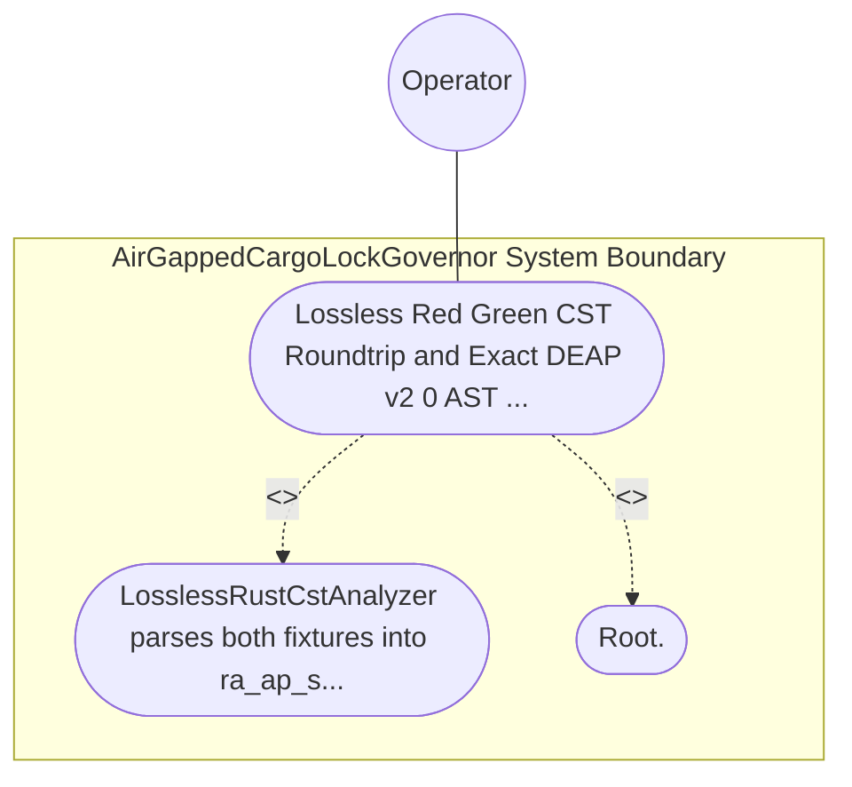

| Attribute | Specification Detail |
| :--- | :--- |
| **Issue ID** | TBD |
| **Title** | Use Case 38: Lossless Red Green CST Roundtrip and Exact DEAP v2 0 AST Metrics Extraction |
| **Type** | use-case |
| **Primary Actor** | Operator |
| **Scope** | AirGappedCargoLockGovernor |
| **Level** | User Goal |
| **Generation Mode** | subagent |
| **Specification Source** | [schema/model.sysml](../../schema/model.sysml) |

# Use Case 38: Lossless Red Green CST Roundtrip and Exact DEAP v2 0 AST Metrics Extraction

## UML Diagrams

## 1. Actors
- `Operator`

## 2. Preconditions
- A Rust .rs fixture containing outer/inner docblocks, inline and block comments, raw strings containing braces, #[rt_loop] and #[cfg(test)] modules, methods taking &self and &mut self, a function with let mut flag: bool = false, a 4-clause compound boolean predicate, a pub fn returning Result<usize, String>, and a pub(crate) fn helper (plus a second fixture with an incomplete trailing expression).

## 3. Trigger
- LosslessRustCstAnalyzer parses both fixtures into ra_ap_syntax + rowan Red/Green syntax trees and computes DEAP v2.0 metrics and DocTier classifications.

## 4. Main Success Scenario
1. LosslessRustCstAnalyzer parses both fixtures into ra_ap_syntax + rowan Red/Green syntax trees and computes DEAP v2.0 metrics and DocTier classifications.
2. Root.

## 5. Alternate and Exception Flows
- Precondition guard failure in `AirGappedCargoLockGovernor`:
  - `AirGappedCargoLockGovernor` rejects the `Lossless Red Green CST Roundtrip and Exact DEAP v2 0 AST Metrics Extraction` request without partial state mutation and reports diagnostic status to `Operator`.
- Invariant violation while enforcing `Lossless Red Green CST Roundtrip and Exact DEAP v2 0 AST Metrics Extraction`:
  - `AirGappedCargoLockGovernor` aborts `Lossless Red Green CST Roundtrip and Exact DEAP v2 0 AST Metrics Extraction` execution, preserves prior verified state, and notifies `Operator`.

## 6. Postconditions
- Root.

## 8. Realization Matrix
| Specification Item | Type | Link / Reference |
| :--- | :--- | :--- |
| **TBD** | User Story | [User Story 51: verify Offline Locked Build](../user-stories/US-51-verifyOfflineLockedBuild.md) |
| **TBD** | Feature | [Feature 41: [BP 08 Lossless Rust CST Codemod Engine and Unified rustc Compatible JSON Diagnostics] AirGappedCargoLockGovernor](../features/FEAT-41-AirGappedCargoLockGovernor.md) |

## Source References
Use case operational flows and lifecycle activity references:
- System Architecture Model: `schema/model.sysml`
- Normative Systems Engineering Standard: ISO/IEC/IEEE 29148:2018 §6.4.2 Concept of Operations

Operational use case realization and traceability links derive from `schema/model.sysml` pursuant to ISO/IEC/IEEE 29148.
